[Họ tên — MSSV]

[Lớp]

[Giảng viên]

[Ngày nộp]

[[TOC]]

# Bảng đối chiếu yêu cầu đề bài

Báo cáo trình bày việc thu thập và chuẩn hoá dữ liệu tuyển sinh, xây dựng mạng quan hệ giữa trường và ngành, áp dụng thuật toán mạng và đưa kết quả vào ứng dụng EduRadar. Dữ liệu được thu thập ngày 23/10/2026 và xử lý (làm sạch, chuẩn hoá mã ngành) lần cuối ngày 09/11/2026, gồm 71.011 dòng điểm chuẩn của 292 trường; bốn mô hình mạng được khảo sát riêng cho từng năm 2024–2026. Mạng biểu diễn quan hệ đào tạo và cạnh tranh theo điểm, không biểu diễn quan hệ bạn bè hoặc hành vi đăng ký nguyện vọng của từng thí sinh.

Nguồn: `docs/TONG_KET_DU_LIEU.md`; `data/clean/quality_report.md`; `data/network/summary.csv`.

**Bảng ĐC.1. Đối chiếu các yêu cầu của đề bài.**

| Yêu cầu | Mục báo cáo | Bằng chứng chính |
| --- | --- | --- |
| (1) Chọn chủ đề, lấy được dữ liệu | Chương 1 | 292 trường, ba năm; câu hỏi nghiên cứu; Hình 2.1 |
| (2) Crawl ít nhất 20.000 record; mô tả làm sạch và chuẩn hoá | 2.1–2.6; Phụ lục A–C | 921 request; 76.726 dòng thô → 71.011 dòng sạch; log, DB; Hình 2.1–2.4 |
| (3) Tính các độ đo SNA | 3.1–3.4; bảng ĐC.2 dưới đây | `summary.csv` đủ bốn mạng × ba năm (G1–G4 đủ độ đo); `metrics/*.csv` không ô trống; Hình 3.1–3.7 |
| (3') Chọn thuật toán áp dụng | 4.1–4.6 | Louvain, Girvan–Newman toàn đồ thị, HITS, PageRank, Adamic–Adar; kiểm chứng theo thời gian và độ nhạy |
| (4) Trực quan và mô phỏng | Chương 5 | NetworkX, Matplotlib, Gephi (ForceAtlas2); phân bố bậc log–log, mạng tương tác; Hình 5.1–5.8 |
| (5) Ứng dụng minh hoạ | Chương 6 | Web https://diemthidaihoc.com; FastAPI; sáu tab; Hình 6.1–6.9; kịch bản demo |

Nguồn: đối chiếu đề bài với các tệp kết quả nêu trong từng chương.

**Bảng ĐC.2. Đối chiếu riêng từng độ đo bắt buộc và bổ sung.**

| Độ đo | Tiểu mục | Bảng và hình đối chiếu |
| --- | --- | --- |
| Degree centrality và Degree distribution (kèm γ luật lũy thừa) | 3.2.1 | Bảng 3.3–3.6; Hình 3.2–3.7 |
| Betweenness centrality | 3.2.2 | Bảng 3.7–3.8; Hình 5.3 |
| Closeness centrality | 3.2.3 | Bảng 3.9 |
| Eigenvector centrality (có và không trọng số, localization) | 3.2.4 | Bảng 3.10–3.11 |
| PageRank | 3.2.5 | Bảng 3.12; Bảng 4.4; Hình 4.1 |
| HITS hub và authority | 3.2.6 | Bảng 3.13; Bảng 4.4–4.5 |
| Density | 3.2.7 | Bảng 3.14 |
| Average shortest path length | 3.2.8 | Bảng 3.15 |
| Diameter | 3.2.9 | Bảng 3.15 |
| Clustering coefficient và Transitivity | 3.2.10 | Bảng 3.16 |
| Modularity | 3.2.11 | Bảng 3.17; Bảng 4.1–4.3; Hình 5.1–5.2, 5.7–5.8 |
| Thành phần liên thông, LCC, assortativity, reciprocity | 3.2.12 | Bảng 3.18 |

Nguồn: `sna/build.py` cho cách tính; `data/network/summary.csv`, `data/network/metrics/*.csv` cho kết quả; `docs/do_nhay_sna.md` cho độ nhạy. Mỗi tiểu mục 3.2 tách định nghĩa, công thức, cách tính, kết quả và ý nghĩa; bảng toàn bộ chỉ tiêu ba năm ở mục 3.3.

# Trả lời 8 câu hỏi trọng tâm

Mục này trả lời trực tiếp tám câu hỏi về mô hình và dữ liệu; chi tiết ở các chương sau. Định nghĩa đồ thị lấy từ trường `definition` của `data/network/*_2026.json` (cũng là nội dung thẻ “Định nghĩa đồ thị” trên web).

**Câu 1. Đồ thị gì?** Bốn đồ thị, mỗi năm 2024, 2025, 2026 một bản:

| Mạng | Loại đồ thị | Câu hỏi trả lời |
| --- | --- | --- |
| G1 Trường–Ngành | Hai phía (bipartite), vô hướng, có trọng số | Trường mở ngành nào, ngành nào phổ biến |
| G2 Trường–Trường | Chiếu một phía từ G1, vô hướng, có trọng số | Trường nào có danh mục ngành giống nhau |
| G3 Ngành–Ngành | Chiếu một phía từ G1, vô hướng, có trọng số | Ngành nào thường được mở cùng nhau |
| G4 Cạnh tranh | Có hướng Trường → Trường, có trọng số | Trường nào cạnh tranh trực tiếp theo điểm |

**Câu 2. Nút là gì?** G1: trường (292 mã trường trong toàn kỳ; mỗi năm 276–278 trường có dòng đã gán mã ngành) và ngành theo mã 7 số Bộ GD&ĐT (413–421 ngành mỗi năm). G2, G4: trường. G3: ngành. G2, G3, G4 bỏ nút cô lập.

**Câu 3. Cạnh là gì?** G1: trường có ít nhất một dòng điểm chuẩn của ngành trong năm (mọi phương thức). G2: hai trường có Jaccard(tập ngành) ≥ 0,25. G3: hai ngành có Jaccard(tập trường mở ngành) ≥ 0,25. G4: A → B khi ở cùng một ngành, điểm THPT thang 30 cao nhất của B cao hơn A trong khoảng (0; 2] điểm (dòng không cờ).

**Câu 4. Trọng số là gì?** G1: số dòng điểm chuẩn của cặp (trường, ngành), tính mọi phương thức, chương trình, tổ hợp. G2, G3: hệ số Jaccard $|A\cap B|/|A\cup B|$. G4: số ngành thỏa điều kiện cạnh. Năm 2026 các mạng có lần lượt 697/5.046, 250/2.540, 370/1.391, 226/9.215 nút/cạnh (Bảng 3.1–3.2).

**Câu 5. Thu thập dữ liệu thế nào?** Chương trình `crawler/fetch.py` (thư viện chuẩn Python) gọi API JSON công khai của diemthi.tuyensinh247.com: `/api/school/search` lấy danh mục 587 cơ sở, chọn 307 trường đại học (`level = 2`); `/api/common/cutoff-score?school_id=&year=` lấy điểm chuẩn mỗi trường × mỗi năm 2024–2026, tổng **921 request**, 0 lỗi, 833 trang có điểm, 292 trường có điểm, **76.726 dòng thô**. Crawler kiểm `robots.txt` trước mỗi request, nghỉ tối thiểu 1,5 giây giữa hai request (cộng ngẫu nhiên 0–0,5 giây), thử lại tối đa 3 lần khi lỗi mạng, lưu JSON gốc vào `data/raw/cutoff/<năm>/<mã>.json` và ghi nhật ký `data/raw/fetch_log.csv`. Thông tin bổ trợ: VNUR 2026, đề án HOCMAI, học phí (mục 2.1).

**Câu 6. Thời gian lấy dữ liệu?** Điểm chuẩn tải ngày **23/10/2026**, từ 13:51:00 đến 14:20:33 (29 phút 33 giây theo nhật ký), cho ba năm tuyển sinh 2024, 2025, 2026. Dữ liệu được xử lý (làm sạch, chuẩn hoá mã ngành) lần cuối ngày **09/11/2026**; mạng và độ đo tính lại ngày 21/11/2026 trên cùng dữ liệu. Web hiển thị hai mốc “Thu thập dữ liệu: 23/10/2026 · Xử lý/cập nhật: 09/11/2026” lấy từ DB.

**Câu 7. Làm sạch thế nào?**

| Bước | Thay đổi | Còn lại |
| --- | ---: | ---: |
| Dòng thô từ API | 76.726 | 76.726 |
| Bỏ dòng không có điểm hoặc điểm ≤ 0 | − 69 | 76.657 |
| Bỏ dòng không có tên ngành | − 0 | 76.657 |
| Gộp cặp điểm gốc + điểm quy đổi thành 1 dòng | − 4.961 | 71.696 |
| Bỏ dòng trùng hoàn toàn | − 685 | **71.011** |

Ngoài ra: chuẩn Unicode, mã tổ hợp, phương thức và thang điểm; gắn cờ chất lượng (1.113 dòng thang khác 30, 3 dòng THPT dưới 12, 2 outlier) thay vì xoá; giữ 631 dòng trùng khoá khác điểm để không tự chọn; gán mã ngành 7 số cho 69.112 dòng (97,33%) qua 7 quy tắc và bảng sửa tay `data/manual/major_map.csv` (Bảng 2.7, 2.9). Nguồn: `data/clean/quality_report.md`.

**Câu 8. Đã tính các độ đo nào?**

| Nhóm | Độ đo | Mạng | Mục |
| --- | --- | --- | --- |
| Quy mô | Số nút, cạnh, mật độ (thường và hai phía), bậc trung bình | G1–G4 | 3.2.7 |
| Trung tâm | Degree, betweenness, closeness, eigenvector (có và không trọng số), PageRank | G1–G4 | 3.2.1–3.2.5 |
| Trung tâm có hướng | HITS hub/authority, bậc vào/ra, cường độ vào | G4 (authority cả G1) | 3.2.6 |
| Liên thông & đường đi | Thành phần (yếu/mạnh), LCC, SCC, đường đi trung bình, đường kính | G1–G4 | 3.2.8–3.2.9, 3.2.12 |
| Phân cụm & cộng đồng | Clustering (Latapy cho G1, có hướng cho G4), transitivity, assortativity, reciprocity, modularity | G1–G4 | 3.2.10–3.2.12 |
| Phân bố bậc | Histogram, CCDF log–log, ước lượng γ luật lũy thừa (MLE, KS) | G1–G4 | 3.2.1 |
| Thuật toán | Louvain, Girvan–Newman toàn đồ thị, Spearman, Adamic–Adar, độ nhạy ARI/NMI | G2–G4 | Chương 4 |

# Chương 1. Chủ đề và mục tiêu

## 1.1. Bối cảnh và lý do chọn đề tài

Thông tin tuyển sinh đại học được công bố theo trường, năm, phương thức xét tuyển, chương trình và tổ hợp. Vì vậy, một mức điểm chỉ có ý nghĩa khi đi cùng đúng bối cảnh. So sánh trực tiếp điểm THPT với điểm đánh giá năng lực, hoặc dùng học phí của một chương trình cho toàn bộ trường, có thể dẫn đến nhận định sai. Đề tài chọn dữ liệu điểm chuẩn công khai vì có cấu trúc lặp theo thời gian, có thể thu thập bằng chương trình và phục vụ nhu cầu tra cứu thực tế.

Góc nhìn SNA bổ sung cho các bảng tra cứu: hai trường có thể giống nhau về danh mục ngành dù nằm ở hai địa phương khác nhau; một ngành có thể nối các khối đào tạo vốn tách biệt; các trường có cùng ngành và mức điểm gần nhau tạo thành một mạng cạnh tranh có hướng. Từ đó, đề tài nghiên cứu một mạng tổ chức và lĩnh vực đào tạo. Các quan hệ là quan hệ được suy ra từ dữ liệu công bố, cần được diễn giải theo quy tắc xây dựng mạng.

## 1.2. Mục tiêu và câu hỏi nghiên cứu

Mục tiêu thứ nhất là tạo một tập dữ liệu đủ lớn và có thể truy nguồn: làm sạch điểm, chuẩn hoá mã ngành, phương thức và tổ hợp, đồng thời giữ thông tin điểm gốc, điểm quy đổi, năm và cờ chất lượng. Mục tiêu thứ hai là áp dụng các độ đo và thuật toán SNA để diễn giải cấu trúc tuyển sinh. Mục tiêu thứ ba là xây dựng một ứng dụng để giảng viên và người dùng có thể kiểm tra kết quả bằng thao tác trực tiếp.

Các câu hỏi nghiên cứu được trả lời ở Chương 7:

1. Trường nào có danh mục ngành giống nhau và tạo thành những cộng đồng đào tạo nào?
2. Ngành nào phổ biến, ngành nào đóng vai trò cầu nối giữa các nhóm ngành?
3. Trường nào nhận nhiều quan hệ cạnh tranh trực tiếp; HITS và PageRank khác nhau như thế nào?
4. Cấu trúc mạng thay đổi ra sao từ 2024 đến 2026, và kết luận nào bền vững khi đổi tham số?
5. Kết quả SNA có thể hỗ trợ tư vấn ngành và tìm lựa chọn tương tự như thế nào?

## 1.3. Phạm vi và sản phẩm

Phạm vi thực nghiệm gồm 292 mã trường có điểm trong ít nhất một năm thuộc giai đoạn 2024–2026. Danh mục nguồn chọn được 307 trường đại học, trong đó 15 trường chưa có dòng điểm. Số trường có điểm theo năm lần lượt là 279, 278 và 276; đây là các tập giao nhau, không cộng thành tổng trường. Có 455 mã ngành 7 số khác nhau trong toàn kỳ; mạng từng năm chỉ dùng các dòng map được mã ngành.

Nguồn: `docs/TONG_KET_DU_LIEU.md`, mục Điểm chuẩn và tổ hợp; `data/eduradar.db`, bảng `admissions`.

Sản phẩm gồm dữ liệu chuẩn hoá trong SQLite, các tệp độ đo và GEXF, các biểu đồ, báo cáo và ứng dụng EduRadar. Bản công khai tại [https://diemthidaihoc.com](https://diemthidaihoc.com) phục vụ tra cứu bằng dữ liệu tĩnh; bản FastAPI phục vụ trực tiếp từ dữ liệu trên máy. Phạm vi này phản ánh mẫu đã thu thập, không được xem là điều tra toàn bộ hệ thống đại học hay xác suất trúng tuyển.


# Chương 2. Thu thập và xử lý dữ liệu

## 2.1. Nguồn dữ liệu và phạm vi thu thập

Bộ dữ liệu của EduRadar V2 được xây dựng để tra cứu điểm chuẩn các năm 2024–2026, tư vấn theo điểm và tạo mạng phục vụ phân tích SNA. Nguồn chính là API công khai của Tuyensinh247; các thông tin bổ trợ gồm danh mục tổ hợp, xếp hạng VNUR 2026, đề án tuyển sinh HOCMAI, học phí và địa bàn của trường. Đây là tập dữ liệu đã thu thập phục vụ đồ án, không đại diện cho toàn bộ cơ sở giáo dục hoặc mọi thông báo tuyển sinh đang tồn tại trên Internet.

Mốc thu thập phải phân biệt với mốc xử lý. Điểm chuẩn được tải ngày **23/10/2026** (`MAX(crawled_at)` trong `admissions`, nhật ký 13:51–14:20). Lần chạy lại pipeline gần nhất trên dữ liệu thô đã có diễn ra ngày **09/11/2026** (`meta.updated_on = 2026-11-09`; `quality_report.md` tạo 09/11/2026 08:09), sau khi bổ sung bảng sửa mã ngành thủ công. Web hiển thị cả hai mốc ở đầu trang. Mốc xử lý không chứng minh các trang học phí, đề án hoặc bảng xếp hạng đều vừa được tải trong ngày đó.

**Bảng 2.1. Danh mục nguồn, cách truy cập và khả năng truy nguyên**

| Nhóm dữ liệu và quy mô | URL hoặc vị trí URL nguồn | Cách truy cập và đơn vị thu thập | Ngày thu thập được ghi nhận | Robots.txt và Content-Signal |
| --- | --- | --- | --- | --- |
| Danh mục trường: 587 mục; chọn 307 trường đại học | `https://diemthi.tuyensinh247.com/api/school/search` | GET API JSON; lọc `level = 2` | Chưa có nhật ký riêng cho request danh mục trong các nguồn kiểm chứng của chương | Crawler hiện có kiểm tra `https://diemthi.tuyensinh247.com/robots.txt`; chưa ghi nhận bản nội dung robots hoặc Content-Signal tại thời điểm tải |
| Điểm chuẩn: 76.726 dòng thô → 71.011 dòng sạch | `https://diemthi.tuyensinh247.com/api/common/cutoff-score?school_id=…&year=…`; trang dẫn nguồn, thí dụ `https://diemthi.tuyensinh247.com/diem-chuan/dai-hoc-bach-khoa-ha-noi-BKA.html` | GET API JSON; một trường × một năm là một tác vụ tải | 23/10/2026; nhật ký từ 13:51:00 đến 14:20:33 | Như trên; không suy diễn quyền sử dụng từ việc endpoint truy cập được |
| Tổ hợp: 298 mã có tên môn; 385 mã dùng trong điểm | `https://diemthi.tuyensinh247.com/api/common/blocks` | GET API JSON; tách mã tổ hợp, giữ các định nghĩa của nguồn | Chưa ghi nhận ngày riêng trong nguồn kiểm chứng | Chưa ghi nhận bản robots/Content-Signal lịch sử |
| VNUR 2026: 149 mã trường gồm 95 trực tiếp, 54 kế thừa | Các URL `universities.vnur_url`, thí dụ `https://vnur.vn/dai-hoc-bach-khoa-ha-noi/` và `https://vnur.vn/dai-hoc-quoc-gia-ha-noi-3/` | Tra cứu và ánh xạ thủ công qua `vnur_2026.csv`, `vnur_map.csv`; giữ hạng, tên đơn vị và quan hệ kế thừa | Năm bảng xếp hạng là 2026; chưa ghi nhận ngày tải riêng | Chưa ghi nhận trong bộ bằng chứng của chương |
| HOCMAI: 271 bài nguồn, ghép vào 267 trường | URL bài gốc được giữ trong trường `source_url` của dữ liệu đề án; tài liệu tổng kết không liệt kê toàn bộ URL bài | Đọc dữ liệu bài viết có nội dung HTML, bóc tách theo heading; quyết định ghép trường ở `dean_map.csv` | Chưa ghi nhận ngày tải riêng trong các nguồn kiểm chứng của chương | Chưa ghi nhận bản robots/Content-Signal; không đồng nhất khả năng đọc bài với cấp phép tái sử dụng |
| Học phí bộ đầu: 203 trường có mức | `tuition.source_url` trong SQLite; thí dụ [Đại học Đông Á](https://donga.edu.vn/tuyensinh/ts-chi-tiet/dai-hoc-dong-a-cong-bo-hoc-phi-nam-2026-bac-dai-hoc-chinh-quy-44617), [Báo Nhân Dân](https://nhandan.vn/hoc-phi-dai-hoc-tang-theo-lo-trinh-tu-chu-post978685.html), [Tuyensinhso](https://tuyensinhso.vn/chua-phan-loai/hien-co-gan-120-truong-dai-hoc-cong-bo-hoc-phi-nam-2026-c430564.html) | Tổng hợp thủ công từ website chính thức, báo chí, trang tổng hợp; lưu khoảng học phí và loại bằng chứng | Chưa có mốc tải thống nhất; năm học được giữ riêng theo từng mục | Chưa ghi nhận bản robots/Content-Signal của từng URL |
| Học phí bổ sung: 89 trường, 82 có mức tiền | Danh sách nguồn theo từng mục trong `data/manual/hoc_phi_bo_sung_89_truong_20261024.md`; tài liệu tổng kết không chép toàn bộ URL | Nhập ghi chú nghiên cứu thủ công; `tuition_import.py` giữ đơn vị của từng khoản | Tên hồ sơ mang mốc 24/10/2026, không dùng thay ngày truy cập từng URL | Chưa ghi nhận trong bộ bằng chứng của chương |
| Tỉnh/thành: 292 trường sau hợp lớp; 185 trong DB nền | URL trong `universities.province_url`, thí dụ `https://www.is.vnu.edu.vn/`, `https://sao.agu.edu.vn/`, `https://vju.ac.vn/`; kết hợp VNUR, HOCMAI | Đối chiếu địa chỉ trường/phân hiệu; quy về tên tỉnh sau sắp xếp hành chính 2025 | Chưa ghi nhận ngày tải riêng của từng địa chỉ | Chưa ghi nhận trong bộ bằng chứng của chương |
| Danh mục tỉnh: tập trường thu thập có 30 tỉnh/thành | [Danh mục tỉnh trên Cổng Chính phủ](https://xaydungchinhsach.chinhphu.vn/bang-danh-muc-va-ma-so-cua-34-tinh-thanh-moi-cac-don-vi-hanh-chinh-cap-xa-moi-11925070418263625.htm) | Tài liệu tham chiếu cho chuẩn hóa tên địa bàn | Chưa ghi nhận ngày truy cập; mốc danh mục 2025 | Chưa ghi nhận trong bộ bằng chứng của chương |

Nguồn: `docs/TONG_KET_DU_LIEU.md`, `data/raw/fetch_log.csv`, các cột URL trong `data/eduradar.db`; `crawler/fetch.py`, `pipeline/dean.py`, `pipeline/tuition_import.py` chỉ dùng để mô tả cơ chế truy cập và xử lý. Dấu `…` thể hiện tham số thay đổi theo trường/năm, không phải URL của một lần tải cụ thể.

Bảng 2.1 liệt kê mọi **nhóm nguồn** tham gia hệ thống. Với các nguồn có URL theo từng trường, báo cáo chỉ đưa ví dụ có thể đối chiếu trong SQLite; danh sách đầy đủ phải lấy từ cột URL hoặc hồ sơ thủ công tương ứng. Trong bộ đầu học phí, SQLite có **58 URL phân biệt** cho 203 mã trường, nên số URL không bằng số trường. Script `scripts/report_data_evidence.py` truy vấn toàn bộ URL học phí, URL VNUR và URL địa chỉ đang có trong DB. Các nguồn kiểm chứng được chốt cho chương này không chứa đầy đủ URL bài HOCMAI hoặc URL của 89 mục học phí bổ sung; do đó chưa thể trình bày một danh sách URL hoàn chỉnh đến từng bài cho hai nhóm này. Đây là giới hạn hồ sơ nguồn, không được thay bằng URL tự suy đoán.

Crawler hiện kiểm tra robots trước khi gọi API và dừng nếu `can_fetch` trả về không cho phép. Tuy nhiên, mã chương trình hiện hành chỉ cho biết cách thực hiện, không thay thế bản chụp robots ở ngày thu thập. Nhật ký hiện có không lưu response header hay Content-Signal. Vì vậy, báo cáo ghi **chưa ghi nhận bằng chứng** cho các nội dung này, không kết luận trang cho phép mọi hình thức thu thập hoặc tái sử dụng. Phạm vi sử dụng của đồ án là học tập phi thương mại, có dẫn nguồn khi hiển thị.

**Bảng 2.2. Quy mô các lớp dữ liệu sau xử lý**

| Lớp dữ liệu | Số lượng và cách hiểu |
| --- | --- |
| Danh mục trường API | 587 mục mọi loại hình; chọn 307 trường `level = 2`; 292 trường có ít nhất một dòng điểm, 15 trường chưa có điểm ở cả ba năm |
| Điểm chuẩn | 76.726 dòng thô; 71.011 dòng sạch; 455 mã ngành được sử dụng; 69.112 dòng có mã ngành |
| Tổ hợp | 385 mã xuất hiện trong điểm; 264.630 lượt gắn dòng–tổ hợp; danh mục nguồn có tên môn cho 298 mã; giao giữa hai tập là 253 mã |
| VNUR 2026 | 149/292 trường có hạng: 95 hạng trực tiếp và 54 đơn vị kế thừa; 143 chưa gắn hạng |
| Đề án HOCMAI | 271 bài nguồn; 268 bài ghép vào 267 mã trường; 3 bài chưa ghép; 1.190 mục phương thức và 8.208 gạch đầu dòng dữ kiện |
| Học phí bộ đầu | 203 trường: 17 nguồn chính thức, 30 báo chí, 156 trang tổng hợp |
| Học phí bổ sung | 89 trường: 53 nguồn chính thức, 4 văn bản chính thức lưu ở bên thứ ba, 25 nguồn thứ cấp, 7 chưa xác minh được mức tiền |
| Học phí hợp hai bộ | Hai bộ không trùng mã trường; 285/292 trường có mức tiền tham khảo; 7 trường chỉ có thông báo chưa xác minh |
| Địa bàn | Theo lớp hợp cuối trong tổng kết: 292/292 trường, 30 tỉnh/thành; nguồn gồm 90 địa chỉ chính thức, 95 VNUR, 107 HOCMAI. DB nền mới lưu tỉnh rõ cho 185 trường; phân biệt này được giải thích ở mục 2.6 |

Nguồn: `docs/TONG_KET_DU_LIEU.md`, `data/clean/quality_report.md`; đối chiếu số điểm, mã ngành, tổ hợp và hạng với `data/eduradar.db` (bản xử lý 09/11/2026).

## 2.2. Kiến trúc và quy trình crawler

Luồng xử lý được giữ đơn giản: `crawler/fetch.py` → `data/raw/` → `pipeline/clean.py` → `data/eduradar.db` → web và `sna/build.py` → `data/network/`. Các quyết định sửa tay đặt tại `data/manual/`, sau đó chạy lại pipeline để tái tạo kết quả; không sửa trực tiếp bảng sạch hoặc DB. Hình 2.1 mô tả luồng này.

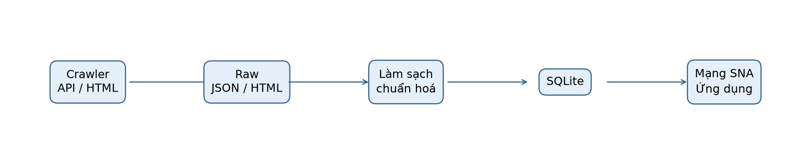

Hình 2.1. Luồng thu thập, làm sạch và sử dụng dữ liệu EduRadar V2.

Nguồn: tổng hợp từ cấu trúc xử lý của dự án.

`crawler/fetch.py` sử dụng thư viện chuẩn Python: `urllib.request` gửi HTTP, `urllib.parse` tạo query string, `json` đọc phản hồi, `csv` ghi nhật ký và `urllib.robotparser` kiểm tra robots. Danh mục trường được lấy một lần hoặc đọc lại từ cache. Mỗi trường đại học được tạo ba tác vụ với tham số `school_id` của nguồn và `year ∈ {2024, 2025, 2026}`. Đoạn mã rút gọn sau phản ánh cách gọi endpoint, không được chạy lại khi lập báo cáo:

```python
data = get_json(
    "/api/common/cutoff-score",
    {"school_id": school["id"], "year": year},
)
rows = data.get("data") or []
out = RAW / "cutoff" / str(year) / f"{school['code']}.json"
```

Phản hồi được giữ cùng đối tượng trường, năm, `fetched_at`, `source_url` và `response`. Địa chỉ `source_url` trỏ tới trang điểm chuẩn của trường trên Tuyensinh247; nó không phải đường dẫn tới quyết định tuyển sinh chính thức. Mỗi tác vụ ghi một dòng vào `fetch_log.csv` với các cột `time`, `school_id`, `code`, `year`, `rows`, `error`. Nhật ký được flush sau mỗi tác vụ để giảm nguy cơ mất dấu khi bị ngắt.

**Bảng 2.3. Kết quả đợt tải điểm chuẩn từ nhật ký**

| Chỉ tiêu | Giá trị |
| --- | ---: |
| Tác vụ trường × năm | 307 × 3 = 921 |
| Dòng nhật ký / khóa trường–năm phân biệt | 921 / 921 |
| Bắt đầu / kết thúc nhật ký | 23/10/2026 13:51:00 / 14:20:33 |
| Khoảng thời gian giữa hai mốc nhật ký | 1.773 giây = 29 phút 33 giây |
| Trung vị khoảng cách giữa các mốc ghi log | 2 giây |
| Tác vụ rỗng | 88: năm 2024 có 28; 2025 có 29; 2026 có 31 |
| Dòng có thông báo lỗi | 0 |
| Tổng số dòng trả về | 76.726 |

Nguồn: tổng hợp trực tiếp `data/raw/fetch_log.csv`; script tái lập `scripts/report_data_evidence.py`.

Số 921 chỉ đếm các tác vụ **điểm chuẩn** trong log; không bao gồm request danh mục trường, danh mục tổ hợp hoặc robots. Không có khóa trường–năm lặp trong log này. Kết quả cho thấy không có lỗi được ghi ở cấp tác vụ, nhưng log không lưu từng lần thử HTTP, vì vậy không dùng nó để khẳng định chắc chắn rằng chưa từng có retry nội bộ.

Crawler hiện đặt khoảng nghỉ tối thiểu `DELAY = max(1.5, args.delay)` trước request mạng, đồng thời nghỉ `args.delay + random.uniform(0, 0.5)` giữa các tác vụ điểm. Khi lỗi kết nối, timeout hoặc JSON không hợp lệ, `get_json` thử tối đa ba lần, tăng thời gian chờ theo `5 × attempt` giây. Thời điểm log chỉ chính xác đến giây; một số hai mốc liên tiếp chênh một giây không phải bằng chứng rằng thời gian nghỉ thực dưới 1,5 giây. Ngược lại, trung vị hai giây cũng không đủ để kiểm chứng riêng từng khoảng nghỉ. Trong phiên lập báo cáo không chạy crawler, và nguyên tắc vận hành là không crawl khi đang mở web.

Các file đã tồn tại được bỏ qua khi chạy lại; chỉ dùng `--force` khi chủ động tải lại. Tác vụ thất bại vẫn ghi lỗi rồi chuyển sang tác vụ tiếp theo. Nếu API trả `success = false`, phản hồi vẫn được lưu kèm thông báo trong log; khi cần tải lại các trường hợp đã có file phải dùng `--force` có chọn mã/năm. Trang trả mảng rỗng được xem là thiếu dữ liệu ở nguồn, không tạo bản ghi điểm giả. Đối với lần tải đang dùng, có 88 tác vụ rỗng và không có dòng lỗi; không thực hiện tải lại để lấp các khoảng trống này.

## 2.3. Định nghĩa record và quy mô tập dữ liệu

Một record trong `admissions` là **một mức điểm chuẩn của một chương trình tại một trường, trong một năm, theo một phương thức và phương thức con, với một nhóm tổ hợp và ghi chú như nguồn công bố**, sau khi ghép điểm gốc/quy đổi và loại dòng trùng. Record không phải một thí sinh, một hồ sơ đăng ký hoặc một ngành duy nhất. Cùng `major_code` có thể xuất hiện ở nhiều trường, chương trình và năm; một chương trình có nhiều nhóm tổ hợp hoặc mức điểm khác nhau vẫn có thể tạo nhiều dòng.

Khóa nghiệp vụ dùng khi phát hiện trùng là `(uni_code, year, method, sub_method, program_code, program_name, combos, note)`. Khi loại trùng hoàn toàn, pipeline bổ sung `score` vào khóa này. Các dòng cùng khóa nghiệp vụ nhưng khác điểm được giữ để tránh tự chọn một giá trị không có căn cứ. `id` là số thứ tự sinh lại sau làm sạch, không phải định danh bền vững do API cung cấp.

**Bảng 2.4. Các trường thông tin của một record sạch**

| Nhóm | Cột | Nội dung |
| --- | --- | --- |
| Định danh | `id`, `uni_code`, `year` | Khóa kỹ thuật của lần xuất, mã trường, năm tuyển sinh |
| Phương thức | `method`, `method_name`, `sub_method` | Mã chuẩn, tên hiển thị, phương thức con của nguồn |
| Chương trình | `program_code`, `program_name`, `program_type` | Mã, tên chương trình và loại chương trình suy từ tên/mã |
| Ngành | `major_code`, `match_how` | Mã ngành chuẩn hóa và quy tắc đã gán; có thể chưa gán |
| Tổ hợp | `combos` | Danh sách mã ngăn bởi `;`, đồng thời tách sang `admission_combos` |
| Điểm | `score`, `scale_max`, `score_equiv` | Điểm, thang điểm suy ra, điểm quy đổi nếu ghép được |
| Chất lượng | `note`, `flag` | Ghi chú nguồn và cảnh báo dữ liệu |
| Truy nguyên | `source_url`, `crawled_at` | Trang điểm chuẩn và thời điểm thu thập |

Nguồn: schema và dữ liệu `admissions` trong `data/eduradar.db`; định nghĩa khóa từ `pipeline/clean.py`.

Hình 2.2 thể hiện sự giảm số dòng: 76.726 → 76.657 sau lọc điểm → 71.696 sau ghép điểm gốc/quy đổi → **71.011** sau loại trùng. Như vậy tập sạch đạt hơn 3,5 lần yêu cầu tối thiểu 20.000 record; chênh lệch với raw là 5.715 dòng, không phải 5.715 lỗi độc lập vì phần lớn là hai biểu diễn của cùng một record được ghép lại.

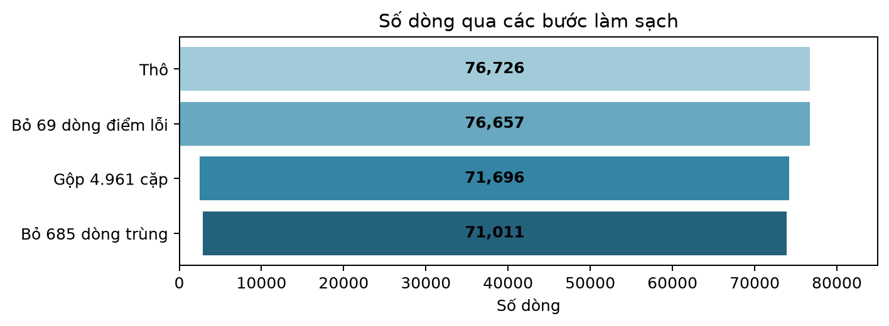

Hình 2.2. Số dòng qua các bước làm sạch.

Nguồn: `data/clean/quality_report.md`.

**Bảng 2.5. Số dòng sạch theo năm và phương thức**

| Phương thức | 2024 | 2025 | 2026 | Tổng |
| --- | ---: | ---: | ---: | ---: |
| THPT | 5.988 | 7.910 | 6.763 | 20.661 |
| HOCBA | 5.539 | 5.227 | 4.518 | 15.284 |
| DGNL_HCM | 2.422 | 2.672 | 3.000 | 8.094 |
| DGNL_HN | 1.035 | 1.594 | 2.008 | 4.637 |
| DGTD | 712 | 1.021 | 1.306 | 3.039 |
| DGNL_SPT | 231 | 803 | 903 | 1.937 |
| KETHOP | 1.124 | 1.887 | 7.053 | 10.064 |
| CCQT | 512 | 984 | 700 | 2.196 |
| UTXT | 670 | 655 | 284 | 1.609 |
| KHAC | 357 | 1.481 | 1.652 | 3.490 |
| **Dòng sạch** | **18.590** | **24.234** | **28.187** | **71.011** |
| Dòng thô từ log | 18.757 | 25.758 | 32.211 | 76.726 |
| Trường có dữ liệu sạch | 279 | 278 | 276 | 292 trường phân biệt |
| Mã ngành được dùng | 413 | 419 | 421 | 455 mã phân biệt |

Nguồn: `data/clean/quality_report.md`, `data/raw/fetch_log.csv`, truy vấn nhóm `year`, `method` từ `data/eduradar.db`. Hai hàng cuối là số phần tử phân biệt, không cộng dọc thành tổng ba năm.

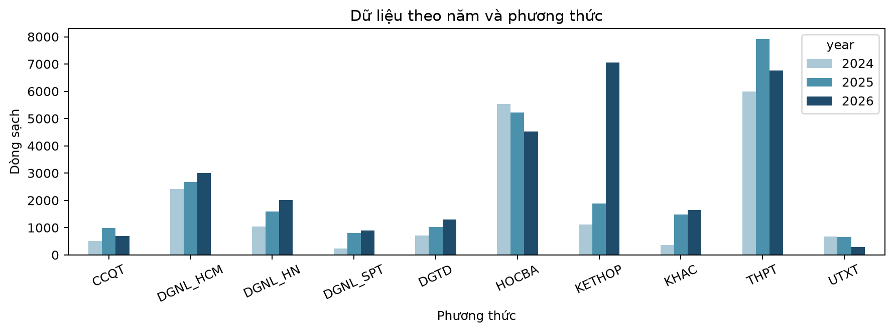

Hình 2.3. Phân bố số record theo năm và phương thức.

Nguồn: Bảng 2.5.

KETHOP tăng mạnh về số dòng trong năm 2026. Đây là thay đổi về số dòng dữ liệu nguồn sau chuẩn hóa, chưa đủ để kết luận số người sử dụng phương thức hoặc mức độ phổ biến xã hội tăng tương ứng. Số record của trường cũng phụ thuộc việc nguồn tách tổ hợp, phương thức con, chương trình và ghi chú. Do đó, bảng xếp theo số dòng chỉ đo quy mô dữ liệu của trường trong bộ thu thập.

**Bảng 2.6. Mười trường có nhiều record sạch nhất**

| Mã | Tên theo danh mục nguồn | 2024 | 2025 | 2026 | Tổng |
| --- | --- | ---: | ---: | ---: | ---: |
| DTT | Trường Đại Học Tôn Đức Thắng | 517 | 598 | 1.139 | 2.254 |
| KHA | Đại Học Kinh Tế Quốc Dân | 460 | 529 | 937 | 1.926 |
| HHA | Trường Đại Học Hàng Hải Việt Nam | 281 | 868 | 699 | 1.848 |
| SPK | Trường Đại Học Công nghệ Kỹ thuật TP HCM | 648 | 526 | 243 | 1.417 |
| DAD | Trường Đại Học Đông Á | 214 | 228 | 883 | 1.325 |
| SPS | Trường Đại Học Sư Phạm TPHCM | 133 | 524 | 426 | 1.083 |
| TCT | Đại Học Cần Thơ | 309 | 363 | 381 | 1.053 |
| PKA | Đại Học Phenikaa | 220 | 320 | 510 | 1.050 |
| QSX | Trường Đại Học Khoa Học Xã Hội và Nhân Văn TPHCM | 363 | 409 | 162 | 934 |
| TMU | Trường Đại Học Thương Mại | 264 | 225 | 407 | 896 |

Nguồn: `admissions` JOIN `universities` theo `uni_code`, GROUP BY mã trường, ORDER BY số dòng giảm dần trong `data/eduradar.db`. Truy vấn toàn bộ 292 trường được lưu trong `scripts/report_data_evidence.py`, khóa kết quả `schools_292`, và trình bày đầy đủ tại Phụ lục A.3.

## 2.4. Các bước làm sạch và xử lý vấn đề dữ liệu

### 2.4.1. Trình tự xử lý và số dòng ảnh hưởng

Pipeline đọc toàn bộ phản hồi đã lưu, gắn thông tin trường, năm, URL và thời điểm thu thập. Nếu trường `year` của dòng thiếu, chương trình dùng năm của file rồi ép về số nguyên. Cột `mark` được ép sang kiểu số; giá trị không chuyển được thành số trở thành thiếu. Các bước tiếp theo được thực hiện theo thứ tự cố định trong Bảng 2.7.

**Bảng 2.7. Nhật ký làm sạch của lần chạy 09/11/2026**

| Bước | Vấn đề và quy tắc | Dòng bị giảm hoặc được ghi nhận | Số dòng còn lại |
| --- | --- | ---: | ---: |
| Đọc raw | Hợp nhất phản hồi của 921 tác vụ điểm | 76.726 dòng vào | 76.726 |
| Lọc điểm | Loại `mark` thiếu, không ép được số hoặc ≤ 0 | −69 | 76.657 |
| Chuẩn văn bản, lọc tên | NFC, bỏ ký tự thay thế, tiền tố đánh số, gộp khoảng trắng; bỏ tên ngành rỗng | 0 dòng bị loại do tên rỗng | 76.657 |
| Phương thức và tổ hợp | Chuẩn mã phương thức, tách/chuẩn mã tổ hợp | Không giảm dòng; số ô văn bản bị sửa chưa thống kê riêng trong nguồn hiện hành | 76.657 |
| Ghép điểm gốc/quy đổi | Ghép theo khóa không gồm ghi chú, đưa điểm quy đổi vào `score_equiv` | −4.961 dòng biểu diễn quy đổi | 71.696 |
| Thang điểm và cờ | Gán thang theo phương thức hoặc suy từ giá trị; gắn cảnh báo | Không loại dòng ở bước này | 71.696 |
| Loại trùng hoàn toàn | Trùng khóa nghiệp vụ và cùng `score` thì giữ một | −685 | 71.011 |
| Phát hiện mâu thuẫn | Cùng khóa nghiệp vụ nhưng khác điểm | 631 dòng được giữ, không phải 631 khóa | 71.011 |
| Loại chương trình, map ngành | Phân loại chương trình; gán mã ngành và cách gán (Bảng 2.9) | 69.112 dòng có mã, 1.899 dòng chưa có mã | 71.011 |

Nguồn: `data/clean/quality_report.md`; thứ tự và khóa xử lý đối chiếu `pipeline/clean.py`. Báo cáo hiện hành không có thống kê riêng số ô sửa Unicode, tiền tố hoặc khoảng trắng trong mã, nên không dùng các số thống kê của lần chạy cũ.

### 2.4.2. Điểm số, văn bản và tổ hợp

Việc bỏ 69 dòng điểm không hợp lệ nhằm bảo đảm `score` dùng được cho tra cứu và tính toán. Trái lại, điểm lớn bất thường hoặc thấp nhưng vẫn là số dương không bị tự sửa hoặc xóa: pipeline giữ giá trị và gắn cờ để người dùng nhận biết. Chẳng hạn DB còn dòng KHA, năm 2024, KETHOP, chương trình `EP15` Khoa học dữ liệu có `score = 2600`, thang không xác định, cờ `outlier`. Báo cáo không tự kết luận giá trị đúng phải là 26,00 vì chưa có bằng chứng từ văn bản gốc.

Văn bản được chuẩn Unicode NFC, xóa ký tự thay thế `U+FFFD`, gộp khoảng trắng và bỏ khoảng trắng đầu/cuối. Tên chương trình được bỏ tiền tố đánh số dạng `(1)`, `(2)` ở đầu; mã chương trình được bỏ dấu cách. Tên gốc sau làm sạch vẫn được lưu ở `program_name`, tách khỏi khóa so khớp `name_key`. Các nguồn hiện hành không lưu cặp trước/sau của từng ô đã sửa; vì vậy không coi một ví dụ giả định là bằng chứng một dòng raw cụ thể đã xảy ra lỗi này, và không gán số dòng ảnh hưởng riêng cho từng phép biến đổi.

Với tổ hợp, mã được viết hoa, bỏ khoảng trắng và sửa chữ `O` thành số `0` ở phần số của mã. Tổng kết dữ liệu xác nhận các dạng `BO3 → B03`, `BO0 → B00`, `AO1 → A01`. DB xác nhận B03 là “Toán, Ngữ văn, Sinh học”, B00 là “Toán, Hóa học, Sinh học” và A01 là “Toán, Vật lí, Tiếng Anh”. Các mã sau chuẩn hóa được loại lặp trong một record, sắp xếp và nối bằng `;`; bảng `admission_combos` tách mỗi cặp `(admission_id, combo)` để truy vấn. Quy tắc này tạo **264.630 lượt gắn**, không phải 264.630 record điểm mới.

Có 385 mã được sử dụng nhưng chỉ 253 mã trong số đó có tên môn ở danh mục. **132 mã còn thiếu tên môn vẫn được giữ trong dữ liệu**; hệ thống không tự đặt tên môn. Danh mục API có 298 mã được đặt tên, nên còn các mã có định nghĩa nhưng không xuất hiện trong tập điểm. Nếu cùng mã có nhiều định nghĩa, chọn định nghĩa có `school_count` lớn nhất để hiển thị; vẫn giữ các định nghĩa và số trường theo nguồn trong dữ liệu giải thích. Đây là cách chọn đại diện từ nguồn, không phải xác nhận một định nghĩa là đúng cho mọi trường.

### 2.4.3. Ghép điểm gốc và điểm quy đổi

Nguồn có thể trả hai biểu diễn điểm cho một chương trình. Theo cách dùng của pipeline, `is_converted_score == 1` là dòng điểm gốc; các giá trị khác, kể cả thiếu hoặc giá trị bất thường, được đưa về nhánh còn lại. Dòng nhánh còn lại có khóa ghép trùng với dòng gốc được chuyển thành `score_equiv`; nếu không có cặp gốc thì vẫn giữ làm dòng đơn. Khóa ghép gồm trường, năm, phương thức, phương thức con, mã/tên chương trình và nhóm tổ hợp, **không gồm ghi chú**. Điều này cần được lưu ý vì hai dòng khác ghi chú vẫn có thể được coi là một cặp.

Nhờ ghép, số dòng giảm 4.961; trong bảng cuối có **4.940 dòng** mang `score_equiv`. Hai số không nhất thiết bằng nhau vì sau đó còn bước loại trùng, và một khóa ghép có thể có nhiều biểu diễn quy đổi. Mã hiện hành loại trùng theo khóa ghép trong bảng quy đổi trước khi merge; khi có nhiều điểm quy đổi cho cùng khóa, chỉ giữ dòng đầu tiên. Đây là giới hạn của cách ghép hiện tại, cần thận trọng nếu dùng điểm quy đổi cho phân tích sâu.

Báo cáo làm sạch trước đây ghi nhận trường hợp bất thường `is_converted_score = 26` ở SP2, năm 2026, Sư phạm Khoa học tự nhiên và đã sửa điều kiện phân nhánh để mọi giá trị khác 1 không bị bỏ âm thầm. Con số “ba dòng raw” trong ghi chép lịch sử chưa được tái kiểm ở đây vì phạm vi bằng chứng không bao gồm nội dung raw điểm. Bằng chứng hiện tại trong DB là chương trình `7140247`, năm 2026 có hai dòng KHAC: `score = 21,27` và `19,69`, đều mang `score_equiv = 25,57`, cùng một dòng THPT có `score = 25,57`. Không được hiểu ba dòng kết quả này là ba dòng raw bất thường, hoặc suy ra mỗi dòng raw bất thường đều trở thành một record sạch độc lập.

### 2.4.4. Dòng trùng và dòng mâu thuẫn

Sau ghép, 685 dòng trùng khóa và cùng điểm được bỏ. Việc bỏ trùng không dựa riêng vào mã ngành vì như vậy sẽ làm mất các chương trình, phương thức hoặc nhóm tổ hợp có ý nghĩa khác nhau. Với cùng khóa nhưng khác điểm, pipeline giữ toàn bộ 631 dòng liên quan và xuất danh sách vào `data/interim/conflicts.csv`. Số này đếm dòng tham gia mâu thuẫn, không phải số cặp và cũng không phải số trường sai dữ liệu.

Ví dụ kiểm chứng được trong DB là hai dòng KHAC của SP2 nêu trên: trường, năm, phương thức, mã/tên chương trình, nhóm tổ hợp và ghi chú giống nhau, nhưng điểm lần lượt 21,27 và 19,69. Pipeline không tự chọn số cao hơn hoặc lấy trung bình vì đó là quyết định cần thông tin nguồn bổ sung. Các dòng này có thể vẫn không mang `flag`, do kiểm tra trùng khóa được lưu riêng với bộ cờ về thang/giá trị điểm.

## 2.5. Chuẩn hóa và bổ sung thông tin phục vụ phân tích

### 2.5.1. Phương thức và thang điểm

**Bảng 2.8. Ánh xạ phương thức của nguồn sang mã sử dụng trong hệ thống**

| `mark_type` nguồn | Mã chuẩn | Tên hiển thị | Thang mặc định |
| --- | --- | --- | ---: |
| 1 | THPT | Điểm thi THPT | 30 |
| 2 | DGNL_HCM | ĐGNL ĐHQG-HCM (V-ACT) | 1.200 |
| 3 | HOCBA | Học bạ | 30 |
| 5 | DGNL_HN | ĐGNL ĐHQG-HN (HSA) | 150 |
| 6 | DGTD | Đánh giá tư duy (TSA) | 100 |
| 7 | DGNL_SPT | ĐGNL ĐHSP HN (SPT) | 30 |
| 10 | KETHOP | Xét tuyển kết hợp | Suy từ giá trị |
| 12 | CCQT | Chứng chỉ quốc tế | Suy từ giá trị |
| 11 | UTXT | Ưu tiên / xét tuyển thẳng | Suy từ giá trị |
| 4, 8, 9 và mã chưa nhận diện | KHAC | Khác | Suy từ giá trị |

Nguồn: bảng `METHODS` trong `pipeline/clean.py`; mã thực sự xuất hiện và số dòng sau chuẩn hóa tại Bảng 2.5 được kiểm chứng bằng SQLite.

Khi điểm không vượt thang mặc định, pipeline giữ thang mặc định. Nếu vượt thang hoặc phương thức chưa có thang, chọn mức nhỏ nhất chứa được điểm trong `{30, 40, 100, 150, 1200, 1600}`. Nếu không mức nào chứa được điểm, thang để thiếu và gắn `outlier`. Không có phép quy mọi phương thức về thang 30. Các phương thức có thang khác nhau phải được lọc trước khi so sánh; `score_equiv` là giá trị lấy từ biểu diễn của nguồn, không phải kết quả tự nhân chia theo thang.

Hai ví dụ trong DB cho thấy giới hạn của suy thang. NTS, học bạ 2024, `KDQS2.1`, có điểm 31 được gán thang 40 và cờ `thang_khac_30`, trong khi cùng chương trình còn điểm 30 và 29 ở thang 30. Không đủ bằng chứng xác định 31 là thang 40 hay điểm có cộng ưu tiên. DDT, năm 2026, KHAC, `7510205_11`, có điểm 225 được gán thang 1.200 do không có thang 300 trong tập ứng viên. Đây là kết quả thuật toán, không phải nguồn xác nhận rằng bài thi tương ứng dùng thang 1.200.

### 2.5.2. Chuẩn hóa mã ngành

Danh mục ngành được dựng từ chính dữ liệu điểm: lấy tiền tố bảy chữ số bắt đầu bằng 7 trong mã chương trình, chọn tên phổ biến nhất cho từng mã, ưu tiên các dòng loại CHUAN. Do vậy, thuật ngữ “mã ngành chuẩn hóa” trong báo cáo chỉ nói về danh mục thống nhất nội bộ; chưa thể coi đây là danh mục chính thức đã đối chiếu toàn bộ với Bộ GD&ĐT.

Với dòng chưa nhận diện được mã bảy số, pipeline tạo `name_key` bằng cách bỏ dấu, viết thường, bỏ phần trong ngoặc và một số từ chỉ chương trình, gộp dấu cách. Các từ như “quốc tế” hoặc “tiếng Anh” không bị xóa như những từ đơn lẻ không có nghĩa; tuy nhiên một số cụm mô tả chương trình đã quy định trong biểu thức chuẩn hóa vẫn có thể bị loại. Việc giữ nội dung phân biệt ngành giúp tránh gộp “Kinh doanh quốc tế” vào một ngành kinh doanh khác chỉ vì cùng có phần tên chung.

Thứ tự thực hiện là **`ma_7_so` → sửa mã nguồn (`doi_ma_nguon`/`bo_ma_nguon`) → `thu_cong` → `ten_khop` → `dau_ten_chuan` → `ten_gan_dung` → `chua_ten_chuan`**, dừng ở quy tắc khớp đầu tiên; cuối cùng `ten_tu_ma` thay tên chương trình chỉ gồm chữ số bằng tên ngành chuẩn. Dòng `ma:<mã>` hoặc `ma:<mã>@<TRƯỜNG>` trong `data/manual/major_map.csv` đổi (`doi_ma_nguon`) hoặc bỏ (`bo_ma_nguon`, giá trị `-`) mã 7 số mà nguồn ghi sai. `thu_cong_bo` là nhánh của bước thủ công theo tên: dấu `-` yêu cầu để trống mã, ngăn những phép gán tự động chưa đáng tin. Các số liệu và tỉ lệ ở Bảng 2.9 lấy trực tiếp từ DB, tính trên mẫu số 71.011 và làm tròn hai chữ số thập phân.

**Bảng 2.9. Kết quả gán mã ngành theo quy tắc**

| Thứ tự | Cách gán | Quy tắc | Số dòng | Tỉ lệ |
| --- | --- | --- | ---: | ---: |
| 1 | `ma_7_so` | Dùng tiền tố `7\d{6}` của mã chương trình | 56.261 | 79,23% |
| 1a | `doi_ma_nguon` | Mã nguồn ghi sai, đổi theo dòng `ma:<mã>` của bảng map | 5 | 0,01% |
| 1b | `bo_ma_nguon` | Mã nguồn ghi sai, bỏ theo dòng `ma:<mã>` có giá trị `-` | 152 | 0,21% |
| 2 | `thu_cong` | Tra `name_key` trong bảng map thủ công | 2.040 | 2,87% |
| 2b | `thu_cong_bo` | Chủ động để trống mã theo dấu `-` | 61 | 0,09% |
| 3 | `ten_khop` | Khớp `name_key` với tên đã biết mã | 9.413 | 13,26% |
| 4 | `dau_ten_chuan` | Bắt đầu bằng tên chuẩn có ít nhất hai từ | 1.182 | 1,66% |
| 5 | `ten_gan_dung` | `difflib` có độ giống tối thiểu 0,9 | 83 | 0,12% |
| 6 | `chua_ten_chuan` | Chứa cụm tên chuẩn, đủ điều kiện và chiếm ít nhất 60% số từ cốt lõi | 113 | 0,16% |
| 7 | `ten_tu_ma` | Tên chương trình chỉ là mã số, thay bằng tên ngành chuẩn | 15 | 0,02% |
| — | Chưa khớp | Không có kết quả từ các quy tắc trên | 1.686 | 2,37% |
| | **Có mã** | Không tính `bo_ma_nguon`, `thu_cong_bo` và chưa khớp | **69.112** | **97,33%** |
| | **Chưa có mã** | 1.686 chưa khớp + 152 bỏ mã nguồn + 61 chủ động bỏ | **1.899** | **2,67%** |

Nguồn: `SELECT match_how, COUNT(*) FROM admissions GROUP BY match_how` và kiểm tra `major_code` trong `data/eduradar.db`; mô tả quy tắc từ `pipeline/clean.py`. Các tỉ lệ thành phần có thể không cộng đúng 100,00% do làm tròn.

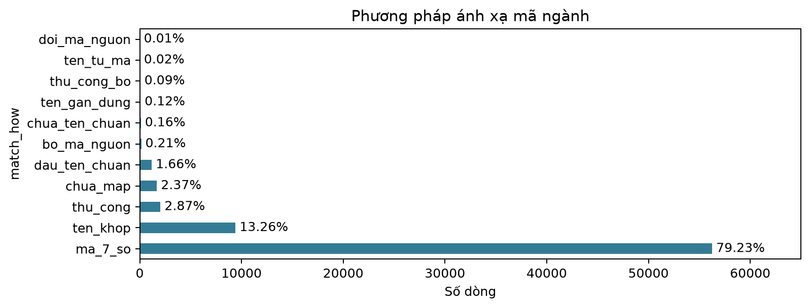

Hình 2.4. Cơ cấu các cách gán mã ngành.

Nguồn: Bảng 2.9.

**Bảng 2.10. Ví dụ có thể truy vấn trong dữ liệu sạch cho từng cách gán**

| Cách gán | Trường / mã chương trình | Tên chương trình đang lưu | Kết quả |
| --- | --- | --- | --- |
| `ma_7_so` | ANH / `7480201_Nam` | Ngành Công nghệ thông tin | `7480201` — Công nghệ thông tin |
| `thu_cong` | BKA / `ET-LUH` | Điện tử - Viễn thông - ĐH Leibniz Hannover (CHLB Đức) | `7520207` — Kỹ thuật điện tử - viễn thông |
| `thu_cong_bo` | BKA / `MS5` | Kỹ thuật in | Để trống mã |
| `ten_khop` | ANH / `DS7480201` | Công nghệ thông tin (Hệ dân sự) | `7480201` — Công nghệ thông tin |
| `dau_ten_chuan` | BKA / `ET-E16` | Truyền thông số và Kỹ thuật đa phương tiện (CT tiên tiến) | `7320111` — Truyền thông số |
| `ten_gan_dung` | BKA / `CH-E11` | Kỹ thuật Hóa dược (CT tiên tiến) | `7520301` — Kỹ thuật hóa học |
| `chua_ten_chuan` | BKA / `IT1` | CNTT: Khoa học Máy tính | `7480101` — Khoa học máy tính |
| Chưa khớp | BKA / `BF-E19` | Kỹ thuật sinh học (CT tiên tiến) | Để trống mã |

Nguồn: truy vấn `admissions` LEFT JOIN `majors` trong `data/eduradar.db`. Đây là ví dụ quy tắc trên các giá trị sạch có chứng thực, không phải cặp chụp raw trước/sau và không phải kết luận mọi phép map đều chính xác.

Lỗi đã được sửa trong cách dựng từ điển tên là chọn **mã xuất hiện trội** thay cho mã gặp đầu tiên. Nếu nhiều mã dùng cùng một tên, `key_to_code` đếm lượt xuất hiện của cặp tên–mã; khi dựng tên danh mục và cụm từ chuẩn, hàm `dominant` ưu tiên mã có nhiều dòng sử dụng. Ví dụ DB đồng thời có `7310120` và `7340120` mang tên Kinh doanh quốc tế; `7340002` và `7340101` cùng mang tên Quản trị kinh doanh. Quy tắc đa số giảm sự phụ thuộc thứ tự đọc dữ liệu, nhưng không xác thực được mã ít gặp là sai hay mã trội là mã pháp lý đúng. Những trường hợp bất định cần sửa qua `data/manual/major_map.csv`.

Ví dụ `CH-E11` cho thấy khớp gần đúng có thể gộp một tên chuyên biệt vào ngành rộng hơn. Các phép khớp tên, đặc biệt tiền tố, gần đúng và chứa cụm, là heuristic. Tỉ lệ 97,33% vì vậy là **độ phủ gán mã**, không phải độ chính xác 97,33%. Báo cáo chất lượng hiện hành ghi 168 khóa tên chưa map (`data/interim/major_unmatched.csv`); tổng số dòng chưa có mã là 1.899, trong đó đã bao gồm hai nhánh bỏ mã có chủ đích. Lần xử lý 09/11/2026 thêm các dòng sửa mã nguồn (`doi_ma_nguon`, `bo_ma_nguon`) và rà lại bảng map thủ công; các mã nguồn bị xác định là ghi sai được để trống thay vì giữ.

### 2.5.3. Loại chương trình và địa bàn

Loại chương trình được nhận diện trên tên cộng mã sau bỏ dấu, theo thứ tự: tiên tiến, chất lượng cao, liên kết, tiếng Anh, phân hiệu/cơ sở, tài năng; không khớp thì gán CHUAN. Mỗi record chỉ nhận một nhãn theo quy tắc đầu tiên khớp. Vì tên chương trình có thể đồng thời chứa nhiều đặc điểm, nhãn này là phân loại tiện ích cho bộ lọc, không phải phân loại chương trình đã được trường xác nhận đầy đủ.

**Bảng 2.11. Số dòng theo loại chương trình**

| Nhãn | Số dòng |
| --- | ---: |
| CHUAN | 62.618 |
| TIENG_ANH | 3.111 |
| LIEN_KET | 1.510 |
| TIEN_TIEN | 1.290 |
| CLC | 1.287 |
| PHAN_HIEU | 1.079 |
| TAI_NANG | 116 |
| **Tổng** | **71.011** |

Nguồn: `data/clean/quality_report.md`, đối chiếu GROUP BY `program_type` trong SQLite.

Địa bàn được gán theo địa chỉ trường hoặc phân hiệu cụ thể; không lấy tỉnh đại học mẹ áp cho mọi thành viên. Các địa chỉ cũ được chuẩn hóa về tên sau sắp xếp năm 2025. Theo tổng kết, VJU/QHQ/QHY thuộc Hà Nội, QSA thuộc An Giang; phân hiệu ĐHTN tại Hà Giang được quy về Tuyên Quang, phân hiệu ĐH Đà Nẵng tại Kon Tum về Quảng Ngãi, phân hiệu ĐHQG-HCM tại Bến Tre về Vĩnh Long. Với một mã có nhiều cơ sở, bộ lọc chỉ biểu diễn một tỉnh theo địa chỉ chính đã đối chiếu; dữ liệu không mô tả đầy đủ mạng lưới cơ sở.

Tài liệu tổng kết ghi lớp hợp cuối có 90 địa chỉ chính thức, 95 VNUR và 107 HOCMAI. Tuy nhiên DB nền đang lưu `province = 'Khác'` cho 107 mã và `province_source` rỗng ở các mã này. Vì vậy khi sử dụng DB riêng cho phân tích địa bàn, cần hợp phần HOCMAI hoặc ghi nhận các trường chưa xác định; không được dùng độ phủ cuối của web thay cho kết quả truy vấn DB nền.

### 2.5.4. VNUR 2026 và quan hệ kế thừa

Hạng VNUR được nhập thủ công và ghép theo mã trường. Pipeline kiểm tra mã trường có trong danh mục và không được gán hai hạng cho cùng một mã. Các trường có ghi chú bắt đầu bằng “thuộc …” được đánh dấu quan hệ kế thừa, lưu tên đại học mẹ ở `vnur_parent`. Có **95 trường có hạng trực tiếp, 54 đơn vị kế thừa**, tổng cộng 149/292 trường, tương ứng 51,03%.

Hạng kế thừa chỉ là thông tin tham khảo theo đơn vị mẹ; không được diễn giải rằng VNUR đã xếp hạng riêng từng phân hiệu hoặc trường thành viên. Trên giao diện phải giữ nhãn tên đại học mẹ. Hạng VNUR 2026 được dùng tham khảo cho cả ba năm của bộ điểm, nên không phù hợp để suy luận thứ hạng trường đã thay đổi thế nào từ 2024 đến 2026.

### 2.5.5. Đề án HOCMAI: bóc tách HTML theo heading

`pipeline/dean.py` dùng BeautifulSoup đọc phần HTML trong nội dung bài, bỏ `style`, `script`, `noscript` và các bảng danh sách ngành. Bộ trích xuất duyệt H2/H3/H4 cùng đoạn văn, mục danh sách và hàng bảng; H2 xác định nhóm phương thức hoặc thời gian/hồ sơ, H3 tạo từng phương thức, H4 định hướng các trường như đối tượng, điều kiện, chỉ tiêu, điểm cộng và quy tắc. Các đoạn được tách thành dữ kiện ngắn, loại lặp; dữ kiện xuất hiện ở nhiều phương thức được đưa sang phần dùng chung. Thời gian và hồ sơ chỉ được hiển thị khi nội dung nguồn có căn cứ.

Kết quả có **267/292 trường (91,44%)** có đề án. Trong 271 bài nguồn, 268 bài ghép vào 267 mã trường, tức có một mã nhận hai bài; ba bài ngoài danh mục điểm được để chưa ghép. Dữ liệu có 1.190 mục phương thức và 8.208 gạch đầu dòng dữ kiện, không phải 8.208 thông báo độc lập. Quyết định ghép bài với mã trường nằm ở `data/manual/dean_map.csv`; đầu ra chỉ giữ dữ kiện cấu trúc và URL bài gốc.

Có **91 bài** mà năm ở tiêu đề khác năm trong H2 phương thức. Bộ xử lý giữ cả `year` và `methods_year`, đồng thời ghi chú để người đọc thấy sự khác biệt; không đổi mọi đề án cũ thành năm 2026 chỉ vì bài xuất hiện trong trang tổng hợp hiện tại. Đây là giới hạn về tính đồng nhất thời gian của nguồn, không được giải quyết bằng cách ghi đè năm.

### 2.5.6. Học phí hai tầng, đơn vị và mức độ bằng chứng

Học phí được trình bày thành hai bộ có cách biểu diễn khác nhau. Bộ đầu có 203 trường, lưu khoảng triệu đồng/năm và ghi rõ các trường hợp ước tính quy đổi. Bộ bổ sung có 89 trường, giữ nguyên đơn vị theo nguồn: đồng/tín chỉ, học kỳ, tháng, năm, toàn khóa hoặc từng khoản thu; không tự nhân chia về học phí năm. Hai bộ không trùng mã nên độ phủ hợp không bị đếm hai lần.

**Bảng 2.12. Học phí theo loại bằng chứng và bộ dữ liệu**

| Loại bằng chứng | Bộ đầu | Bộ bổ sung | Tổng mã trường |
| --- | ---: | ---: | ---: |
| Nguồn chính thức | 17 | 53 | 70 |
| Văn bản chính thức, bản lưu bên thứ ba | 0 | 4 | 4 |
| Báo chí | 30 | 0 | 30 |
| Trang tổng hợp | 156 | 0 | 156 |
| Tham khảo thứ cấp trong bộ bổ sung | 0 | 25 | 25 |
| Chưa xác minh được mức tiền | 0 | 7 | 7 |
| **Tổng mã trường được lập mục** | **203** | **89** | **292** |
| **Có mức tiền tham khảo** | **203** | **82** | **285** |

Nguồn: `docs/TONG_KET_DU_LIEU.md`; bộ đầu đối chiếu bảng `tuition` trong `data/eduradar.db`.

`tuition_import.py` nhận diện số tiền cùng đơn vị, tách mức theo nhóm ngành/chương trình khi đủ thông tin và giữ câu giới hạn. Các mức không rõ đơn vị không được tùy ý coi là triệu đồng/năm. Mỗi mục cần giữ nguồn, năm học, khóa, phạm vi áp dụng, học bổng hoặc điều kiện thanh toán nếu có. Loại nguồn chính thức hay thứ cấp mô tả xuất xứ bằng chứng, không bảo đảm mọi mức đều áp dụng cho mọi sinh viên năm 2026.

Theo tổng kết, đã ghi overrides cho đủ **32 mục** trong `data/manual/tuition_extra_overrides.json`, dựa trên phần Mức học phí và Giới hạn của hồ sơ nhập. Sau import còn 0 mục trong danh sách cần xem tay; điều này chỉ nói danh sách chờ của importer đã được xử lý. Vẫn còn 13 mục khác chưa tách được bảng theo ngành nên giữ tóm tắt. Không được coi “0 cần xem tay” là học phí đã đầy đủ hoặc đã xác minh hết ở nguồn chính thức.

Các ví dụ có bằng chứng trong tổng kết minh họa lý do phải giữ đơn vị và giới hạn: HHA giữ “gần 700.000 đồng/tín chỉ” và tách chương trình tiếng Việt/Anh; KTA, DVB, TDB giữ đơn vị riêng cho từng dòng để không cộng hoặc nhân hai cách thu; NTS chỉ gán đơn vị năm cho mức tiêu chuẩn 28–32 triệu đồng/năm, các khoảng viết tắt thiếu đơn vị được ghi rõ chưa có đơn vị trong nguồn; SIU ghi biểu phí đã bao gồm ưu đãi học bổng và giảm theo cách thanh toán. Không dùng một mức i-Hons của bảng chung FTU làm trần cho mọi chương trình tại NTS.

Bảy mã **DBH, DKT, DNB, HFH, NHP, NLG, SDU** chưa xác minh được mức tiền. Các mục này giữ thông báo giới hạn và không hiển thị số tiền. Độ phủ học phí có mức là **285/292 = 97,60%**, không đồng nghĩa 97,60% trường đã có học phí chính thức 2026 theo cùng một đơn vị.

## 2.6. Đánh giá chất lượng, độ phủ và giới hạn

### 2.6.1. Cờ chất lượng và độ phủ theo trường–năm

**Bảng 2.13. Cờ chất lượng trong bảng điểm sạch**

| Cờ | Ý nghĩa của quy tắc | Số dòng |
| --- | --- | ---: |
| Rỗng (`ok` khi thống kê) | Không vi phạm ba quy tắc cờ hiện có | 69.893 |
| `thang_khac_30` | THPT/học bạ được suy ra thang khác 30, chưa có cờ khác ưu tiên | 1.113 |
| `diem_thap_bat_thuong` | THPT có điểm dưới 12 | 3 |
| `outlier` | Điểm vượt mọi thang ứng viên, không xác định được thang | 2 |
| **Tổng** | | **71.011** |

Nguồn: `data/clean/quality_report.md`, GROUP BY `flag` trong `data/eduradar.db`.

Ba điểm THPT thấp là DNC/2024, Kỹ thuật y sinh và Kiến trúc, cùng 6 điểm; GNT/2024, Diễn viên Kịch - Điện ảnh liên thông, 5 điểm. Hai outlier là KHA/2024/KETHOP/EP15 với 2.600 điểm và PKA/2025/HOCBA/FBE8 với 2.333 điểm. Các dòng này vẫn được giữ để người dùng thấy giá trị nguồn; cần lọc cờ khi tạo tập phân tích yêu cầu điểm tin cậy hơn. Cờ rỗng chỉ có nghĩa không trúng ba quy tắc trên, không chứng minh record chính xác hoặc không trùng khóa.

**Bảng 2.14. Độ phủ điểm theo năm và tính liên tục của trường**

| Chỉ tiêu | 2024 | 2025 | 2026 |
| --- | ---: | ---: | ---: |
| Trường có ít nhất một record | 279 | 278 | 276 |
| Thiếu dữ liệu so với 292 trường có điểm ở ít nhất một năm | 13 | 14 | 16 |
| Thiếu dữ liệu so với 307 trường được chọn để crawl | 28 | 29 | 31 |
| Số record sạch | 18.590 | 24.234 | 28.187 |

Nguồn: `data/eduradar.db`, `data/raw/fetch_log.csv`. Có **259/292 trường** có dữ liệu đủ cả ba năm; tập ba năm không phải panel cân bằng.

**Bảng 2.15. Độ phủ các lớp thông tin bổ trợ và giới hạn của mẫu số**

| Lớp thông tin | Độ phủ | Điều kiện diễn giải |
| --- | --- | --- |
| Gán mã ngành | 69.112/71.011 dòng = 97,33% | Độ phủ tự động/thủ công, chưa phải độ chính xác đã kiểm tay |
| Đề án HOCMAI | 267/292 trường = 91,44% | Còn 25 trường chưa có; năm trong bài có thể không đồng nhất |
| Học phí có mức tiền | 285/292 trường = 97,60% | Nguồn, năm và đơn vị khác nhau; 7 mục không có mức đã xác minh |
| VNUR, gồm kế thừa | 149/292 trường = 51,03% | Chỉ 95 hạng trực tiếp; 54 đơn vị dùng quan hệ với đại học mẹ |
| Tỉnh trong DB nền | 185/292 trường = 63,36% | 90 địa chỉ chính thức + 95 VNUR; còn 107 `Khác` |
| Tỉnh sau hợp lớp HOCMAI theo tổng kết | 292/292 trường = 100,00% | Thêm 107 từ HOCMAI; 30 tỉnh/thành được biểu diễn |
| Mã tổ hợp đang dùng có tên môn | 253/385 mã = 65,71% | 132 mã thiếu tên môn vẫn nằm trong dữ liệu |

Nguồn: `docs/TONG_KET_DU_LIEU.md` và truy vấn `data/eduradar.db`. Mẫu số điểm là dòng; các lớp bổ trợ là mã trường; tổ hợp là mã phân biệt, không so trực tiếp các tỉ lệ này với nhau.

Lược đồ SQLite hiện có bốn bảng lõi `universities`, `majors`, `admissions`, `admission_combos`, cùng hai bảng tra cứu/bổ trợ `combos`, `tuition`. Việc mô tả bốn bảng lõi không có nghĩa file DB chỉ chứa bốn bảng. Đề án và học phí bổ sung được xuất ở lớp JSON riêng của pipeline. Tương tự, độ phủ tỉnh 100% trong tổng kết là kết quả hợp cuối; nếu chỉ cấp DB nền cho một phép phân tích khác thì vẫn phải xử lý 107 mã chưa có địa bàn tại đó.

### 2.6.2. Kiểm chứng 20 dòng và các giới hạn còn lại

Hồ sơ kiểm chứng trước đây đề xuất chọn 20 dòng, phân tầng hai dòng cho mỗi trong mười phương thức và dùng seed 42. Tuy nhiên kết quả số dòng khớp trong báo cáo làm sạch vẫn để **\_\_/20**; các nguồn kiểm chứng được chốt cho chương này chưa cung cấp kết quả đối chiếu hoàn tất với trang nguồn. Vì vậy, báo cáo **chưa công bố tỉ lệ chính xác của mẫu 20 dòng**, không tự điền 20/20. Đếm số record, tính độ phủ và kiểm tra quy tắc trong DB là kiểm chứng tính nhất quán nội bộ; chúng không thay cho việc xác minh giá trị với thông báo tuyển sinh gốc.

Các giới hạn chính gồm: (i) phụ thuộc một trang tổng hợp cho điểm chuẩn, có thể kế thừa thiếu hoặc sai từ nguồn; (ii) thang điểm một phần là suy luận từ giá trị, chưa bao quát mọi bài thi; (iii) 631 dòng cùng khóa khác điểm chưa được phân xử; (iv) danh mục ngành dựng từ dữ liệu có mã đồng tên, và các phép map tên chưa đo độ chính xác riêng; (v) 1.899 dòng chưa gán mã sẽ không tạo quan hệ trường–ngành ở bước cần mã ngành; (vi) thiếu trường–năm làm thay đổi tập nút giữa các năm; (vii) học phí, đề án và VNUR không đồng nhất về mốc thời gian hoặc phạm vi; (viii) chưa có hồ sơ URL/ngày truy cập đầy đủ đến từng bài cho mọi nguồn bổ trợ trong bộ bằng chứng của chương.

Với các giới hạn đó, tập dữ liệu vẫn đạt các kết quả đo được cho đồ án: **71.011 record sạch, 292 trường, 455 mã ngành, 97,33% dòng được gán mã**; dữ liệu đủ để xây mạng và hỗ trợ tra cứu. Các kết quả SNA ở chương sau cần được diễn giải là cấu trúc của tập dữ liệu đã thu thập, không là bức tranh đầy đủ về hành vi chọn trường, chỉ tiêu hoặc xác suất trúng tuyển của thí sinh.


# Chương 3. Mô hình mạng và các độ đo SNA

## 3.1. Xây dựng bốn mạng trường – ngành

Đầu vào là các dòng `admissions` đã có `major_code` (69.112/71.011 dòng, 97,33%), tách theo năm 2024, 2025, 2026. Dòng chưa có mã ngành không tham gia mạng. Định nghĩa dưới đây lấy từ trường `definition` mà `sna/build.py` ghi vào `data/network/<mạng>_2026.json`; web hiển thị đúng nội dung này trong thẻ “Định nghĩa đồ thị”.

**Bảng 3.1. Định nghĩa bốn mạng**

| Mạng | Loại đồ thị | Nút | Cạnh | Trọng số | Ngưỡng / tham số | Nút / cạnh 2026 |
| --- | --- | --- | --- | --- | --- | --- |
| G1 Trường–Ngành | Hai phía (bipartite), vô hướng, có trọng số | Trường (hình tròn) và ngành theo mã 7 số Bộ GD&ĐT (hình kim cương) | Trường có điểm chuẩn của ngành đó trong năm | Số dòng điểm chuẩn của cặp (trường, ngành), tính mọi phương thức, chương trình, tổ hợp | Chỉ dùng dòng đã có mã ngành 7 số | 697 / 5.046 |
| G2 Trường–Trường | Chiếu một phía Trường–Trường từ G1, vô hướng, có trọng số | Trường | Nối 2 nút khi Jaccard(tập ngành của 2 trường) ≥ 0,25 | Hệ số Jaccard = \|giao\| / \|hợp\| | Ngưỡng Jaccard 0,25; bỏ nút cô lập (không có cạnh) | 250 / 2.540 |
| G3 Ngành–Ngành | Chiếu một phía Ngành–Ngành từ G1, vô hướng, có trọng số | Ngành (mã 7 số) | Nối 2 nút khi Jaccard(tập trường mở 2 ngành) ≥ 0,25 | Hệ số Jaccard = \|giao\| / \|hợp\| | Ngưỡng Jaccard 0,25; bỏ nút cô lập (không có cạnh) | 370 / 1.391 |
| G4 Cạnh tranh | Có hướng Trường → Trường, có trọng số | Trường có điểm chuẩn THPT thang 30 | A → B khi cùng một ngành, điểm B cao hơn A trong khoảng (0; 2] điểm | Số ngành thỏa điều kiện | Chỉ phương thức THPT thang 30, dòng không gắn cờ; lấy điểm cao nhất của trường cho mỗi ngành; khoảng điểm 2; bỏ nút cô lập | 226 / 9.215 |

*Nguồn: `data/network/*_2026.json`, trường `definition`; số nút/cạnh từ `data/network/summary.csv`.*

**G1** là đồ thị hai phía $G_1=(U\cup M,E)$, trọng số $w_{um}$ là số dòng điểm của cặp trường–ngành. **G2/G3** là phép chiếu một phía của G1 với hệ số Jaccard

$$J(a,b)=\frac{|N(a)\cap N(b)|}{|N(a)\cup N(b)|},$$

trong đó $N(a)$ là tập ngành của trường $a$ (G2) hoặc tập trường mở ngành $a$ (G3); giữ cạnh khi $J\ge0{,}25$. **G4** có cạnh $A\to B$ với trọng số

$$w_{AB}=\sum_m\mathbf1\{0<s_{B,m}-s_{A,m}\le2\},$$

với $s_{X,m}$ là điểm THPT thang 30 cao nhất (dòng không cờ) của trường $X$ ở ngành $m$. Cạnh G4 biểu diễn khả năng lựa chọn gần nhau theo điểm trong mô hình, không phải hành vi chuyển nguyện vọng đã quan sát. Hai tham số 0,25 và 2 được kiểm độ nhạy ở mục 4.5.

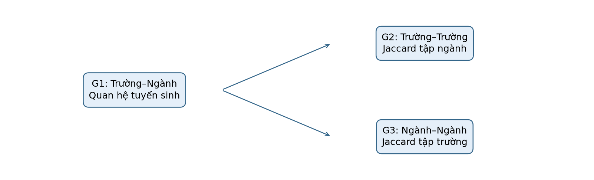

*Hình 3.1. Nguyên lý chiếu mạng hai phía. Nguồn phương pháp: `sna/build.py`, hàm `g1_bipartite`, `jaccard_projection`, `g4_competition`.*

**Bảng 3.2. Quy mô bốn mạng qua ba năm**

| Mạng | Năm | Số đỉnh | Số cạnh | Đỉnh là |
| --- | --- | --- | --- | --- |
| G1 Trường–Ngành | 2024 | 689 | 4.429 | 276 trường + 413 ngành |
| G2 Trường–Trường | 2024 | 249 | 2.581 | trường |
| G3 Ngành–Ngành | 2024 | 374 | 1.316 | ngành |
| G4 Cạnh tranh | 2024 | 259 | 10.542 | trường |
| G1 Trường–Ngành | 2025 | 697 | 4.662 | 278 trường + 419 ngành |
| G2 Trường–Trường | 2025 | 251 | 2.478 | trường |
| G3 Ngành–Ngành | 2025 | 371 | 1.381 | ngành |
| G4 Cạnh tranh | 2025 | 260 | 10.788 | trường |
| G1 Trường–Ngành | 2026 | 697 | 5.046 | 276 trường + 421 ngành |
| G2 Trường–Trường | 2026 | 250 | 2.540 | trường |
| G3 Ngành–Ngành | 2026 | 370 | 1.391 | ngành |
| G4 Cạnh tranh | 2026 | 226 | 9.215 | trường |

*Nguồn: `data/network/summary.csv`.*

## 3.2. Định nghĩa, công thức, kết quả và ý nghĩa các độ đo

Ký hiệu $n=|V|$, $m=|E|$, $k_v$ là bậc, $d(u,v)$ là khoảng cách theo số cạnh. Đường đi, betweenness, closeness, clustering và assortativity tính **không trọng số** (Jaccard là độ giống, chưa đổi thành độ dài); eigenvector, PageRank, HITS và Louvain dùng `weight`. Mọi độ đo nút có giá trị cho **mọi** đỉnh (đỉnh ngoài thành phần lớn nhất nhận 0 ở eigenvector), nên `metrics/*.csv` không còn ô trống. Bảng top 10 dưới đây là năm 2026; số ba năm ở mục 3.3.

### 3.2.1. Degree centrality và Degree distribution

**(1) Định nghĩa.** Bậc là số quan hệ trực tiếp; degree distribution là phân bố số đỉnh theo bậc. Bậc G1 phía trường là số ngành mở, phía ngành là số trường mở; G2/G3 là số đối tác vượt ngưỡng Jaccard; G4 tách bậc vào (số trường “nhắm lên” mình) và bậc ra.

**(2) Công thức.** $C_D(v)=k_v/(n-1)$; G1 chuẩn hoá theo phía đối diện $C_D(u)=k_u/|M|$, $C_D(m)=k_m/|U|$. Phân bố $P(k)=n_k/n$ và hàm phân phối bù $P(K\ge k)$. Đuôi được khớp luật lũy thừa $P(k)\propto k^{-\gamma}$ với $k\ge k_{min}$ bằng MLE rời rạc (Clauset, Shalizi & Newman 2009):

$$\hat\gamma=1+n_{tail}\Big[\sum_{i:\,k_i\ge k_{min}}\ln\frac{k_i}{k_{min}-0{,}5}\Big]^{-1},$$

$k_{min}$ chọn theo khoảng cách Kolmogorov–Smirnov nhỏ nhất, đuôi tối thiểu $\max(30;\,20\%\,n)$ đỉnh.

**(3) Cách tính.** `bipartite.degree_centrality`, `nx.degree_centrality`, `in_degree`/`out_degree`; `powerlaw_fit` và `degree_plot` trong `sna/build.py` (histogram + CCDF log–log có đường khớp).

**(4) Kết quả.**

**Bảng 3.3. Mười trường và mười ngành có bậc cao nhất ở G1 năm 2026**

| Hạng | Trường (số ngành mở) | Ngành (số trường mở) |
| --- | --- | --- |
| 1 | Đại Học Cần Thơ (TCT) — 97 | Quản trị kinh doanh (7340101) — 157 |
| 2 | Đại Học Phenikaa (PKA) — 66 | Công nghệ thông tin (7480201) — 154 |
| 3 | Trường Đại Học Văn Lang (DVL) — 64 | Kế toán (7340301) — 137 |
| 4 | Trường Đại Học Vinh (TDV) — 64 | Ngôn ngữ Anh (7220201) — 136 |
| 5 | Đại Học Duy Tân (DDT) — 62 | Tài chính - Ngân hàng (7340201) — 114 |
| 6 | Trường Đại Học Đông Á (DAD) — 60 | Quản trị dịch vụ du lịch và lữ hành (7810103) — 81 |
| 7 | Trường Đại học Công Nghệ TPHCM (DKC) — 60 | Ngôn ngữ Trung Quốc (7220204) — 80 |
| 8 | Trường Đại Học Đồng Tháp (SPD) — 58 | Luật (7380101) — 79 |
| 9 | Trường Đại Học Nguyễn Tất Thành (NTT) — 57 | Marketing (7340115) — 77 |
| 10 | Trường Đại Học Quy Nhơn (DQN) — 52 | Logistics và quản lý chuỗi cung ứng (7510605) — 76 |

**Bảng 3.4. Mười đỉnh bậc cao nhất ở G2 và G3 năm 2026**

| Hạng | G2: trường (bậc) | G3: ngành (bậc) |
| --- | --- | --- |
| 1 | Trường Đại Học Ngoại Ngữ Tin Học TPHCM (DNT) — 73 | Sư phạm Địa lý (7140219) — 25 |
| 2 | Đại học Kinh Tế TPHCM - Phân hiệu Vĩnh Long (KSV) — 70 | Giáo dục Chính trị (7140205) — 23 |
| 3 | Trường Đại Học Công Nghệ và Quản Lý Hữu Nghị (DCQ) — 67 | Logistics và quản lý chuỗi cung ứng (7510605) — 23 |
| 4 | Trường Đại Học Ngân Hàng TPHCM (NHS) — 67 | Giáo dục Công dân (7140204) — 22 |
| 5 | Trường Đại học Hùng Vương TPHCM (DHV) — 66 | Tài chính - Ngân hàng (7340201) — 22 |
| 6 | Trường Đại Học Kinh Tế Kỹ Thuật Bình Dương (DKB) — 66 | Quản trị khách sạn (7810201) — 22 |
| 7 | Trường Đại Học Bà Rịa – Vũng Tàu (BVU) — 65 | Sư phạm Lịch sử - Địa lý (7140249) — 21 |
| 8 | Trường Đại Học Lạc Hồng (DLH) — 65 | Truyền thông đa phương tiện (7320104) — 21 |
| 9 | Trường Đại Học Đại Nam (DDN) — 64 | Kỹ thuật trắc địa - bản đồ (7520503) — 21 |
| 10 | Học Viện Ngân Hàng (NHH) — 60 | Sư phạm Tin học (7140210) — 20 |

**Bảng 3.5. Mười trường có bậc vào, bậc ra và cường độ vào cao nhất ở G4 năm 2026**

| Hạng | Bậc vào | Bậc ra | Cường độ vào (tổng số ngành) |
| --- | --- | --- | --- |
| 1 | Trường Đại Học Công Đoàn (LDA) — 128 | Trường Đại Học Vinh (TDV) — 100 | Trường Đại Học Kiến Trúc Đà Nẵng (KTD) — 554 |
| 2 | Trường Đại Học Thăng Long (DTL) — 126 | Trường Đại Học Đồng Tháp (SPD) — 97 | Trường Đại Học Công Đoàn (LDA) — 418 |
| 3 | Học Viện Nông Nghiệp Việt Nam (HVN) — 124 | Đại Học Cần Thơ (TCT) — 96 | Trường Đại Học Sư Phạm Kỹ Thuật Hưng Yên (SKH) — 405 |
| 4 | Trường Đại Học Quy Nhơn (DQN) — 122 | Trường Đại học Thủ Dầu Một (TDM) — 94 | Đại Học Cần Thơ (TCT) — 402 |
| 5 | Trường Đại Học Đồng Tháp (SPD) — 121 | Trường Đại Học Quy Nhơn (DQN) — 92 | Trường Đại Học Công Nghiệp Việt - Hung (VHD) — 366 |
| 6 | Trường Đại Học Vinh (TDV) — 121 | Trường Đại Học Văn Lang (DVL) — 92 | Trường Đại học Nghệ An (CEA) — 355 |
| 7 | Trường Đại Học Hải Phòng (THP) — 120 | Đại Học Phenikaa (PKA) — 87 | Trường Đại Học Hồng Đức (HDT) — 353 |
| 8 | Trường Đại Học Hồng Đức (HDT) — 118 | Trường Đại Học Hải Phòng (THP) — 86 | Trường Đại Học Vinh (TDV) — 352 |
| 9 | Trường Đại học Thủ Dầu Một (TDM) — 117 | Trường Đại Học Hùng Vương (THV) — 82 | Trường Đại Học Quy Nhơn (DQN) — 322 |
| 10 | Trường Đại Học Công Thương TPHCM (DCT) — 115 | Trường Đại Học Tây Nguyên (TTN) — 81 | Trường Đại Học Nông Lâm Thái Nguyên (DTN) — 304 |

*Nguồn Bảng 3.3–3.5: `data/network/metrics/<mạng>_2026.csv`; tên đối chiếu bảng `universities`, `majors` của DB.*

**Bảng 3.6. Ước lượng luật lũy thừa của phân bố bậc**

| Mạng / chỉ tiêu | 2024 | 2025 | 2026 |
| --- | --- | --- | --- |
| G1: Power-law γ (bậc trường) | 2,9250 | 2,6632 | 2,8732 |
| G1: Power-law k_min (bậc trường) | 17 | 14 | 17 |
| G1: Power-law số đỉnh ở đuôi (bậc trường) | 103 | 140 | 130 |
| G1: Power-law KS (bậc trường) | 0,1006 | 0,1008 | 0,0883 |
| G1: Power-law γ (bậc ngành) | 2,4595 | 2,3878 | 2,4384 |
| G1: Power-law k_min (bậc ngành) | 16 | 14 | 17 |
| G1: Power-law số đỉnh ở đuôi (bậc ngành) | 85 | 105 | 92 |
| G1: Power-law KS (bậc ngành) | 0,0856 | 0,0948 | 0,0976 |
| G2: Power-law γ | 4,5467 | 2,5747 | 2,6435 |
| G2: Power-law k_min | 38 | 16 | 16 |
| G2: Power-law số đỉnh ở đuôi | 50 | 134 | 143 |
| G2: Power-law KS | 0,1137 | 0,1108 | 0,0938 |
| G3: Power-law γ | 2,9230 | 2,5054 | 2,8913 |
| G3: Power-law k_min | 7 | 6 | 8 |
| G3: Power-law số đỉnh ở đuôi | 170 | 193 | 145 |
| G3: Power-law KS | 0,1030 | 0,1255 | 0,1197 |
| G4: Power-law γ (bậc vào) | 6,2016 | 5,2177 | 3,8357 |
| G4: Power-law k_min (bậc vào) | 77 | 69 | 59 |
| G4: Power-law số đỉnh ở đuôi (bậc vào) | 50 | 64 | 77 |
| G4: Power-law KS (bậc vào) | 0,1458 | 0,0866 | 0,1252 |

*Nguồn: `data/network/summary.csv`, các cột `*powerlaw_*`.*

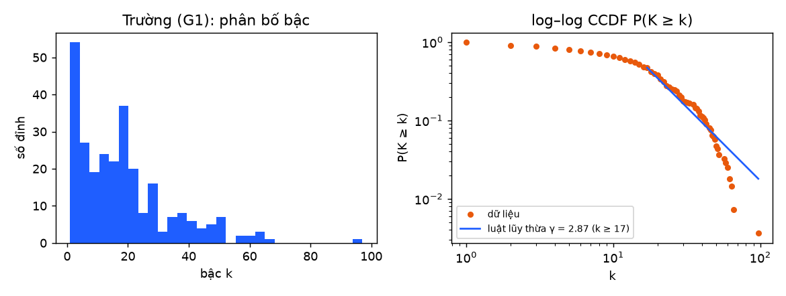

*Hình 3.2. Bậc trường trong G1 2026: histogram (trái) và CCDF log–log với đường khớp luật lũy thừa (phải). Nguồn: `data/network/fig/g1_uni_degree_2026.png` do `sna/build.py` vẽ.*

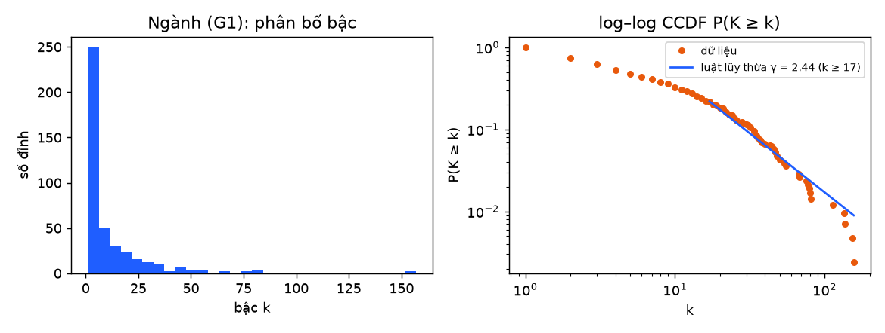

*Hình 3.3. Bậc ngành trong G1 2026 (số trường mở ngành). Nguồn: như Hình 3.2.*

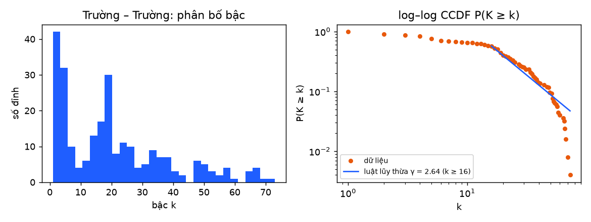

*Hình 3.4. Phân bố bậc G2 2026. Nguồn: `data/network/fig/g2_uni_uni_degree_2026.png`.*

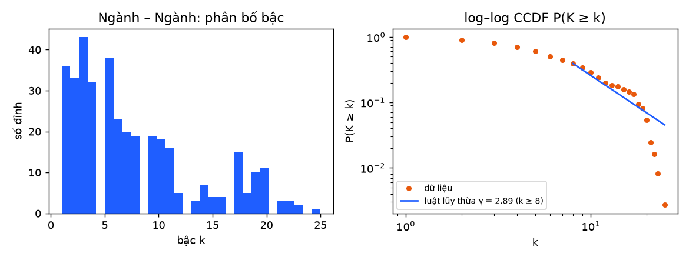

*Hình 3.5. Phân bố bậc G3 2026. Nguồn: `data/network/fig/g3_major_major_degree_2026.png`.*

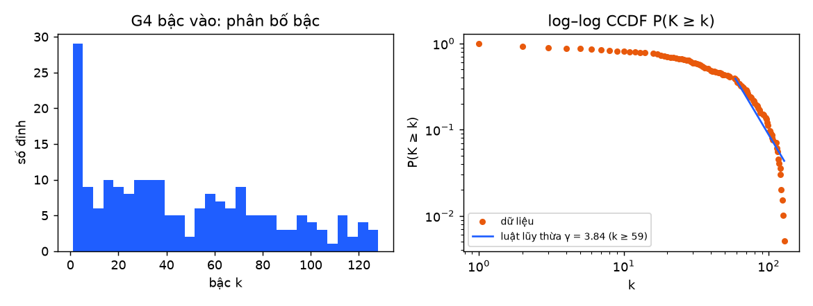

*Hình 3.6. Bậc vào G4 2026. Nguồn: `data/network/fig/g4_in_degree_2026.png`.*

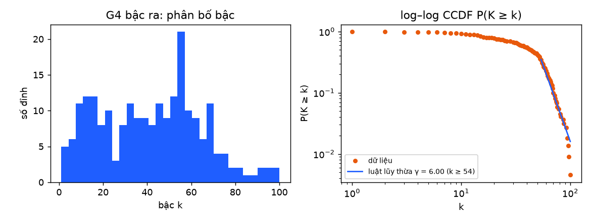

*Hình 3.7. Bậc ra G4 2026. Nguồn: `data/network/fig/g4_out_degree_2026.png`.*

**(5) Ý nghĩa.** Quản trị kinh doanh (157 trường) và Công nghệ thông tin (154 trường) có bậc G1 cao nhất: đây là các ngành “đại trà”. Bậc G3 cao lại thuộc khối sư phạm (Sư phạm Địa lý), tức ngành có nhiều ngành đồng hành trong cùng tập trường. Phân bố bậc có đuôi nặng: γ năm 2026 khoảng 2,4–2,9 ở G1, G2, G3 và 3,84 ở bậc vào G4, nhưng KS 0,09–0,13 và $k_{min}$ khá lớn (chỉ 20–40% số đỉnh ở đuôi). Vì vậy kết luận là **đuôi nặng, gần luật lũy thừa ở phần đuôi, không phải mạng scale-free thuần**; báo cáo không suy ra cơ chế gắn kết ưu tiên. Trong tư vấn, bậc là độ rộng lựa chọn, không phải chất lượng đào tạo.

### 3.2.2. Betweenness centrality

**(1) Định nghĩa.** Mức một đỉnh nằm trên các đường đi ngắn nhất giữa những đỉnh khác; đỉnh ít cạnh vẫn có thể cao nếu nối các khối xa nhau.

**(2) Công thức.** $C_B(v)=\dfrac{2}{(n-1)(n-2)}\sum_{s\ne v\ne t}\dfrac{\sigma_{st}(v)}{\sigma_{st}}$ (vô hướng; có hướng chia $(n-1)(n-2)$), với $\sigma_{st}$ là số đường ngắn nhất $s\to t$, $\sigma_{st}(v)$ số đường qua $v$.

**(3) Cách tính.** `nx.betweenness_centrality(normalized=True)` không trọng số (thuật toán Brandes, $O(nm)$); G1 dùng `bipartite.betweenness_centrality`.

**(4) Kết quả.**

**Bảng 3.7. Mười đỉnh betweenness cao nhất ở G2, G3, G4 năm 2026**

| Hạng | G2 | G3 | G4 |
| --- | --- | --- | --- |
| 1 | Trường Đại Học Võ Trường Toản (VTT) — 0,1004 | Sinh học (7420101) — 0,1624 | Đại Học Phenikaa (PKA) — 0,0593 |
| 2 | Trường Đại Học Hải Phòng (THP) — 0,0685 | Kỹ thuật vật liệu (7520309) — 0,0802 | Trường Đại Học Y Dược Thái Bình (YTB) — 0,0552 |
| 3 | Trường Đại Học Quốc Tế Hồng Bàng (HIU) — 0,0614 | Khoa học đất (7620103) — 0,0762 | Đại Học Cần Thơ (TCT) — 0,0286 |
| 4 | Trường Đại Học Hà Tĩnh (HHT) — 0,0551 | Địa lý học (7310501) — 0,0709 | Trường Đại Học Vinh (TDV) — 0,0271 |
| 5 | Trường Đại Học Kiến Trúc Đà Nẵng (KTD) — 0,0475 | Vật lý Y khoa (7520403) — 0,0702 | Trường Đại Học Đồng Tháp (SPD) — 0,0204 |
| 6 | Trường Đại Học Kiến Trúc Hà Nội (KTA) — 0,0438 | Kỹ thuật xây dựng (7580201) — 0,0684 | Đại Học Trà Vinh (DVT) — 0,0184 |
| 7 | Trường Đại học Nghệ An (CEA) — 0,0421 | Hán Nôm (7220104) — 0,0659 | Trường Đại Học Quy Nhơn (DQN) — 0,0174 |
| 8 | Trường Đại Học Luật TPHCM (LPS) — 0,0372 | Kỹ thuật công nghiệp (7520117) — 0,0643 | Trường Đại học Thủ Dầu Một (TDM) — 0,0166 |
| 9 | Học Viện Phụ Nữ Việt Nam (HPN) — 0,0369 | Ngôn ngữ Đức (7220205) — 0,0626 | Trường Đại học Y Dược Buôn Ma Thuột (BMU) — 0,0165 |
| 10 | Trường Đại Học Kiến Trúc TPHCM (KTS) — 0,0366 | Hải dương học (7440228) — 0,0623 | Trường Đại Học Công Nghiệp TPHCM (IUH) — 0,0163 |

**Bảng 3.8. Betweenness hai phía của G1 năm 2026**

| Hạng | G1 phía trường | G1 phía ngành |
| --- | --- | --- |
| 1 | Đại Học Cần Thơ (TCT) — 0,0454 | Công nghệ thông tin (7480201) — 0,0968 |
| 2 | Trường Đại Học Mỏ Địa Chất (MDA) — 0,0429 | Ngôn ngữ Anh (7220201) — 0,0784 |
| 3 | Trường Đại Học Văn Lang (DVL) — 0,0398 | Quản trị kinh doanh (7340101) — 0,0714 |
| 4 | Trường Đại Học Công nghệ Kỹ thuật TP HCM (SPK) — 0,0254 | Kế toán (7340301) — 0,0487 |
| 5 | Đại Học Trà Vinh (DVT) — 0,0247 | Tài chính - Ngân hàng (7340201) — 0,0307 |
| 6 | Trường Đại Học Khoa Học Xã Hội và Nhân Văn TPHCM (QSX) — 0,0230 | Luật (7380101) — 0,0253 |
| 7 | Trường Đại Học Nguyễn Tất Thành (NTT) — 0,0227 | Quản trị dịch vụ du lịch và lữ hành (7810103) — 0,0252 |
| 8 | Đại Học Phenikaa (PKA) — 0,0217 | Ngôn ngữ Trung Quốc (7220204) — 0,0231 |
| 9 | Trường Đại học Công Nghệ TPHCM (DKC) — 0,0214 | Điều dưỡng (7720301) — 0,0163 |
| 10 | Trường Đại Học Đông Á (DAD) — 0,0209 | Marketing (7340115) — 0,0159 |

*Nguồn: `data/network/metrics/<mạng>_2026.csv`, cột `betweenness`.*

**(5) Ý nghĩa.** Đại học Võ Trường Toản dẫn G2 dù không nằm trong top bậc; Sinh học dẫn G3 (0,1624), nối các khối khoa học tự nhiên, nông nghiệp và sư phạm. Ở G1, Công nghệ thông tin và Đại học Mỏ – Địa chất là cầu nối giữa khối ngành phổ thông và khối ngành đặc thù. Thứ hạng betweenness **nhạy với ngưỡng**: Sinh học đứng hạng 23 ở Jaccard 0,15 và hạng 76 ở 0,35 (mục 4.5), nên chỉ đọc như đặc điểm của cấu hình 0,25.

### 3.2.3. Closeness centrality

**(1) Định nghĩa.** Mức gần trung bình của một đỉnh tới các đỉnh nó đi tới được.

**(2) Công thức.** $C_C(v)=\dfrac{n_v-1}{n-1}\cdot\dfrac{n_v-1}{\sum_{u}d(v,u)}$ (hiệu chỉnh Wasserman–Faust khi đồ thị không liên thông, $n_v$ là số đỉnh tới được). G4 dùng khoảng cách **đi vào** đỉnh.

**(3) Cách tính.** `nx.closeness_centrality` cho G2–G4; `bipartite.closeness_centrality` cho G1.

**(4) Kết quả.**

**Bảng 3.9. Mười đỉnh closeness cao nhất năm 2026**

| Hạng | G2 | G3 | G4 (theo khoảng cách đi vào) |
| --- | --- | --- | --- |
| 1 | Trường Đại Học Ngoại Ngữ Tin Học TPHCM (DNT) — 0,4312 | Sinh học (7420101) — 0,2359 | Trường Đại Học Công Đoàn (LDA) — 0,6788 |
| 2 | Trường Đại Học Công Nghệ và Quản Lý Hữu Nghị (DCQ) — 0,4303 | Hải dương học (7440228) — 0,2242 | Trường Đại Học Thăng Long (DTL) — 0,6724 |
| 3 | Trường Đại học Hùng Vương TPHCM (DHV) — 0,4235 | Nông học (7620109) — 0,2196 | Trường Đại Học Quy Nhơn (DQN) — 0,6703 |
| 4 | Trường Đại Học Kinh Tế Kỹ Thuật Bình Dương (DKB) — 0,4235 | Lịch sử (7229010) — 0,2193 | Trường Đại Học Vinh (TDV) — 0,6682 |
| 5 | Trường Đại Học Bà Rịa – Vũng Tàu (BVU) — 0,4145 | Khoa học đất (7620103) — 0,2189 | Trường Đại Học Hải Phòng (THP) — 0,6682 |
| 6 | Trường Đại Học Kinh Tế Công Nghiệp Long An (DLA) — 0,4129 | Toán tin (7460117) — 0,2177 | Học Viện Nông Nghiệp Việt Nam (HVN) — 0,6599 |
| 7 | Trường Đại Học Lạc Hồng (DLH) — 0,4082 | Địa lý học (7310501) — 0,2149 | Trường Đại Học Đồng Tháp (SPD) — 0,6599 |
| 8 | Trường Đại học Sao Đỏ (SDU) — 0,4082 | Kỹ thuật trắc địa - bản đồ (7520503) — 0,2108 | Trường Đại học Thủ Dầu Một (TDM) — 0,6579 |
| 9 | Trường Đại Học Trưng Vương (DVP) — 0,4074 | Hóa dược (7720203) — 0,2107 | Trường Đại Học Công Nghiệp TPHCM (IUH) — 0,6559 |
| 10 | Trường Đại Học Đại Nam (DDN) — 0,4036 | Khí tượng và khí hậu học (7440222) — 0,2092 | Đại Học Cần Thơ (TCT) — 0,6519 |

*Nguồn: `data/network/metrics/<mạng>_2026.csv`, cột `closeness`.*

**(5) Ý nghĩa.** G2 và G4 có closeness cao ở các trường đa ngành phía Nam (G2) và trường điểm trung bình được nhiều trường khác “nhắm lên” (G4: Công Đoàn, Thăng Long). G3 có closeness thấp hơn hẳn (≈ 0,21–0,24) vì đường đi trung bình 5,67 bước. Với G1, hàm hai phía của NetworkX chuẩn hoá theo phía đối diện nên ở thành phần nhỏ giá trị có thể vượt 1: 24 đỉnh G1 2026 có closeness > 1 (lớn nhất 1,6035), thuộc thành phần nhỏ: Biên phòng, CCE, Chỉ huy - Tham mưu Thông tin, Chỉ huy - Tham mưu đặc công, Chỉ huy Kỹ thuật hóa học, Chỉ huy Tham mưu Lục quân. Vì vậy báo cáo không xếp hạng closeness G1 toàn cục.

### 3.2.4. Eigenvector centrality

**(1) Định nghĩa.** Một đỉnh quan trọng khi nối với những đỉnh quan trọng.

**(2) Công thức.** $\lambda x_v=\sum_u w_{vu}x_u$, $x$ là vector riêng ứng với trị riêng lớn nhất của ma trận kề có trọng số; bản không trọng số dùng $w_{vu}\in\{0,1\}$.

**(3) Cách tính.** `nx.eigenvector_centrality_numpy` trên thành phần liên thông lớn nhất (G4: thành phần liên thông mạnh lớn nhất); đỉnh ngoài nhận 0. Tính cả bản có trọng số (`eigenvector`) và không trọng số (`eigenvector_unw`).

**(4) Kết quả.**

**Bảng 3.10. Mười đỉnh eigenvector cao nhất G2, G3 năm 2026, có và không trọng số**

| Hạng | G2 có trọng số | G2 không trọng số | G3 có trọng số | G3 không trọng số |
| --- | --- | --- | --- | --- |
| 1 | Trường Đại Học Ngoại Ngữ Tin Học TPHCM (DNT) — 0,2029 | Trường Đại Học Ngoại Ngữ Tin Học TPHCM (DNT) — 0,1789 | Quản lý và phân tích dữ liệu khoa học (7440229) — 0,2965 | Sư phạm Địa lý (7140219) — 0,2481 |
| 2 | Trường Đại Học Ngân Hàng TPHCM (NHS) — 0,1901 | Trường Đại Học Ngân Hàng TPHCM (NHS) — 0,1674 | Địa tin học (7480206) — 0,2965 | Sư phạm Lịch sử - Địa lý (7140249) — 0,2353 |
| 3 | Trường Đại Học Gia Định (GDU) — 0,1766 | Trường Đại Học Bà Rịa – Vũng Tàu (BVU) — 0,1662 | Kỹ thuật địa vật lý (7520502) — 0,2965 | Giáo dục Chính trị (7140205) — 0,2350 |
| 4 | Trường Đại Học Bà Rịa – Vũng Tàu (BVU) — 0,1761 | Trường Đại Học Kinh Tế Kỹ Thuật Bình Dương (DKB) — 0,1658 | Đá quý Đá mỹ nghệ (7520505) — 0,2965 | Sư phạm Tin học (7140210) — 0,2346 |
| 5 | Trường Đại Học Đại Nam (DDN) — 0,1753 | Trường Đại học Hùng Vương TPHCM (DHV) — 0,1658 | Kỹ thuật khí thiên nhiên (7520605) — 0,2965 | Sư phạm Lịch sử (7140218) — 0,2333 |
| 6 | Trường Đại học Hùng Vương TPHCM (DHV) — 0,1750 | Trường Đại Học Đại Nam (DDN) — 0,1655 | Công nghệ số trong thăm dò và khai thác tài nguyên thiên nhiên (7520606) — 0,2965 | Sư phạm Ngữ văn (7140217) — 0,2329 |
| 7 | Trường Đại Học Kinh Tế Kỹ Thuật Bình Dương (DKB) — 0,1737 | Trường Đại Học Công Nghệ và Quản Lý Hữu Nghị (DCQ) — 0,1642 | Xây dựng công trình ngầm thành phố và Hệ thống tàu điện ngầm (7580204) — 0,2965 | Sư phạm Toán học (7140209) — 0,2310 |
| 8 | Trường Đại Học Công Nghệ và Quản Lý Hữu Nghị (DCQ) — 0,1664 | Trường Đại Học Lạc Hồng (DLH) — 0,1619 | Du lịch địa chất (7810105) — 0,2965 | Sư phạm Vật lý (7140211) — 0,2310 |
| 9 | Đại học Kinh Tế TPHCM - Phân hiệu Vĩnh Long (KSV) — 0,1660 | Trường Đại Học Gia Định (GDU) — 0,1601 | Quản lý tài nguyên khoáng sản (7850196) — 0,2965 | Sư phạm Hóa học (7140212) — 0,2310 |
| 10 | Trường Đại Học Lạc Hồng (DLH) — 0,1632 | Đại học Kinh Tế TPHCM - Phân hiệu Vĩnh Long (KSV) — 0,1597 | An toàn, Vệ sinh lao động (7850202) — 0,2965 | Sư phạm Sinh học (7140213) — 0,2310 |

**Bảng 3.11. Mức tập trung của eigenvector năm 2026**

| Mạng 2026 | Bản | Đỉnh > 0,001 | Đỉnh > 0,05 | Lớn nhất |
| --- | --- | --- | --- | --- |
| G1 Trường–Ngành | có trọng số | 456/697 | 60/697 | 0,3701 |
| G1 Trường–Ngành | không trọng số | 594/697 | 105/697 | 0,2111 |
| G2 Trường–Trường | có trọng số | 174/250 | 68/250 | 0,2029 |
| G2 Trường–Trường | không trọng số | 179/250 | 75/250 | 0,1789 |
| G3 Ngành–Ngành | có trọng số | 34/370 | 18/370 | 0,2965 |
| G3 Ngành–Ngành | không trọng số | 52/370 | 23/370 | 0,2481 |
| G4 Cạnh tranh | có trọng số | 173/226 | 65/226 | 0,3327 |

*Nguồn: `data/network/metrics/<mạng>_2026.csv`, cột `eigenvector`, `eigenvector_unw`.*

**(5) Ý nghĩa.** Eigenvector dồn vào khối dày đặc nhất (*localization*) do mạng gồm nhiều khối tách biệt. Ở G3 có trọng số, chỉ 34/370 ngành có giá trị > 0,001; mười ngành đầu cùng giá trị 0,2965 vì là khối ngành địa chất – mỏ chỉ do một trường mở, mọi cặp có Jaccard = 1. Bỏ trọng số, khối sư phạm (52/370 ngành > 0,001) thay chỗ. G2 ít bị ảnh hưởng hơn (174/250 đỉnh > 0,001) và cả hai bản cùng chỉ ra lõi trường tư đa ngành phía Nam. Do đó **xếp hạng toàn cục nên xem PageRank/degree**; eigenvector chỉ dùng để chỉ ra “lõi dày đặc nhất”. Web ghi chú điều này ngay dưới bảng eigenvector.

### 3.2.5. PageRank

**(1) Định nghĩa.** Xác suất dừng của bước ngẫu nhiên đi theo cạnh có trọng số, có xác suất nhảy ngẫu nhiên.

**(2) Công thức.** $PR(v)=\dfrac{1-\alpha}{n}+\alpha\sum_{u\to v}PR(u)\dfrac{w_{uv}}{s_u^{out}}$, $\alpha=0{,}85$, $s_u^{out}$ là tổng trọng số cạnh ra.

**(3) Cách tính.** `nx.pagerank(weight="weight")` cho cả bốn mạng (vô hướng coi mỗi cạnh là hai chiều).

**(4) Kết quả.**

**Bảng 3.12. Mười đỉnh PageRank cao nhất năm 2026**

| Hạng | G1 (cả hai phía) | G2 | G3 | G4 |
| --- | --- | --- | --- | --- |
| 1 | Quản trị kinh doanh (7340101) — 0,0183 | Trường Đại Học Ngoại Ngữ Tin Học TPHCM (DNT) — 0,0103 | Tài chính - Ngân hàng (7340201) — 0,0055 | Đại Học Cần Thơ (TCT) — 0,0243 |
| 2 | Trường Đại Học Tôn Đức Thắng (DTT) — 0,0152 | Đại học Kinh Tế TPHCM - Phân hiệu Vĩnh Long (KSV) — 0,0096 | Logistics và quản lý chuỗi cung ứng (7510605) — 0,0053 | Đại Học Kinh Tế Quốc Dân (KHA) — 0,0212 |
| 3 | Công nghệ thông tin (7480201) — 0,0140 | Trường Đại Học Ngân Hàng TPHCM (NHS) — 0,0095 | Toán kinh tế (7310108) — 0,0052 | Trường Đại Học Nha Trang (TSN) — 0,0165 |
| 4 | Kế toán (7340301) — 0,0123 | Trường Đại Học Công Nghệ và Quản Lý Hữu Nghị (DCQ) — 0,0090 | Sư phạm Địa lý (7140219) — 0,0051 | Trường Đại Học Mở TPHCM (MBS) — 0,0160 |
| 5 | Trường Đại Học Đông Á (DAD) — 0,0116 | Trường Đại Học Kinh Tế Kỹ Thuật Bình Dương (DKB) — 0,0090 | Kế toán (7340301) — 0,0051 | Trường Đại Học Sài Gòn (SGD) — 0,0158 |
| 6 | Tài chính - Ngân hàng (7340201) — 0,0116 | Trường Đại học Hùng Vương TPHCM (DHV) — 0,0089 | Tôn giáo học (7229009) — 0,0049 | Trường Đại Học Sư Phạm Hà Nội (SPH) — 0,0155 |
| 7 | Đại Học Kinh Tế Quốc Dân (KHA) — 0,0109 | Trường Đại Học Lạc Hồng (DLH) — 0,0088 | Nhân học (7310302) — 0,0049 | Đại Học Phenikaa (PKA) — 0,0139 |
| 8 | Ngôn ngữ Anh (7220201) — 0,0107 | Trường Đại Học Bà Rịa – Vũng Tàu (BVU) — 0,0087 | Ngôn ngữ Anh (7220201) — 0,0048 | Đại Học Bách Khoa Hà Nội (BKA) — 0,0137 |
| 9 | Marketing (7340115) — 0,0084 | Trường Đại Học Đại Nam (DDN) — 0,0086 | Quản trị kinh doanh (7340101) — 0,0048 | Trường Đại Học Giao Thông Vận Tải (GHA) — 0,0137 |
| 10 | Luật (7380101) — 0,0078 | Học Viện Ngân Hàng (NHH) — 0,0085 | Hán Nôm (7220104) — 0,0048 | Trường Đại học Thủ Đô Hà Nội (HNM) — 0,0133 |

*Nguồn: `data/network/metrics/<mạng>_2026.csv`, cột `pagerank`.*

**(5) Ý nghĩa.** Ở G1, PageRank xen kẽ ngành đại trà và trường nhiều dòng điểm (Tôn Đức Thắng, Đông Á) vì trọng số là số dòng. Ở G4, PageRank xếp đầu Cần Thơ, Kinh tế Quốc dân, Nha Trang, Bách khoa Hà Nội…, tương quan hạng dương với điểm THPT trung bình ở cả ba năm (ρ = 0,5670; 0,5421; 0,6075). PageRank G4 đo vị trí “được hướng tới qua nhiều bước” trong mô hình, không phải xếp hạng học thuật.

### 3.2.6. HITS: hub và authority

**(1) Định nghĩa.** Authority cao khi được nhiều hub tốt trỏ tới; hub cao khi trỏ tới nhiều authority tốt.

**(2) Công thức.** $a_v=\sum_{u\to v}w_{uv}h_u$, $h_v=\sum_{v\to u}w_{vu}a_u$, lặp và chuẩn hoá đến hội tụ (vector riêng chính của $A^TA$ và $AA^T$).

**(3) Cách tính.** `nx.hits(max_iter=1000, normalized=True)` trên G4; trên G1 (vô hướng) chạy trên thành phần lớn nhất, khi đó hub = authority.

**(4) Kết quả.**

**Bảng 3.13. Mười trường authority/hub cao nhất G4 và authority G1 năm 2026**

| Hạng | G4 authority | G4 hub | G1 authority (= hub, vô hướng) |
| --- | --- | --- | --- |
| 1 | Trường Đại Học Kiến Trúc Đà Nẵng (KTD) — 0,0336 | Trường Đại Học Vinh (TDV) — 0,0141 | Quản trị kinh doanh (7340101) — 0,0355 |
| 2 | Trường Đại Học Công Đoàn (LDA) — 0,0252 | Trường Đại học Công Nghệ TPHCM (DKC) — 0,0140 | Trường Đại Học Tôn Đức Thắng (DTT) — 0,0285 |
| 3 | Trường Đại Học Sư Phạm Kỹ Thuật Hưng Yên (SKH) — 0,0236 | Trường Đại Học Đồng Tháp (SPD) — 0,0140 | Đại Học Kinh Tế Quốc Dân (KHA) — 0,0238 |
| 4 | Trường Đại Học Công Nghiệp Việt - Hung (VHD) — 0,0227 | Trường Đại Học Nguyễn Tất Thành (NTT) — 0,0138 | Tài chính - Ngân hàng (7340201) — 0,0226 |
| 5 | Trường Đại học Nghệ An (CEA) — 0,0209 | Trường Đại Học Đông Á (DAD) — 0,0136 | Kế toán (7340301) — 0,0195 |
| 6 | Trường Đại Học Hồng Đức (HDT) — 0,0199 | Trường Đại học Nam Cần Thơ (DNC) — 0,0132 | Marketing (7340115) — 0,0191 |
| 7 | Trường Đại Học Vinh (TDV) — 0,0192 | Đại Học Duy Tân (DDT) — 0,0132 | Trường Đại Học Thương Mại (TMU) — 0,0149 |
| 8 | Trường Đại Học Nông Lâm Thái Nguyên (DTN) — 0,0188 | Trường Đại Học Quy Nhơn (DQN) — 0,0131 | Công nghệ thông tin (7480201) — 0,0140 |
| 9 | Đại Học Cần Thơ (TCT) — 0,0180 | Trường Đại Học Văn Lang (DVL) — 0,0128 | Trường Đại Học Đông Á (DAD) — 0,0128 |
| 10 | Trường Đại Học Quy Nhơn (DQN) — 0,0179 | Trường Đại Học Văn Hiến (DVH) — 0,0124 | Ngôn ngữ Anh (7220201) — 0,0126 |

*Nguồn: `data/network/metrics/g4_competition_2026.csv`, `g1_uni_major_2026.csv`.*

**(5) Ý nghĩa.** Authority G4 cao = trường được nhiều trường khác “nhắm lên” trong vùng điểm gần nhau. HITS tập trung vào lõi cạnh tranh dày nhất nên authority tương quan hạng với điểm trung bình đổi dấu qua năm (−0,4013 năm 2024, 0,2349 năm 2026; mục 4.3). Tên gọi “authority” vì vậy không thể hiểu là uy tín học thuật.

### 3.2.7. Density

**(1) Định nghĩa.** Tỉ lệ cạnh có trên số cạnh tối đa.

**(2) Công thức.** Vô hướng $D=\dfrac{2m}{n(n-1)}$; có hướng $D=\dfrac{m}{n(n-1)}$; hai phía $D_B=\dfrac{m}{|U|\,|M|}$. Bậc trung bình $\langle k\rangle=2m/n$ (có hướng $m/n$).

**(3) Cách tính.** `nx.density`, `bipartite.density`.

**(4) Kết quả.**

**Bảng 3.14. Mật độ và bậc trung bình qua ba năm**

| Mạng / chỉ tiêu | 2024 | 2025 | 2026 |
| --- | --- | --- | --- |
| G1: Mật độ | 0,0187 | 0,0192 | 0,0208 |
| G1: Bậc trung bình | 12,8563 | 13,3773 | 14,4792 |
| G2: Mật độ | 0,0836 | 0,0790 | 0,0816 |
| G2: Bậc trung bình | 20,7309 | 19,7450 | 20,3200 |
| G3: Mật độ | 0,0189 | 0,0201 | 0,0204 |
| G3: Bậc trung bình | 7,0374 | 7,4447 | 7,5189 |
| G4: Mật độ | 0,1578 | 0,1602 | 0,1812 |
| G4: Bậc trung bình | 40,7027 | 41,4923 | 40,7743 |
| G1: Mật độ hai phía | 0,0389 | 0,0400 | 0,0434 |

*Nguồn: `data/network/summary.csv`.*

**(5) Ý nghĩa.** Cả bốn mạng đều thưa (G1 hai phía 0,04; G3 0,02). G4 dày nhất (0,18) vì một cặp trường chỉ cần một ngành có điểm cách nhau ≤ 2 là có cạnh. Mật độ G1 hai phía tăng 0,0389 → 0,0434: các trường hiện diện mở nhiều ngành hơn (18,28 ngành/trường năm 2026).

### 3.2.8. Average shortest path length

**(1) Định nghĩa.** Số bước trung bình giữa hai đỉnh tới được nhau.

**(2) Công thức.** $L=\dfrac{1}{n_c(n_c-1)}\sum_{u\ne v}d(u,v)$ trên thành phần lớn nhất (LCC) có $n_c$ đỉnh.

**(3) Cách tính.** `nx.average_shortest_path_length` trên LCC; G4 tính hai cách: theo hướng trên SCC lớn nhất và bỏ hướng trên thành phần yếu lớn nhất.

**(4) Kết quả.** Năm 2026 (ba năm ở Bảng 3.15):

| Mạng 2026 | Miền tính | Số đỉnh | Đường đi trung bình |
| --- | --- | ---: | ---: |
| G1 | LCC | 669 | 3,2793 |
| G2 | LCC | 232 | 3,2444 |
| G3 | LCC | 357 | 5,6705 |
| G4 | SCC lớn nhất, theo hướng | 192 | 1,9803 |
| G4 | Thành phần yếu lớn nhất, bỏ hướng | 224 | 1,7399 |

*Nguồn: `data/network/summary.csv`.*

**(5) Ý nghĩa.** G1 có $L$ = 3,28 bước (trường → ngành → trường → ngành); G2 3,24; G4 chỉ 1,98 theo hướng. G3 dài nhất (5,67) vì các khối ngành nối với nhau qua ít cầu nối.

### 3.2.9. Diameter

**(1) Định nghĩa.** Khoảng cách ngắn nhất lớn nhất giữa hai đỉnh của thành phần.

**(2) Công thức.** $\operatorname{diam}=\max_{u,v\in LCC}d(u,v)$.

**(3) Cách tính.** `nx.diameter` trên LCC; G4 thêm đường kính có hướng trên SCC lớn nhất.

**(4) Kết quả.**

**Bảng 3.15. Thành phần lớn nhất, đường đi trung bình và đường kính qua ba năm**

| Mạng / chỉ tiêu | 2024 | 2025 | 2026 |
| --- | --- | --- | --- |
| G1: Số đỉnh thành phần lớn nhất (LCC) | 663 | 672 | 669 |
| G1: Đường đi ngắn nhất TB (LCC) | 3,3014 | 3,3171 | 3,2793 |
| G1: Đường kính (LCC) | 8 | 8 | 7 |
| G2: Số đỉnh thành phần lớn nhất (LCC) | 219 | 235 | 232 |
| G2: Đường đi ngắn nhất TB (LCC) | 2,7499 | 3,4301 | 3,2444 |
| G2: Đường kính (LCC) | 8 | 13 | 12 |
| G3: Số đỉnh thành phần lớn nhất (LCC) | 345 | 350 | 357 |
| G3: Đường đi ngắn nhất TB (LCC) | 5,6952 | 5,6750 | 5,6705 |
| G3: Đường kính (LCC) | 17 | 14 | 14 |
| G4: Số đỉnh thành phần lớn nhất (LCC) | 257 | 256 | 224 |
| G4: Đường đi ngắn nhất TB (LCC) | 1,8558 | 1,7984 | 1,7399 |
| G4: Đường kính (LCC) | 4 | 4 | 4 |
| G4: Số đỉnh SCC lớn nhất | 243 | 248 | 192 |
| G4: Đường đi TB có hướng (SCC) | 2,1242 | 2,0691 | 1,9803 |
| G4: Đường kính có hướng (SCC) | 6 | 5 | 4 |

*Nguồn: `data/network/summary.csv`.*

**(5) Ý nghĩa.** G2 và G3 có đường kính 12–14 bước dù đường đi trung bình chỉ 3,2–5,7: một chuỗi dài các trường/ngành ở rìa nối vào lõi. G4 có SCC lớn nhất 192/226 trường, đường kính có hướng 4: hầu hết trường trong lõi cạnh tranh tới được nhau trong ≤ 4 bước “nhắm lên”.

### 3.2.10. Clustering coefficient và Transitivity

**(1) Định nghĩa.** Mức các láng giềng của một đỉnh cũng nối với nhau (cục bộ), và tỉ lệ bộ ba khép kín (toàn cục).

**(2) Công thức.** $C_v=\dfrac{2T_v}{k_v(k_v-1)}$, $\bar C=\frac1n\sum_vC_v$; transitivity $T=\dfrac{3\times\text{số tam giác}}{\text{số bộ ba nối}}$. G1 hai phía không có tam giác nên dùng clustering Latapy: $C_{uv}=\dfrac{|N(u)\cap N(v)|}{|N(u)\cup N(v)|}$, $C_u$ là trung bình trên các $v$ cách $u$ hai bước. G4 dùng clustering có hướng (Fagiolo).

**(3) Cách tính.** `nx.clustering`, `nx.average_clustering`, `nx.transitivity`; `bipartite.clustering(mode="dot")` cho G1.

**(4) Kết quả.**

**Bảng 3.16. Hệ số phân cụm và transitivity qua ba năm**

| Mạng / chỉ tiêu | 2024 | 2025 | 2026 |
| --- | --- | --- | --- |
| G1: Hệ số phân cụm TB | 0,1291 | 0,1279 | 0,1227 |
| G1: Transitivity | 0 | 0 | 0 |
| G2: Hệ số phân cụm TB | 0,5582 | 0,5493 | 0,5485 |
| G2: Transitivity | 0,5304 | 0,5493 | 0,5436 |
| G3: Hệ số phân cụm TB | 0,5149 | 0,5611 | 0,5122 |
| G3: Transitivity | 0,6454 | 0,6690 | 0,6679 |
| G4: Hệ số phân cụm TB | 0,4700 | 0,4521 | 0,4637 |
| G4: Transitivity | 0,5845 | 0,5684 | 0,5444 |

*Nguồn: `data/network/summary.csv`. Transitivity G1 = 0 theo định nghĩa đồ thị hai phía.*

**(5) Ý nghĩa.** G2 có $\bar C$ ≈ 0,55 so với mật độ 0,08 (gấp gần 7 lần), cùng đường đi ngắn: **dấu hiệu thế giới nhỏ** (chưa kiểm định với mô hình null). G3 có transitivity 0,67: ngành mở cùng nhau thành khối khép kín. Clustering Latapy G1 0,12 nghĩa là hai trường chung một ngành thường chỉ trùng ~12% tập ngành.

### 3.2.11. Modularity

**(1) Định nghĩa.** Mức một phân hoạch có nhiều cạnh trong nhóm hơn kỳ vọng ngẫu nhiên cùng bậc.

**(2) Công thức.** $Q=\dfrac{1}{2m}\sum_{ij}\Big[A_{ij}-\dfrac{k_ik_j}{2m}\Big]\delta(c_i,c_j)$; bản có trọng số thay $A_{ij}$, $k_i$, $m$ bằng trọng số tương ứng.

**(3) Cách tính.** `community.louvain_communities(weight="weight", seed=42)` và `community.modularity` cho cả bốn mạng (G4 dùng bản có hướng của NetworkX).

**(4) Kết quả.**

**Bảng 3.17. Số cộng đồng Louvain và modularity qua ba năm**

| Mạng / chỉ tiêu | 2024 | 2025 | 2026 |
| --- | --- | --- | --- |
| G1: Số cộng đồng Louvain | 21 | 20 | 21 |
| G1: Modularity Q (Louvain) | 0,4079 | 0,3929 | 0,3619 |
| G2: Số cộng đồng Louvain | 18 | 16 | 19 |
| G2: Modularity Q (Louvain) | 0,4489 | 0,4939 | 0,4845 |
| G3: Số cộng đồng Louvain | 27 | 23 | 20 |
| G3: Modularity Q (Louvain) | 0,8358 | 0,8443 | 0,8363 |
| G4: Số cộng đồng Louvain | 6 | 6 | 5 |
| G4: Modularity Q (Louvain) | 0,3685 | 0,3642 | 0,3184 |

*Nguồn: `data/network/summary.csv`.*

**(5) Ý nghĩa.** G3 có Q ≈ 0,84: cấu trúc cộng đồng rất rõ (ngưỡng thường dùng Q > 0,3). G2 ≈ 0,48 và G1 ≈ 0,36: cộng đồng rõ vừa phải; G4 0,32 với 5 cụm là các dải điểm. Danh sách cộng đồng và so sánh với Girvan–Newman ở mục 4.1–4.2.

### 3.2.12. Các độ đo bổ sung: components, LCC, assortativity, reciprocity

**(1) Định nghĩa.** Số thành phần liên thông (G4: yếu/mạnh), kích thước thành phần lớn nhất, assortativity theo bậc (đỉnh bậc cao có nối đỉnh bậc cao không), reciprocity (tỉ lệ cạnh có chiều ngược).

**(2) Công thức.** $r=\dfrac{\sum_{(u,v)\in E}(k_u-\bar k)(k_v-\bar k)}{\sum_{(u,v)\in E}(k_u-\bar k)^2}$ (hệ số Pearson giữa bậc hai đầu cạnh; G4 dùng bậc vào – bậc vào); $\rho=\dfrac{|\{(u,v)\in E:(v,u)\in E\}|}{m}$.

**(3) Cách tính.** `nx.number_connected_components`, `number_weakly/strongly_connected_components`, `degree_assortativity_coefficient`, `nx.reciprocity`.

**(4) Kết quả.**

**Bảng 3.18. Liên thông, assortativity và reciprocity qua ba năm**

| Mạng / chỉ tiêu | 2024 | 2025 | 2026 |
| --- | --- | --- | --- |
| G1: Số thành phần liên thông | 13 | 12 | 14 |
| G1: Assortativity theo bậc | −0,1478 | −0,1312 | −0,1241 |
| G2: Số thành phần liên thông | 11 | 7 | 8 |
| G2: Assortativity theo bậc | 0,3720 | 0,4271 | 0,3934 |
| G3: Số thành phần liên thông | 13 | 10 | 7 |
| G3: Assortativity theo bậc | 0,6165 | 0,6005 | 0,6562 |
| G4: Thành phần liên thông yếu | 2 | 3 | 2 |
| G4: Thành phần liên thông mạnh | 17 | 13 | 35 |
| G4: Reciprocity | 0,3415 | 0,3454 | 0,3377 |
| G4: Assortativity theo bậc | −0,0717 | −0,0187 | −0,1348 |

*Nguồn: `data/network/summary.csv`.*

**(5) Ý nghĩa.** G2, G3 assortative mạnh (0,39; 0,66): trường đa ngành giống trường đa ngành, ngành phổ biến đi với ngành phổ biến. G1 disassortative (−0,12): trường mở nhiều ngành chủ yếu nối các ngành hiếm hơn và ngược lại. G4 có reciprocity 0,34: một phần ba quan hệ “nhắm lên” là hai chiều (điểm đảo thứ tự giữa các ngành); số SCC tăng 17 → 35 năm 2026 do bớt trường có điểm THPT thang 30.

## 3.3. Bảng tổng hợp toàn bộ chỉ tiêu đã xuất

Các bảng sau chép đủ mọi cột của `summary.csv` cho từng mạng và ba năm (tên tiếng Việt kèm tên cột gốc). Ô “—” là chỉ tiêu không áp dụng cho mạng đó. `compute_seconds`, `gn_seconds` là thời gian của lượt chạy đã lưu, phụ thuộc máy.

**Bảng 3.19. Toàn bộ chỉ tiêu G1**

| Chỉ tiêu (cột) | 2024 | 2025 | 2026 |
| --- | --- | --- | --- |
| Số đỉnh (`nodes`) | 689 | 697 | 697 |
| Số trường (`universities`) | 276 | 278 | 276 |
| Số ngành (`majors`) | 413 | 419 | 421 |
| Số cạnh (`edges`) | 4.429 | 4.662 | 5.046 |
| Mật độ hai phía (`bipartite_density`) | 0,0389 | 0,0400 | 0,0434 |
| Mật độ (`density`) | 0,0187 | 0,0192 | 0,0208 |
| Bậc trung bình (`avg_degree`) | 12,8563 | 13,3773 | 14,4792 |
| Số ngành TB / trường (`avg_majors_per_uni`) | 16,0471 | 16,7698 | 18,2826 |
| Số trường TB / ngành (`avg_unis_per_major`) | 10,7240 | 11,1265 | 11,9857 |
| Số thành phần liên thông (`components`) | 13 | 12 | 14 |
| Số đỉnh thành phần lớn nhất (LCC) (`lcc_nodes`) | 663 | 672 | 669 |
| Hệ số phân cụm TB (`avg_clustering`) | 0,1291 | 0,1279 | 0,1227 |
| Transitivity (`transitivity`) | 0 | 0 | 0 |
| Đường đi ngắn nhất TB (LCC) (`avg_path_length_lcc`) | 3,3014 | 3,3171 | 3,2793 |
| Đường kính (LCC) (`diameter_lcc`) | 8 | 8 | 7 |
| Assortativity theo bậc (`assortativity`) | −0,1478 | −0,1312 | −0,1241 |
| Số cộng đồng Louvain (`louvain_communities`) | 21 | 20 | 21 |
| Modularity Q (Louvain) (`modularity_louvain`) | 0,4079 | 0,3929 | 0,3619 |
| Power-law γ (bậc trường) (`uni_powerlaw_gamma`) | 2,9250 | 2,6632 | 2,8732 |
| Power-law k_min (bậc trường) (`uni_powerlaw_kmin`) | 17 | 14 | 17 |
| Power-law số đỉnh ở đuôi (bậc trường) (`uni_powerlaw_tail_nodes`) | 103 | 140 | 130 |
| Power-law KS (bậc trường) (`uni_powerlaw_ks`) | 0,1006 | 0,1008 | 0,0883 |
| Power-law γ (bậc ngành) (`major_powerlaw_gamma`) | 2,4595 | 2,3878 | 2,4384 |
| Power-law k_min (bậc ngành) (`major_powerlaw_kmin`) | 16 | 14 | 17 |
| Power-law số đỉnh ở đuôi (bậc ngành) (`major_powerlaw_tail_nodes`) | 85 | 105 | 92 |
| Power-law KS (bậc ngành) (`major_powerlaw_ks`) | 0,0856 | 0,0948 | 0,0976 |
| Thời gian tính độ đo (giây) (`compute_seconds`) | 5,3110 | 6,1401 | 5,7719 |

**Bảng 3.20. Toàn bộ chỉ tiêu G2**

| Chỉ tiêu (cột) | 2024 | 2025 | 2026 |
| --- | --- | --- | --- |
| Số đỉnh (`nodes`) | 249 | 251 | 250 |
| Số cạnh (`edges`) | 2.581 | 2.478 | 2.540 |
| Mật độ (`density`) | 0,0836 | 0,0790 | 0,0816 |
| Bậc trung bình (`avg_degree`) | 20,7309 | 19,7450 | 20,3200 |
| Số thành phần liên thông (`components`) | 11 | 7 | 8 |
| Số đỉnh thành phần lớn nhất (LCC) (`lcc_nodes`) | 219 | 235 | 232 |
| Hệ số phân cụm TB (`avg_clustering`) | 0,5582 | 0,5493 | 0,5485 |
| Transitivity (`transitivity`) | 0,5304 | 0,5493 | 0,5436 |
| Đường đi ngắn nhất TB (LCC) (`avg_path_length_lcc`) | 2,7499 | 3,4301 | 3,2444 |
| Đường kính (LCC) (`diameter_lcc`) | 8 | 13 | 12 |
| Assortativity theo bậc (`assortativity`) | 0,3720 | 0,4271 | 0,3934 |
| Số cộng đồng Louvain (`louvain_communities`) | 18 | 16 | 19 |
| Modularity Q (Louvain) (`modularity_louvain`) | 0,4489 | 0,4939 | 0,4845 |
| Thời gian tính độ đo (giây) (`compute_seconds`) | 60,1818 | 40,6768 | 51,8732 |
| GN: số đỉnh xét (`gn_nodes`) | 249 | 251 | 250 |
| GN: Q tốt nhất (`gn_best_modularity`) | 0,2659 | 0,3480 | 0,3239 |
| GN: số cộng đồng tại Q tốt nhất (`gn_best_k`) | 36 | 25 | 32 |
| GN: k tối đa đã xét (`gn_max_k_checked`) | 40 | 40 | 40 |
| GN: thời gian (giây) (`gn_seconds`) | 59,4702 | 39,9793 | 51,2114 |
| Louvain không trọng số: Q (`louvain_unweighted_modularity`) | 0,4019 | 0,4421 | 0,4347 |
| Louvain không trọng số: số cộng đồng (`louvain_unweighted_communities`) | 18 | 16 | 16 |
| Power-law γ (`powerlaw_gamma`) | 4,5467 | 2,5747 | 2,6435 |
| Power-law k_min (`powerlaw_kmin`) | 38 | 16 | 16 |
| Power-law số đỉnh ở đuôi (`powerlaw_tail_nodes`) | 50 | 134 | 143 |
| Power-law KS (`powerlaw_ks`) | 0,1137 | 0,1108 | 0,0938 |
| Ngưỡng Jaccard (`jaccard_threshold`) | 0,2500 | 0,2500 | 0,2500 |

**Bảng 3.21. Toàn bộ chỉ tiêu G3**

| Chỉ tiêu (cột) | 2024 | 2025 | 2026 |
| --- | --- | --- | --- |
| Số đỉnh (`nodes`) | 374 | 371 | 370 |
| Số cạnh (`edges`) | 1.316 | 1.381 | 1.391 |
| Mật độ (`density`) | 0,0189 | 0,0201 | 0,0204 |
| Bậc trung bình (`avg_degree`) | 7,0374 | 7,4447 | 7,5189 |
| Số thành phần liên thông (`components`) | 13 | 10 | 7 |
| Số đỉnh thành phần lớn nhất (LCC) (`lcc_nodes`) | 345 | 350 | 357 |
| Hệ số phân cụm TB (`avg_clustering`) | 0,5149 | 0,5611 | 0,5122 |
| Transitivity (`transitivity`) | 0,6454 | 0,6690 | 0,6679 |
| Đường đi ngắn nhất TB (LCC) (`avg_path_length_lcc`) | 5,6952 | 5,6750 | 5,6705 |
| Đường kính (LCC) (`diameter_lcc`) | 17 | 14 | 14 |
| Assortativity theo bậc (`assortativity`) | 0,6165 | 0,6005 | 0,6562 |
| Số cộng đồng Louvain (`louvain_communities`) | 27 | 23 | 20 |
| Modularity Q (Louvain) (`modularity_louvain`) | 0,8358 | 0,8443 | 0,8363 |
| Thời gian tính độ đo (giây) (`compute_seconds`) | 34,3414 | 24,5849 | 37,1930 |
| GN: số đỉnh xét (`gn_nodes`) | 374 | 371 | 370 |
| GN: Q tốt nhất (`gn_best_modularity`) | 0,8045 | 0,8260 | 0,8066 |
| GN: số cộng đồng tại Q tốt nhất (`gn_best_k`) | 26 | 22 | 23 |
| GN: k tối đa đã xét (`gn_max_k_checked`) | 40 | 40 | 40 |
| GN: thời gian (giây) (`gn_seconds`) | 33,5918 | 23,8528 | 36,1405 |
| Louvain không trọng số: Q (`louvain_unweighted_modularity`) | 0,8090 | 0,8287 | 0,8167 |
| Louvain không trọng số: số cộng đồng (`louvain_unweighted_communities`) | 25 | 21 | 17 |
| Power-law γ (`powerlaw_gamma`) | 2,9230 | 2,5054 | 2,8913 |
| Power-law k_min (`powerlaw_kmin`) | 7 | 6 | 8 |
| Power-law số đỉnh ở đuôi (`powerlaw_tail_nodes`) | 170 | 193 | 145 |
| Power-law KS (`powerlaw_ks`) | 0,1030 | 0,1255 | 0,1197 |
| Ngưỡng Jaccard (`jaccard_threshold`) | 0,2500 | 0,2500 | 0,2500 |

**Bảng 3.22. Toàn bộ chỉ tiêu G4**

| Chỉ tiêu (cột) | 2024 | 2025 | 2026 |
| --- | --- | --- | --- |
| Số đỉnh (`nodes`) | 259 | 260 | 226 |
| Số cạnh (`edges`) | 10.542 | 10.788 | 9.215 |
| Mật độ (`density`) | 0,1578 | 0,1602 | 0,1812 |
| Bậc trung bình (`avg_degree`) | 40,7027 | 41,4923 | 40,7743 |
| Số đỉnh thành phần lớn nhất (LCC) (`lcc_nodes`) | 257 | 256 | 224 |
| Hệ số phân cụm TB (`avg_clustering`) | 0,4700 | 0,4521 | 0,4637 |
| Transitivity (`transitivity`) | 0,5845 | 0,5684 | 0,5444 |
| Đường đi ngắn nhất TB (LCC) (`avg_path_length_lcc`) | 1,8558 | 1,7984 | 1,7399 |
| Đường kính (LCC) (`diameter_lcc`) | 4 | 4 | 4 |
| Assortativity theo bậc (`assortativity`) | −0,0717 | −0,0187 | −0,1348 |
| Số cộng đồng Louvain (`louvain_communities`) | 6 | 6 | 5 |
| Modularity Q (Louvain) (`modularity_louvain`) | 0,3685 | 0,3642 | 0,3184 |
| Thành phần liên thông yếu (`weak_components`) | 2 | 3 | 2 |
| Thành phần liên thông mạnh (`strong_components`) | 17 | 13 | 35 |
| Reciprocity (`reciprocity`) | 0,3415 | 0,3454 | 0,3377 |
| Số đỉnh SCC lớn nhất (`scc_nodes`) | 243 | 248 | 192 |
| Đường đi TB có hướng (SCC) (`scc_avg_path_length`) | 2,1242 | 2,0691 | 1,9803 |
| Đường kính có hướng (SCC) (`scc_diameter`) | 6 | 5 | 4 |
| Power-law γ (bậc vào) (`in_powerlaw_gamma`) | 6,2016 | 5,2177 | 3,8357 |
| Power-law k_min (bậc vào) (`in_powerlaw_kmin`) | 77 | 69 | 59 |
| Power-law số đỉnh ở đuôi (bậc vào) (`in_powerlaw_tail_nodes`) | 50 | 64 | 77 |
| Power-law KS (bậc vào) (`in_powerlaw_ks`) | 0,1458 | 0,0866 | 0,1252 |
| Spearman(authority, điểm TB) (`spearman_authority_vs_avg_score`) | −0,4013 | −0,4098 | 0,2349 |
| Spearman(PageRank, điểm TB) (`spearman_pagerank_vs_avg_score`) | 0,5670 | 0,5421 | 0,6075 |
| Khoảng điểm tối đa (`score_gap`) | 2 | 2 | 2 |

*Nguồn Bảng 3.19–3.22: `data/network/summary.csv`; bảng sinh bằng `scripts/report_sna_tables.py`.*

## 3.4. Nhận xét cấu trúc và thay đổi 2024–2026

**Dấu hiệu thế giới nhỏ.** G2 có đường đi trung bình trong LCC 2,75–3,43 bước và clustering trung bình 0,55–0,56, gấp 6–7 lần mật độ 0,08. Đây là dấu hiệu phù hợp cấu trúc thế giới nhỏ; đồ án chưa so với mô hình null cùng phân bố bậc nên không khẳng định chính thức.

**Mở rộng danh mục ngành ở G1.** Cạnh tăng 4.429 → 5.046 (+13,9%) trong khi số trường gần như giữ nguyên (276 → 276) và số ngành tăng 413 → 421; số ngành trung bình mỗi trường tăng 16,05 → 18,28. Cạnh không đồng nghĩa chỉ tiêu hay số sinh viên.

**G2, G3 ở ngưỡng 0,25.** G2 giảm 11 → 8 thành phần, LCC tăng 219 → 232 đỉnh; G3 giảm 13 → 7 thành phần, 27 → 20 cộng đồng, transitivity tăng 0,6454 → 0,6679 trong khi Q giữ ≈ 0,84. Phân tích độ nhạy (mục 4.5) cho thấy chiều “liên thông hơn” của G2/G3 chỉ đúng ở 0,25, còn chiều tăng Q của G2 và transitivity của G3 vững hơn.

**G4 cần tách biến động cấu trúc khỏi độ phủ.** Đỉnh giảm 259 → 226, cạnh 10.542 → 9.215, mật độ tăng 0,158 → 0,181 vì mẫu số giảm; số trường có điểm THPT thang 30 (có mã ngành) giảm 272 → 238 (Bảng 4.6). Không đủ căn cứ kết luận cạnh tranh ngoài thực tế giảm.

*Nguồn mục 3.4: `data/network/summary.csv`, `data/eduradar.db`, `docs/do_nhay_sna.md`.*

# Chương 4. Thuật toán áp dụng

## 4.1. Louvain: phát hiện cộng đồng trường và ngành

**Mục tiêu và lý do chọn.** Nhận diện nhóm trường có danh mục ngành giống nhau (G2) và khối ngành thường mở cùng nhau (G3). Louvain xử lý được trọng số Jaccard, nhanh ở quy mô vài trăm đỉnh và cho phân hoạch đưa lên web (màu nút, bộ lọc cộng đồng).

**Nguyên lý và mã giả.** Hai pha luân phiên: chuyển từng đỉnh sang cộng đồng láng giềng nếu làm tăng $Q$, rồi gộp mỗi cộng đồng thành siêu đỉnh và lặp lại. Kết quả là tối ưu cục bộ.

```text
khởi tạo mỗi đỉnh là một cộng đồng
lặp:
    với từng đỉnh, chuyển sang cộng đồng láng giềng có ΔQ dương lớn nhất
    lặp đến khi không còn cải thiện
    gộp cộng đồng thành siêu đỉnh (cộng trọng số cạnh)
dừng khi Q không tăng; trả phân hoạch, tính Q trên mạng gốc
```

**Tham số và độ phức tạp.** `louvain_communities(g, weight="weight", seed=42)`, resolution 1. Mỗi lượt cục bộ khoảng $O(m)$; thực nghiệm dưới 1 giây cho G2/G3. Seed cố định để tái lập; độ dao động theo seed đo ở mục 4.5.

**Kết quả.** Số cộng đồng và Q ba năm ở Bảng 3.17. Năm 2026:

**Bảng 4.1. Cộng đồng G2 năm 2026 và trường tiêu biểu**

| Cộng đồng | Số đỉnh | Bốn đỉnh bậc cao nhất |
| --- | --- | --- |
| 1 | 61 | Trường Đại Học Ngoại Ngữ Tin Học TPHCM; Trường Đại Học Công Nghệ và Quản Lý Hữu Nghị; Trường Đại học Hùng Vương TPHCM; Trường Đại Học Kinh Tế Kỹ Thuật Bình Dương |
| 2 | 41 | Đại học Kinh Tế TPHCM - Phân hiệu Vĩnh Long; Trường Đại Học Ngân Hàng TPHCM; Học Viện Ngân Hàng; Trường Đại Học Kinh Tế Công Nghiệp Long An |
| 3 | 34 | Trường Đại Học Hải Phòng; Trường Đại Học Hà Tĩnh; Trường Đại Học Hùng Vương; Trường Đại Học Hải Dương |
| 4 | 26 | Trường Đại học Y Dược - ĐHQG Hà Nội; Trường Đại học Kỹ thuật Y Dược Đà Nẵng; Trường Y Dược Đà Nẵng; Trường Đại Học Y Dược Huế |
| 5 | 22 | Trường Đại Học Thủy Lợi; Phân hiệu Đại học Xây dựng miền Trung tại Đà Nẵng; Trường Đại Học Xây Dựng Miền Trung; Trường Đại Học Giao Thông Vận Tải (Cơ sở 2) |
| 6 | 19 | Học Viện Công Nghệ Bưu Chính Viễn Thông; Trường Đại học Công Nghệ Thông Tin và Truyền Thông Thái Nguyên; Trường Đại Học Sư Phạm Kỹ Thuật Vinh; Trường Đại Học Tiền Giang |
| 7 | 6 | Trường Ngoại Ngữ Thái Nguyên; Trường Đại Học Ngoại Ngữ Đà Nẵng; Trường Đại Học Ngoại Ngữ Huế; Học Viện Khoa Học Quân Sự - Hệ Dân sự |
| 8 | 6 | Khoa Giáo Dục Thể Chất Huế; Trường Đại Học Sư Phạm Thể Dục Thể Thao TPHCM; Trường Đại Học Thể Dục Thể Thao Bắc Ninh; Trường Đại Học Sư Phạm Thể Dục Thể Thao Hà Nội |
| 9 | 5 | Trường Đại Học Luật Hà Nội; Trường Đại học Luật Huế; Trường Đại học Kiểm Sát ; Học viện Tòa án |
| 10 | 5 | Trường Đại Học Nghệ Thuật Huế; Trường Đại Học Mỹ Thuật Công Nghiệp; Trường Đại Học Mỹ Thuật Việt Nam; Trường Đại Học Mỹ Thuật TPHCM |
| 11 | 5 | Học Viện Hành Chính và Quản trị công; Học Viện Thanh Thiếu Niên Việt Nam; Học viện cán bộ TPHCM; Trường Đại Học Văn Hóa Hà Nội |
| 12 | 4 | Trường Đại Học Khoa Học Thái Nguyên; Trường Đại Học Khoa Học Tự Nhiên Hà Nội; Trường Đại Học Khoa Học Huế; Trường Đại Học Khoa Học Tự Nhiên TPHCM |
| 13 | 4 | Học Viện An Ninh Nhân Dân; Trường Đại Học An Ninh Nhân Dân; Học Viện Cảnh Sát Nhân Dân; Trường Đại Học Cảnh Sát Nhân Dân |
| 14 | 2 | Trường Sĩ Quan Lục Quân 1 - Đại học Trần Quốc Tuấn; Trường Sĩ Quan Lục Quân 2 - Đại học Nguyễn Huệ |
| 15 | 2 | Học Viện Chính Trị Công An Nhân Dân; Trường Sĩ Quan Chính Trị - Đại Học Chính Trị |
| 16 | 2 | Học Viện Âm Nhạc Huế; Nhạc Viện TPHCM |
| 17 | 2 | Học viện Phòng cháy chữa cháy và Cứu nạn cứu hộ; Học viện Phòng cháy chữa cháy và cứu nạn cứu hộ (phía Nam) |
| 18 | 2 | Trường Đại Học Khoa Học Xã Hội và Nhân Văn Hà Nội; Trường Đại Học Khoa Học Xã Hội và Nhân Văn TPHCM |
| 19 | 2 | Trường Đại Học Sân Khấu Điện Ảnh TPHCM; Trường Đại Học Sân Khấu Điện Ảnh Hà Nội |

**Bảng 4.2. Cộng đồng G3 năm 2026 và ngành tiêu biểu**

| Cộng đồng | Số đỉnh | Bốn đỉnh bậc cao nhất |
| --- | --- | --- |
| 1 | 48 | Logistics và quản lý chuỗi cung ứng; Tài chính - Ngân hàng; Quản trị khách sạn; Truyền thông đa phương tiện |
| 2 | 45 | Hán Nôm; Quản lý thông tin; Ngôn ngữ Đức; Lưu trữ học |
| 3 | 38 | Kỹ thuật xây dựng; Kỹ thuật cơ điện tử; Kỹ thuật môi trường; Kỹ thuật cơ khí |
| 4 | 36 | Công nghệ chế biến thuỷ sản; Phát triển nông thôn; Công nghệ chế biến lâm sản; Quản lý thủy sản |
| 5 | 33 | Sư phạm Địa lý; Giáo dục Chính trị; Giáo dục Công dân; Sư phạm Lịch sử - Địa lý |
| 6 | 27 | Sinh học; Hải dương học; Vật lý Y khoa; Quản lý năng lượng |
| 7 | 25 | Khí tượng và khí hậu học; Toán kinh tế; Thủy văn học; Quản lý tài nguyên nước |
| 8 | 23 | Nhạc công kịch hát dân tộc; Biên kịch điện ảnh; Diễn viên kịch, điện ảnh - truyền hình; Đạo diễn điện ảnh, truyền hình |
| 9 | 21 | Kỹ thuật trắc địa - bản đồ; Địa chất học; Quản lý và phân tích dữ liệu khoa học; Địa tin học |
| 10 | 20 | Robot và trí tuệ nhân tạo; Kỹ thuật công nghiệp; Công nghệ may; Hệ thống nhúng và IoT |
| 11 | 16 | Y học dự phòng; Y học cổ truyền; Răng - Hàm - Mặt; Kỹ thuật hình ảnh y học |
| 12 | 10 | Chăn nuôi; Quản lý tài nguyên rừng; Thú y; Quản lý đất đai |
| 13 | 10 | Piano; Âm nhạc học; Biểu diễn nhạc cụ truyền thống; Sáng tác âm nhạc |
| 14 | 5 | Kinh doanh xuất bản phẩm; Sáng tác văn học; Di sản học; Bảo tàng học |
| 15 | 3 | Khoa học và Kỹ thuật máy tính; Công nghệ Thực phẩm và sức khỏe; Nông nghiệp thông minh và bền vững |
| 16 | 2 | Nghiệp vụ An ninh; An ninh mạng và phòng chống tội phạm công nghệ cao |
| 17 | 2 | Công nghệ kỹ thuật máy tính; Công nghệ kỹ thuật nhiệt |
| 18 | 2 | Du lịch điện tử; Quản trị du lịch và khách sạn |
| 19 | 2 | Khoa học y sinh; Quản lý bệnh viện |
| 20 | 2 | Kinh tế thể thao; Quản trị công nghệ truyền thông |

*Nguồn: `data/network/metrics/g2_uni_uni_2026.csv`, `g3_major_major_2026.csv`, cột `community` (1 = cộng đồng đông nhất); tên từ DB.*

**Đánh giá.** G2 tách được các nhóm dễ giải thích: trường tư đa ngành phía Nam, kinh tế – ngân hàng, đại học địa phương đa ngành, y dược, xây dựng – giao thông, công nghệ thông tin – viễn thông, ngoại ngữ, thể thao, luật, mỹ thuật, công an – quân đội. G3 có khối nông – lâm – thủy sản, kinh tế – dịch vụ, khoa học xã hội – ngôn ngữ, sư phạm, khoa học tự nhiên, kỹ thuật, nghệ thuật, y dược. Nhãn lĩnh vực là diễn giải thủ công từ tên tiêu biểu. Cộng đồng nhỏ (2–4 đỉnh) thường là thành phần tách rời.

## 4.2. Girvan–Newman trên toàn đồ thị, so với Louvain

**Mục tiêu và lý do chọn.** Girvan–Newman (GN) phát hiện cộng đồng bằng cách cắt cầu nối, bổ sung góc nhìn cho Louvain (tối ưu $Q$ trực tiếp). GN chạy trên **toàn bộ** G2 (250 đỉnh) và G3 (370 đỉnh) năm 2026, không lấy mẫu.

**Nguyên lý và mã giả.**

```text
lặp (community.girvan_newman):
    tính edge betweenness, xoá cạnh lớn nhất đến khi tách thêm một thành phần
    tính Q không trọng số của phân hoạch trên đồ thị gốc; giữ Q lớn nhất
dừng khi đủ 40 cộng đồng hoặc quá 300 giây
chạy Louvain không trọng số (seed 42) trên cùng đồ thị để so
```

**Tham số và độ phức tạp.** Edge betweenness không trọng số; $Q$ và Louvain so sánh đều **không trọng số** (`weight=None`) để cùng điều kiện. Chi phí GN xấu nhất $O(m^2n)$ cho mỗi lần tách hoàn toàn; vì vậy dừng ở $k\le40$.

**Kết quả.**

**Bảng 4.3. Girvan–Newman toàn đồ thị so với Louvain**

| Mạng / chỉ tiêu | 2024 | 2025 | 2026 |
| --- | --- | --- | --- |
| G2: GN: số đỉnh xét | 249 | 251 | 250 |
| G2: GN: số cộng đồng tại Q tốt nhất | 36 | 25 | 32 |
| G2: GN: Q tốt nhất | 0,2659 | 0,3480 | 0,3239 |
| G2: Louvain không trọng số: số cộng đồng | 18 | 16 | 16 |
| G2: Louvain không trọng số: Q | 0,4019 | 0,4421 | 0,4347 |
| G2: Số cộng đồng Louvain | 18 | 16 | 19 |
| G2: Modularity Q (Louvain) | 0,4489 | 0,4939 | 0,4845 |
| G2: GN: thời gian (giây) | 59,4702 | 39,9793 | 51,2114 |
| G3: GN: số đỉnh xét | 374 | 371 | 370 |
| G3: GN: số cộng đồng tại Q tốt nhất | 26 | 22 | 23 |
| G3: GN: Q tốt nhất | 0,8045 | 0,8260 | 0,8066 |
| G3: Louvain không trọng số: số cộng đồng | 25 | 21 | 17 |
| G3: Louvain không trọng số: Q | 0,8090 | 0,8287 | 0,8167 |
| G3: Số cộng đồng Louvain | 27 | 23 | 20 |
| G3: Modularity Q (Louvain) | 0,8358 | 0,8443 | 0,8363 |
| G3: GN: thời gian (giây) | 33,5918 | 23,8528 | 36,1405 |

*Nguồn: `data/network/summary.csv`, các cột `gn_*`, `louvain_unweighted_*`, `louvain_communities`, `modularity_louvain`.*

**Đánh giá.** Trên G3, GN đạt Q = 0,8066 gần Louvain không trọng số (0,8167): cấu trúc khối rõ đến mức cắt cầu nối cũng tìm ra gần đúng phân hoạch tối ưu. Trên G2, GN chỉ đạt 0,3239 so với 0,4347 của Louvain: G2 dày, nhiều đường song song, việc cắt cạnh betweenness cao tách ra các mảnh nhỏ trước khi chạm ranh giới cộng đồng. GN chậm hơn Louvain hàng trăm lần (≈ 51 giây so với dưới 1 giây). Louvain được chọn cho web; GN dùng để kiểm chứng.

## 4.3. HITS, PageRank và tương quan Spearman với điểm chuẩn

**Mục tiêu và lý do chọn.** Kiểm xem vị trí trong mạng cạnh tranh G4 có phản ánh mức điểm của trường không. Spearman dùng hạng nên không cần quan hệ tuyến tính.

**Nguyên lý và mã giả.**

```text
dựng G4 (THPT thang 30, không cờ, điểm cao nhất theo trường–ngành, khoảng 2)
chạy HITS (1000 vòng) và PageRank có trọng số (α = 0,85)
điểm TB của trường = MEAN(score) các dòng THPT thang 30 có mã ngành
ρ = Pearson(rank(độ đo), rank(điểm TB)) trên các trường có cả hai
```

**Tham số và độ phức tạp.** Mỗi vòng lặp HITS/PageRank là một phép nhân ma trận thưa $O(m)$; xếp hạng $O(n\log n)$. Điểm TB không lọc cờ và không lấy MAX, nên chịu ảnh hưởng cơ cấu chương trình của trường.

**Kết quả.**

**Bảng 4.4. Tương quan hạng với điểm THPT trung bình**

| Mạng / chỉ tiêu | 2024 | 2025 | 2026 |
| --- | --- | --- | --- |
| G4: Số đỉnh | 259 | 260 | 226 |
| G4: Số cạnh | 10.542 | 10.788 | 9.215 |
| G4: Spearman(authority, điểm TB) | −0,4013 | −0,4098 | 0,2349 |
| G4: Spearman(PageRank, điểm TB) | 0,5670 | 0,5421 | 0,6075 |

**Bảng 4.5. Số trường / authority trung bình theo nhóm điểm THPT trung bình**

| Nhóm điểm TB | 2024 | 2025 | 2026 |
| --- | --- | --- | --- |
| ≤ 17 | 71 / 0,00650 | 76 / 0,00684 | 69 / 0,00309 |
| (17; 19] | 35 / 0,00845 | 25 / 0,00524 | 29 / 0,00749 |
| (19; 21] | 39 / 0,00318 | 52 / 0,00351 | 49 / 0,00667 |
| (21; 23] | 34 / 0,00170 | 51 / 0,00210 | 38 / 0,00362 |
| (23; 25] | 41 / 0,00069 | 28 / 0,00079 | 26 / 0,00295 |
| > 25 | 39 / 0,00084 | 28 / 0,00135 | 15 / 0,00189 |

**Bảng 4.6. Các cặp trường–ngành dùng dựng G4**

| Chỉ tiêu | 2024 | 2025 | 2026 |
| --- | --- | --- | --- |
| Cặp trường–ngành (THPT 30, không cờ, điểm cao nhất) | 4.270 | 4.518 | 4.445 |
| Cặp đúng 15 điểm | 884 | 1.134 | 1.430 |
| Cặp ≤ 16 điểm | 1.385 | 1.544 | 1.630 |
| Trường có điểm THPT 30 (trước lọc cờ, bỏ cô lập) | 272 | 270 | 238 |

*Nguồn: `data/network/summary.csv`, `metrics/g4_competition_<năm>.csv`, `data/eduradar.db`.*

**Đánh giá.** PageRank tương quan dương ổn định (0,54–0,61): dòng “nhắm lên” nhiều bước dồn về trường điểm cao. Authority âm năm 2024–2025 vì HITS dồn vào lõi dày nhất là các trường điểm thấp – trung bình nhiều ngành (Bảng 4.5); năm 2026 số cặp đúng 15 điểm tăng mạnh và nhóm > 25 điểm còn ít trường, authority chuyển sang nhóm 17–21 điểm nên tương quan thành dương. Đây là mô tả trong mẫu, chưa có kiểm định ý nghĩa thống kê.

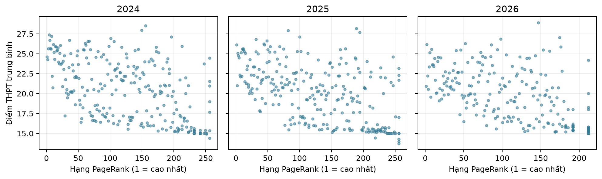

*Hình 4.1. Hạng PageRank G4 (1 = cao nhất) và điểm THPT trung bình theo trường, ba năm. Nguồn: `metrics/g4_competition_<năm>.csv`, `data/eduradar.db`; script `scripts/build_report_figures.py`.*

## 4.4. Adamic–Adar: dự đoán liên kết ngành

**Mục tiêu và lý do chọn.** Xếp hạng các cặp ngành **chưa có cạnh** G3 nhưng có nhiều láng giềng chung ít phổ biến, để dự đoán cặp ngành sẽ được mở cùng nhau.

**Nguyên lý và mã giả.** $AA(x,y)=\sum_{z\in N(x)\cap N(y)}\dfrac{1}{\ln|N(z)|}$.

```text
với mọi cặp chưa có cạnh trong G3 năm gốc: cộng 1/ln(bậc láng giềng chung)
giữ 300 cặp AA cao nhất
kiểm: bao nhiêu cặp thành cạnh ở G3 năm đích; so tỉ lệ nền ngẫu nhiên
```

**Tham số và độ phức tạp.** `nx.adamic_adar_index` trên mọi non-edge, không trọng số; xấu nhất $O(n^2\Delta)$.

**Kết quả.**

**Bảng 4.7. Mười cặp AA cao nhất G3 năm 2026**

| Hạng | Ngành A | Ngành B | AA |
| --- | --- | --- | --- |
| 1 | Văn học | Giáo dục Chính trị | 5,0762 |
| 2 | Giáo dục Công dân | Sư phạm Tiếng Anh | 5,0363 |
| 3 | Kinh doanh quốc tế | Quản trị dịch vụ du lịch và lữ hành | 5,0023 |
| 4 | Tâm lý học giáo dục | Việt Nam học | 4,8374 |
| 5 | Tâm lý học giáo dục | Văn học | 4,7365 |
| 6 | Giáo dục Mầm non | Việt Nam học | 4,6962 |
| 7 | Giáo dục Thể chất | Việt Nam học | 4,6962 |
| 8 | Truyền thông đa phương tiện | Kế toán | 4,6943 |
| 9 | Công nghệ thông tin | Công nghệ tài chính | 4,6943 |
| 10 | Kỹ thuật trắc địa - bản đồ | Kỹ thuật Dầu khí | 4,4406 |

*Nguồn: `data/network/metrics/link_prediction_2026.csv`.*

**Bảng 4.8. Kiểm chứng theo thời gian (top 300)**

| Gốc → đích | Trúng top 10 | Trúng top 100 | Trúng top 300 (precision) | Tỉ lệ nền | Gấp nền |
| --- | --- | --- | --- | --- | --- |
| 2024 → 2025 | 5 | 25 | 55 (18,3%) | 0,32% | 57,2 lần |
| 2025 → 2026 | 1 | 19 | 36 (12,0%) | 0,31% | 38,3 lần |
| 2024 → 2026 | 8 | 29 | 68 (22,7%) | 0,53% | 42,6 lần |

*Nguồn: `scripts/report_network_supplement.py` (dựng lại G3 từ DB bằng hàm của `sna/build.py`, Jaccard 0,25).*

**Đánh giá.** Dự đoán tốt hơn nền ngẫu nhiên hàng chục lần ở mọi cặp năm; precision@300 hai năm (2024 → 2026) cao hơn một năm vì có thêm thời gian để cạnh xuất hiện. Kết quả vững theo ngưỡng (Bảng 4.11). Mô hình dự đoán đồng xuất hiện trong danh mục trường, không dự báo điểm chuẩn hay nhu cầu lao động.

## 4.5. Độ nhạy tham số và độ ổn định cộng đồng

**Mục tiêu.** Jaccard 0,25 và khoảng 2 điểm là tham số chọn tay; cần biết kết luận nào đổi khi tham số đổi.

**Cách làm.** Mỗi lần đổi một tham số; dựng lại mạng bằng chính hàm của `sna/build.py` (cấu hình chuẩn trùng `summary.csv`); so phân hoạch Louvain bằng ARI và NMI trên đỉnh chung:

$$\operatorname{ARI}=\frac{\sum_{ij}\binom{n_{ij}}2-\left[\sum_i\binom{a_i}2\sum_j\binom{b_j}2\right]/\binom n2}{\frac12\left[\sum_i\binom{a_i}2+\sum_j\binom{b_j}2\right]-\left[\sum_i\binom{a_i}2\sum_j\binom{b_j}2\right]/\binom n2},\qquad\operatorname{NMI}=\frac{2I(X;Y)}{H(X)+H(Y)}.$$

Mức nền là ARI giữa 20 seed Louvain và seed 42 ở cùng ngưỡng 0,25. Toàn bộ số liệu: `docs/do_nhay_sna.md` (sinh bằng `scripts/report_sensitivity.py`).

**Kết quả.**

**Bảng 4.10. Độ nhạy G2 theo ngưỡng Jaccard (2026)**

| Độ đo | 0,15 | 0,20 | 0,25 | 0,30 | 0,35 |
| --- | ---: | ---: | ---: | ---: | ---: |
| Số đỉnh | 262 | 259 | 250 | 237 | 218 |
| Số cạnh | 7.472 | 4.446 | 2.540 | 1.332 | 720 |
| Mật độ | 0,218 | 0,133 | 0,082 | 0,048 | 0,030 |
| Số thành phần | 5 | 6 | 8 | 14 | 23 |
| LCC (đỉnh) | 250 | 245 | 232 | 201 | 141 |
| LCC (%) | 95,4 | 94,6 | 92,8 | 84,8 | 64,7 |
| Đường đi TB (LCC) | 2,21 | 2,63 | 3,24 | 3,75 | 3,93 |
| Clustering TB | 0,657 | 0,610 | 0,548 | 0,523 | 0,439 |
| Modularity Louvain | 0,257 | 0,363 | 0,484 | 0,615 | 0,703 |
| Số cộng đồng | 10 | 11 | 19 | 22 | 30 |

Năm 2024 (0,15 / 0,25 / 0,35): Q = 0,242 / 0,449 / 0,668; LCC = 251 / 219 / 163 đỉnh; thành phần = 4 / 11 / 20; cộng đồng = 10 / 18 / 26.

**Bảng 4.11. Độ nhạy G3 theo ngưỡng Jaccard (2026)**

| Độ đo | 0,15 | 0,20 | 0,25 | 0,30 | 0,35 |
| --- | ---: | ---: | ---: | ---: | ---: |
| Số đỉnh | 399 | 392 | 370 | 330 | 267 |
| Số cạnh | 3.429 | 2.135 | 1.391 | 906 | 579 |
| Mật độ | 0,043 | 0,028 | 0,020 | 0,017 | 0,016 |
| Số thành phần | 3 | 4 | 7 | 21 | 50 |
| LCC (đỉnh) | 395 | 385 | 357 | 211 | 23 |
| LCC (%) | 99,0 | 98,2 | 96,5 | 63,9 | 8,6 |
| Đường đi TB (LCC) | 3,28 | 4,03 | 5,67 | 12,82 | 1,72 |
| Clustering TB | 0,538 | 0,535 | 0,512 | 0,483 | 0,505 |
| Modularity Louvain | 0,682 | 0,775 | 0,836 | 0,879 | 0,895 |
| Số cộng đồng | 13 | 14 | 20 | 32 | 50 |

Năm 2024 (0,15 / 0,25 / 0,35): Q = 0,716 / 0,836 / 0,905; LCC = 381 / 345 / 28 đỉnh; thành phần = 5 / 13 / 41; cộng đồng = 16 / 27 / 42.

**Bảng 4.12. Độ nhạy G4 theo khoảng điểm**

| Độ đo | Năm | 1 điểm | 2 điểm | 3 điểm |
| --- | --- | ---: | ---: | ---: |
| Số đỉnh | 2026 | 224 | 226 | 226 |
| Số cạnh | 2026 | 6.098 | 9.215 | 11.492 |
| Mật độ | 2026 | 0,122 | 0,181 | 0,226 |
| Thành phần liên thông mạnh | 2026 | 50 | 35 | 23 |
| Spearman(PageRank, điểm TB) | 2026 | 0,528 | 0,608 | 0,664 |
| Spearman(authority, điểm TB) | 2026 | 0,233 | 0,235 | 0,249 |
| Top 10 PageRank trùng mốc 2 điểm | 2026 | 6 | 10 | 9 |
| Top 10 authority trùng mốc 2 điểm | 2026 | 5 | 10 | 8 |
| Số đỉnh | 2024 | 257 | 259 | 259 |
| Số cạnh | 2024 | 7.107 | 10.542 | 12.731 |
| Mật độ | 2024 | 0,108 | 0,158 | 0,191 |
| Thành phần liên thông mạnh | 2024 | 19 | 17 | 16 |
| Spearman(PageRank, điểm TB) | 2024 | 0,450 | 0,567 | 0,634 |
| Spearman(authority, điểm TB) | 2024 | −0,384 | −0,401 | −0,309 |
| Top 10 PageRank trùng mốc 2 điểm | 2024 | 7 | 10 | 9 |
| Top 10 authority trùng mốc 2 điểm | 2024 | 7 | 10 | 10 |

**Bảng 4.13. Độ ổn định cộng đồng Louvain (2026)**

| So sánh | G2: ARI / NMI (đỉnh chung) | G3: ARI / NMI (đỉnh chung) |
| --- | --- | --- |
| 0,15 so với 0,25 | 0,525 / 0,725 (250) | 0,639 / 0,774 (370) |
| 0,35 so với 0,25 | 0,598 / 0,804 (218) | 0,521 / 0,808 (267) |
| 0,15 so với 0,35 | 0,406 / 0,663 (218) | 0,426 / 0,753 (267) |
| Mức nền: 20 seed so với seed 42 (0,25) | TB 0,796 (thấp nhất 0,543) / 0,888 | TB 0,907 (thấp nhất 0,863) / 0,956 |

Cụm y dược (10 trường QHY, YDN, DDY, DHY, QSY, TYS, YDS, YHB, YPB, DTY) trong G2 2026:

- Ngưỡng 0,15: 10/10 trường cùng một cộng đồng; tỉ lệ cạnh của cộng đồng đó đi ra ngoài 24,6%.
- Ngưỡng 0,20: 10/10 trường cùng một cộng đồng; tỉ lệ cạnh của cộng đồng đó đi ra ngoài 10,9%.
- Ngưỡng 0,25: 10/10 trường cùng một cộng đồng; tỉ lệ cạnh của cộng đồng đó đi ra ngoài 6,6%.
- Ngưỡng 0,30: 10/10 trường cùng một cộng đồng; tỉ lệ cạnh của cộng đồng đó đi ra ngoài 1,4%.
- Ngưỡng 0,35: 10/10 trường cùng một cộng đồng; tỉ lệ cạnh của cộng đồng đó đi ra ngoài 0,9%.

**Bảng 4.14. Trùng lặp top 10 so với ngưỡng 0,25 (2026)**

| Mạng | Ngưỡng | Bậc | Betweenness | Eigenvector | PageRank |
| --- | --- | ---: | ---: | ---: | ---: |
| G2 | 0,15 | 5/10 | 4/10 | 8/10 | 7/10 |
| G2 | 0,35 | 6/10 | 2/10 | 8/10 | 7/10 |
| G3 | 0,15 | 2/10 | 1/10 | 10/10 | 3/10 |
| G3 | 0,35 | 4/10 | 0/10 | 0/10 | 1/10 |

G2: đỉnh betweenness cao nhất ở 0,25 là `U:VTT`; hạng ở 0,15 / 0,25 / 0,35 = 1 / 1 / 74.


G3: đỉnh betweenness cao nhất ở 0,25 là `M:7420101`; hạng ở 0,15 / 0,25 / 0,35 = 23 / 1 / 76.

**Bảng 4.15. Adamic–Adar G3 2024 → 2026 theo ngưỡng**

| Ngưỡng | Trúng trong top 300 | Tỉ lệ nền | Gấp nền |
| --- | ---: | ---: | ---: |
| 0,15 | 121/300 | 0,01426 | 28,3 |
| 0,25 | 68/300 | 0,00532 | 42,6 |
| 0,35 | 57/300 | 0,00361 | 52,6 |

**Bảng 4.16. Mức dao động điểm chuẩn giữa hai năm liền kề**

Điểm THPT thang 30 cao nhất của cùng (trường, ngành), dòng không cờ.

| Cặp năm | Số cặp | Trung vị mức thay đổi | ≤ 1 điểm | ≤ 2 điểm | ≤ 3 điểm |
| --- | ---: | ---: | ---: | ---: | ---: |
| 2024 → 2025 | 3.985 | 1,00 | 54,7% | 76,3% | 87,6% |
| 2025 → 2026 | 3.957 | 0,95 | 61,1% | 79,5% | 88,8% |

*Nguồn Bảng 4.10–4.16: `docs/do_nhay_sna.md`, `docs/do_nhay_sna.json` (sinh bằng `scripts/report_sensitivity.py`).*

**Đánh giá.** Jaccard 0,25 là ngưỡng lớn nhất mà cả G2 và G3 giữ > 90% đỉnh trong LCC (92,8% và 96,5%); ở 0,30 LCC của G3 còn 63,9%, ở 0,35 còn 8,6% (bước chuyển thẩm thấu), làm các độ đo đường đi mất ý nghĩa; ngưỡng 0,15 làm G2 gần như một khối (Q = 0,257). Khoảng 2 điểm khớp với dao động thực tế: điểm chuẩn cùng trường–ngành giữa hai năm liền kề có trung vị thay đổi 1,00–0,95 điểm và 76,3–79,5% không vượt 2 điểm.

**Kết luận vững:** đuôi nặng ở G1; cụm lĩnh vực rõ ở G3 (Q ≥ 0,68 mọi ngưỡng); cụm y dược luôn cùng một cộng đồng (10/10 ở mọi ngưỡng); PageRank G4 tương quan dương với điểm ở mọi khoảng điểm; dấu authority (âm 2024, dương 2026) giữ ở mọi khoảng điểm; Adamic–Adar tốt hơn nền 28–53 lần. **Kết luận nhạy:** top betweenness (Sinh học hạng 1 chỉ ở 0,25), số cộng đồng chính xác, top eigenvector của G3 (khối mỏ – địa chất ở 0,15–0,25, khối sư phạm ở 0,35) và nhận định G2/G3 “liên thông hơn” qua năm.

## 4.6. Chuyển kết quả mạng thành chỉ số “độ hot” và ngành tương tự

**Mục tiêu.** Đưa kết quả mạng vào tư vấn: một chỉ số tham khảo để sắp xếp lựa chọn và danh sách ngành gần nhau.

**Công thức.** $H=0{,}5S_{trường}+0{,}3S_{ngành}+0{,}2S_{xu\ hướng}$, mỗi phần 0–1:

- $S_{trường}=(101-\text{hạng VNUR})/100$; hạng kế thừa đại học mẹ nhân 0,8; chưa xếp hạng = 0.
- $S_{ngành}$ = percentile của $\Delta k_m=k_m^{2026}-k_m^{2024}$, bậc của nút ngành trong **G1** (số trường mở ngành); 10% ngành cao nhất gắn nhãn “Ngành hot 2026”.
- $S_{xu\ hướng}$ = percentile (trong cùng phương thức) của $s^{2026}-s^{2025}$ của cùng (trường, mã chương trình, phương thức, thang), điểm cao nhất, dòng không cờ; thiếu một năm = 0,5.

Percentile hạng trung bình $p=\dfrac{L+R+1}{2N}$ ($L$: số giá trị nhỏ hơn, $R$: nhỏ hơn hoặc bằng). Ngành tương tự: tối đa 8 láng giềng G3 theo Jaccard giảm dần.

**Bảng 4.9. Phạm vi dữ liệu của chỉ số**

| Thành phần | Kết quả |
| --- | --- |
| Ngành trong tập so sánh tăng bậc G1 (2024 ∪ 2026) | 451 |
| Nhãn “Ngành hot 2026” (10% cao nhất) | 46 |
| Khóa (trường, chương trình, phương thức, thang) đủ 2025 và 2026 | 12.914 |

*Nguồn: `webapp/main.py`, hàm `hot_index`; `data/network/metrics/g1_uni_major_{2024,2026}.csv`.*

**Đánh giá.** Trọng số 50–30–20 là quy ước sản phẩm, chưa hiệu chỉnh bằng dữ liệu kết quả tuyển sinh; H không phải xác suất trúng tuyển. Danh sách ngành tương tự dùng cạnh **đã có** của G3, khác với Adamic–Adar dự đoán cạnh **chưa có**.

# Chương 5. Trực quan hoá và mô phỏng

## 5.1. Công cụ và quy ước đọc hình

NetworkX dựng đồ thị, tính độ đo; Matplotlib vẽ biểu đồ tái lập được (`scripts/build_report_figures.py`); Gephi 0.10 (ForceAtlas2) vẽ hai hình mạng chính từ GEXF do `sna/build.py` xuất (đủ đỉnh, cạnh và thuộc tính độ đo). Web dùng vis-network: kéo, thu phóng, tìm nút, bấm nút để xem độ đo, lọc theo cộng đồng. Mọi độ đo tính trên đồ thị đầy đủ; web chỉ vẽ 1.500 cạnh nặng nhất để giữ tương tác mượt, điều này ghi ngay trên thẻ định nghĩa.

## 5.2. Mạng trường và mạng ngành năm 2026

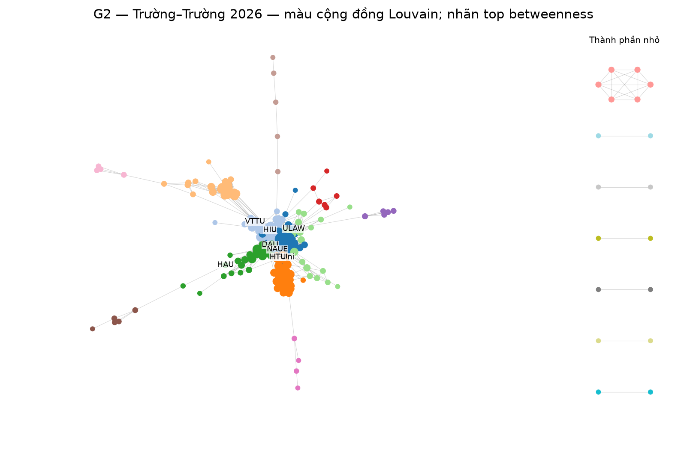

*Hình 5.1. G2 năm 2026 (NetworkX, bố cục lực, seed 42); màu = cộng đồng Louvain, kích thước theo bậc, nhãn = 8 đỉnh betweenness cao nhất. Nguồn: `data/eduradar.db`, `metrics/g2_uni_uni_2026.csv`.*

G2 có 250 đỉnh, 2.540 cạnh, 19 cộng đồng, Q = 0,4845. Vị trí trên hình không phải khoảng cách địa lý hay chênh lệch điểm.

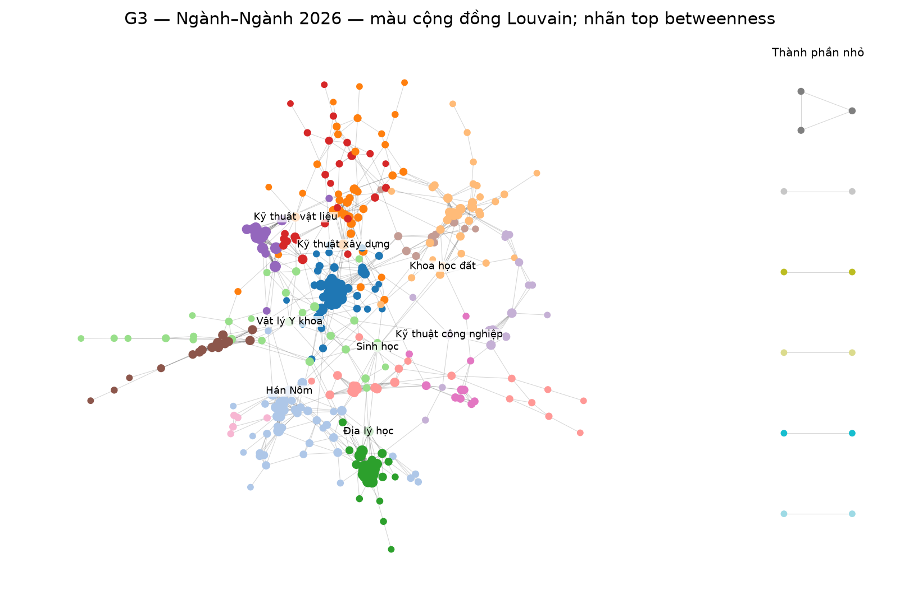

*Hình 5.2. G3 năm 2026, cùng quy ước Hình 5.1. Nguồn: `metrics/g3_major_major_2026.csv`.*

G3 có 370 đỉnh, 1.391 cạnh, 20 cộng đồng, Q = 0,8363.

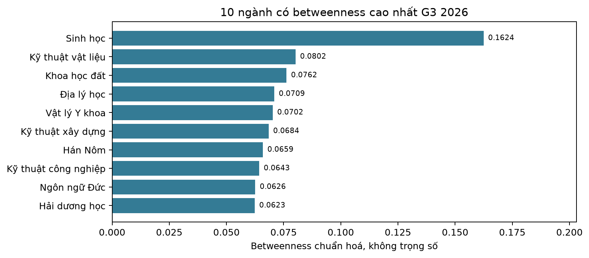

*Hình 5.3. Mười ngành betweenness cao nhất G3 2026. Nguồn: `metrics/g3_major_major_2026.csv`.*

## 5.3. Mô phỏng thay đổi tham số

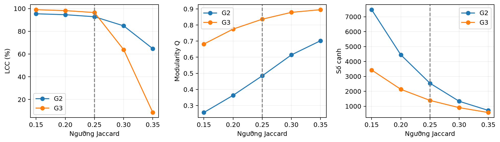

*Hình 5.4. Tỉ lệ đỉnh trong LCC, modularity và số cạnh của G2/G3 năm 2026 theo ngưỡng Jaccard. Nguồn: `docs/do_nhay_sna.json`.*

Modularity tăng khi ngưỡng tăng vì mạng bị chia nhỏ; LCC của G3 sụp giữa 0,25 và 0,35. Modularity cao hơn vì vậy không tự động là mô hình tốt hơn.

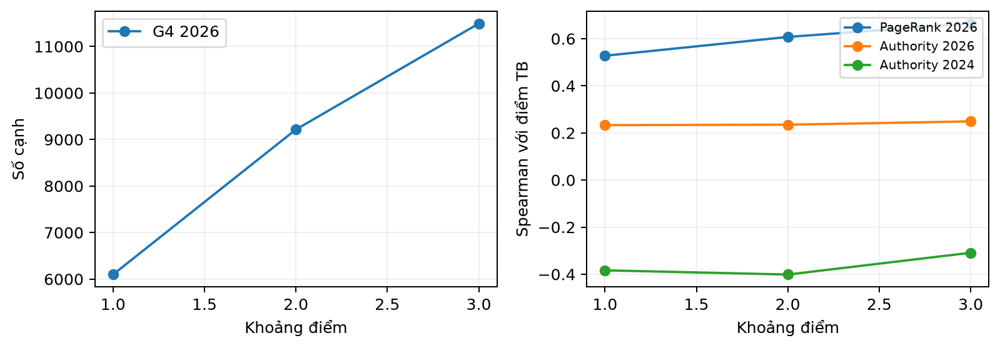

*Hình 5.5. Số cạnh và Spearman của G4 theo khoảng điểm. Nguồn: `docs/do_nhay_sna.json`.*

Số cạnh G4 2026 tăng 6.098 → 11.492 khi khoảng điểm tăng 1 → 3; dấu tương quan không đổi. Đây là phép đổi tham số mô hình, không phải can thiệp vào tuyển sinh thực tế.

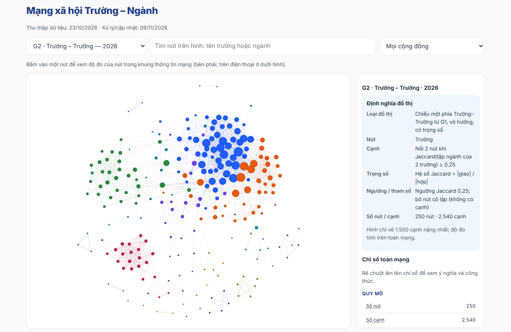

*Hình 5.6. Tab Mạng SNA (G2 2026) ở 1.280 px: thẻ “Định nghĩa đồ thị”, hai mốc ngày, ô tìm nút, bộ lọc cộng đồng, bảng chỉ số có tên tiếng Việt và chú thích công thức khi rê chuột. Ảnh chụp bản tĩnh `site/` ngày 21/11/2026.*

## 5.4. Hình mạng vẽ bằng Gephi

Hai hình dưới xuất từ Gephi theo cùng quy ước: mở `data/network/gexf/<mạng>_2026.gexf` (vô hướng), tô màu theo thuộc tính `community` đã tính bằng Louvain (không chạy lại Modularity của Gephi), kích thước theo `degree`, bố cục ForceAtlas2 (Prevent Overlap), chỉ hiện nhãn đỉnh bậc cao, xuất PNG nền trắng.

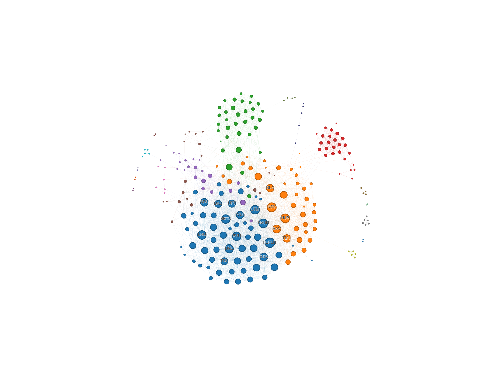

*Hình 5.7. G2 năm 2026 trong Gephi, ForceAtlas2, màu = cộng đồng Louvain (19 cộng đồng, Q = 0,4845), kích thước = bậc. Nguồn: `data/network/gexf/g2_uni_uni_2026.gexf`.*

Hình cho thấy một lõi lớn dày đặc gồm các trường tư đa ngành (nhãn LHU, BVU, HUFLIT, GDU, DNU…), sát bên là cụm kinh tế – ngân hàng (KSV, HUB, BAV, TMU, DLA); một cụm lớn khác nằm phía trên lõi, một cụm nhỏ dày tách hẳn bên phải và nhiều cụm 2–6 trường rời rạc ở rìa, đúng với 8 thành phần liên thông của G2.

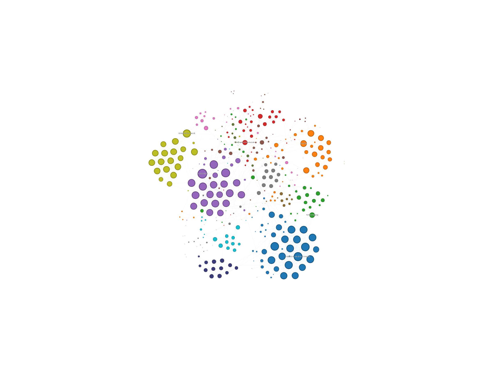

*Hình 5.8. G3 năm 2026 trong Gephi, cùng quy ước (20 cộng đồng, Q = 0,8363). Nguồn: `data/network/gexf/g3_major_major_2026.gexf`.*

Các khối ngành tách rõ, giữa các khối có rất ít cạnh: khối kinh tế – dịch vụ (nhãn Logistics), khối địa chất – trắc địa (Kỹ thuật trắc địa – bản đồ), khối khoa học xã hội – ngôn ngữ (Hán Nôm), khối kỹ thuật (Kỹ thuật xây dựng), khối nông – thủy sản (Công nghệ chế biến thủy sản) cùng các khối nhỏ hơn. Hình phù hợp Q ≈ 0,84 và đường đi trung bình 5,67 bước.

# Chương 6. Ứng dụng minh hoạ

## 6.1. Địa chỉ và kiến trúc vận hành

Ứng dụng công khai: [https://diemthidaihoc.com](https://diemthidaihoc.com). Bản tĩnh gồm HTML, CSS, JavaScript và JSON xuất trước bởi `scripts/export_static.py`, chạy được khi máy chủ FastAPI đã tắt. Bản chạy tại máy dùng `webapp/main.py` (FastAPI) truy vấn SQLite cho cùng giao diện `webapp/static/`. Luồng: crawler → raw → `pipeline/clean.py` → SQLite → FastAPI và `sna/build.py`; xuất JSON chỉ là bước đóng gói. Đầu trang hiển thị hai mốc lấy từ dữ liệu: **Thu thập dữ liệu 23/10/2026** (`MAX(crawled_at)`) và **Xử lý/cập nhật 09/11/2026** (`updated_on`).

## 6.2. Sáu tab và chức năng

**Bảng 6.1. Chức năng của ứng dụng**

| Tab | Chức năng chính | Liên hệ với đồ án |
| --- | --- | --- |
| Theo trường | Tìm tên/mã, lọc tỉnh và năm; điểm theo phương thức, chương trình, tổ hợp; đề án, học phí có nguồn | Kiểm tra dữ liệu sạch, đơn vị học phí, năm đề án, hạng kế thừa |
| Theo ngành | Tra mã ngành chuẩn hoặc tên chương trình; so trường theo năm, phương thức; gợi ý ngành tương tự từ G3 | Đưa chuẩn hoá mã ngành và mạng chiếu G3 vào tra cứu |
| Xếp nguyện vọng | Nhập điểm, tổ hợp, 5–15 nguyện vọng và mức mong muốn (1–5 sao); dự báo điểm chuẩn năm sau, xác suất đỗ từng nguyện vọng và thứ tự đăng ký đề xuất | Dùng chuỗi điểm chuẩn THPT 3 năm của từng chương trình |
| Tư vấn chọn ngành | Trắc nghiệm 58 câu (sở thích RIASEC, tính cách MBTI, giá trị, học lực, điều kiện) và bảng điểm; chấm mức phù hợp với 86 ngành, kèm khả năng trúng tuyển và lý do | Kết hợp hồ sơ người dùng với điểm chuẩn THPT 2026 thật |
| Mạng SNA | G1–G4 × 3 năm; thẻ định nghĩa đồ thị; chỉ số nhóm theo chủ đề, tên tiếng Việt và công thức; tìm nút, bấm nút xem độ đo, lọc cộng đồng | Minh hoạ trực tiếp Chương 3–4 |
| Độ phủ dữ liệu | Cách thu thập (nguồn, 2 API, số request, độ trễ, robots.txt), phễu làm sạch 76.726 → 71.011, cách gán mã ngành, cờ chất lượng; độ phủ từng trường–năm, học phí, đề án | Công khai quy trình và phần thiếu để người dùng tự đánh giá |

*Nguồn: `webapp/static/index.html`, `app.js`, `nv.js`, `career.js`, `webapp/main.py`.*

**Xếp nguyện vọng** (`nv.js`). Với mỗi chương trình, điểm chuẩn năm sau được dự báo bằng $\hat s=0{,}5\,(\beta_0+\beta_1s_{t-1}+\beta_2s_t)+0{,}5\,s_t$, hệ số hồi quy học từ dữ liệu ba năm (dự báo năm thứ ba từ hai năm trước rồi so với thực tế; chương trình chỉ có một năm dùng hồi quy một biến). Sai số không giả định phân phối chuẩn: dùng 41 phân vị của sai số thực tế, chia theo mức dao động giữa hai năm gần nhất (ổn định / dao động vừa / mạnh). Xác suất đỗ $P=F(\text{điểm}-\hat s)$ xếp nhóm An toàn (≥ 90%), Vừa sức (≥ 60%), Mạo hiểm (≥ 20%), Rất khó. Thứ tự đề xuất sắp theo mức mong muốn giảm dần rồi xác suất đỗ tăng dần (nguyện vọng khó đặt trước không làm mất cơ hội nguyện vọng sau); trang tính xác suất trúng ở từng nguyện vọng theo chuỗi xét lần lượt và giải thích lý do mỗi lần đổi chỗ. Giới hạn 15 nguyện vọng, ngành sư phạm chỉ ở nguyện vọng 1–5.

**Tư vấn chọn ngành** (`career.js`). Điểm tổng = 80% độ phù hợp + 20% khả năng trúng tuyển. Độ phù hợp gồm sở thích RIASEC 35% (so hồ sơ 6 nhóm Holland với mã 3 chữ của ngành, cả mức và hình dạng hồ sơ), học lực 20%, tính cách MBTI 15% (4 trục cộng trục “vững vàng”, dạng phần trăm liên tục), giá trị nghề nghiệp 15% và điều kiện thực tế 15%. RIASEC và MBTI được đối chiếu chéo để báo độ tin cậy; khả năng trúng tuyển dùng điểm chuẩn THPT 2026 của tổ hợp tốt nhất người dùng đủ điều kiện. Kết quả là gợi ý tham khảo.

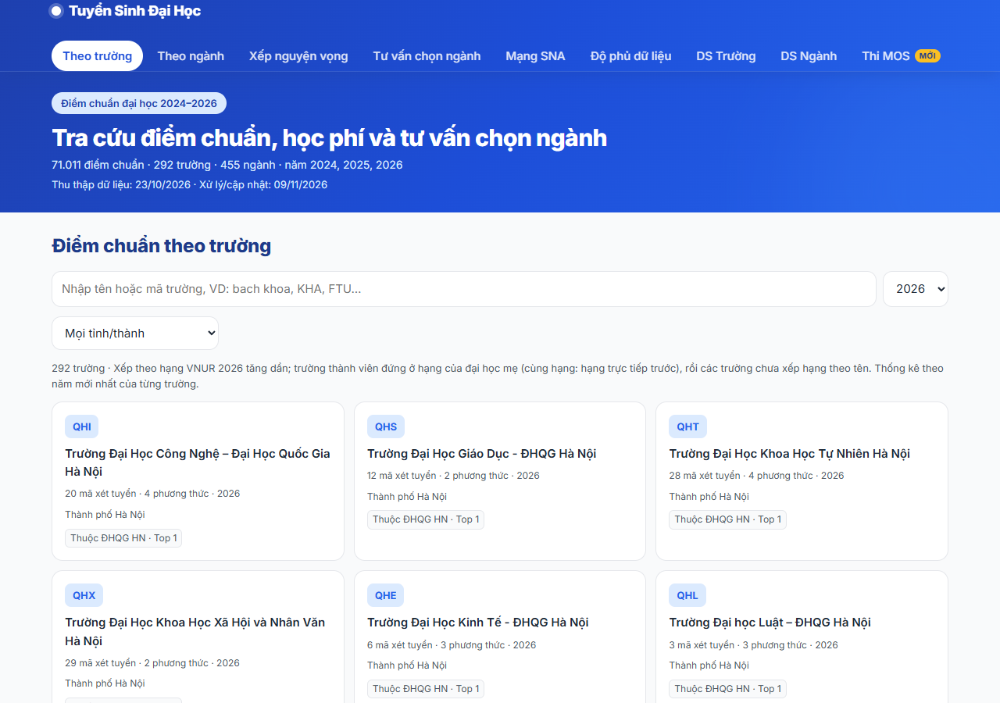

*Hình 6.1. Tab Theo trường, 1.280 px: danh mục 292 trường xếp theo hạng VNUR.*

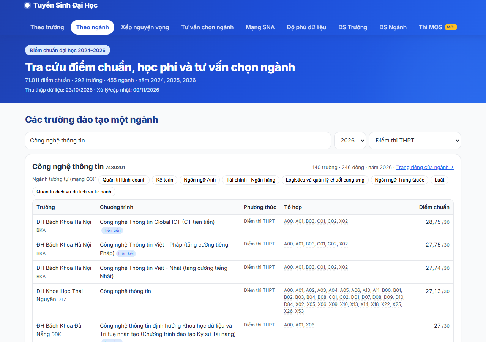

*Hình 6.2. Tra ngành Công nghệ thông tin (7480201), 1.280 px; 1.899 dòng chưa có mã ngành vẫn là giới hạn khi tra theo ngành chuẩn.*

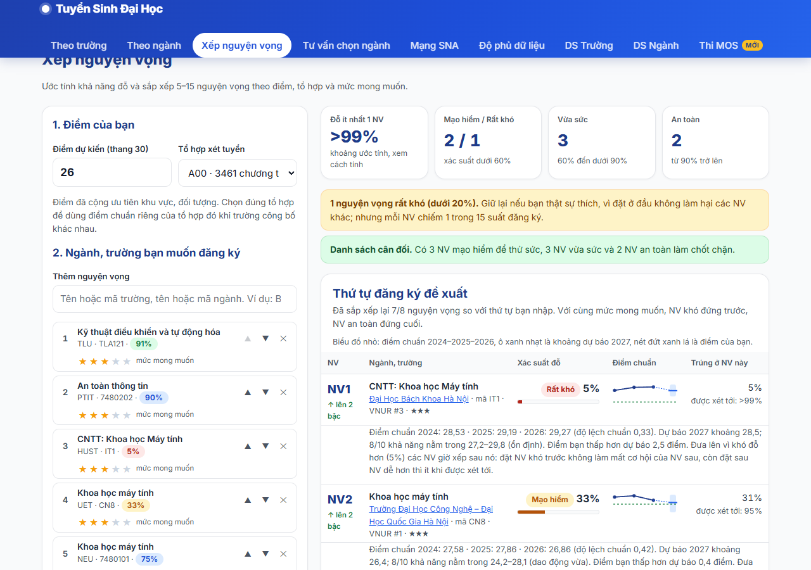

*Hình 6.3. Tab Xếp nguyện vọng với hồ sơ mẫu (26 điểm, A00, 8 nguyện vọng), 1.280 px; điểm 26 là đầu vào minh hoạ.*

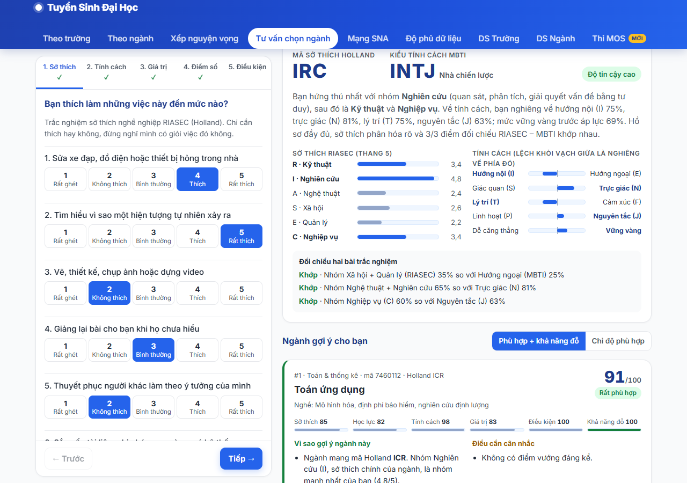

*Hình 6.4. Tab Tư vấn chọn ngành với hồ sơ mẫu: mã Holland, kiểu MBTI, ngành gợi ý kèm khả năng trúng tuyển, 1.280 px.*

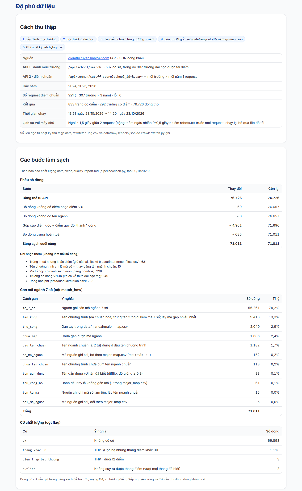

*Hình 6.5. Tab Độ phủ dữ liệu: khối “Cách thu thập” và “Các bước làm sạch” (phễu, gán mã ngành, cờ chất lượng), 1.280 px. Số liệu đọc từ `data/raw/fetch_log.csv` và `data/clean/quality_report.md` qua API `/api/coverage`.*

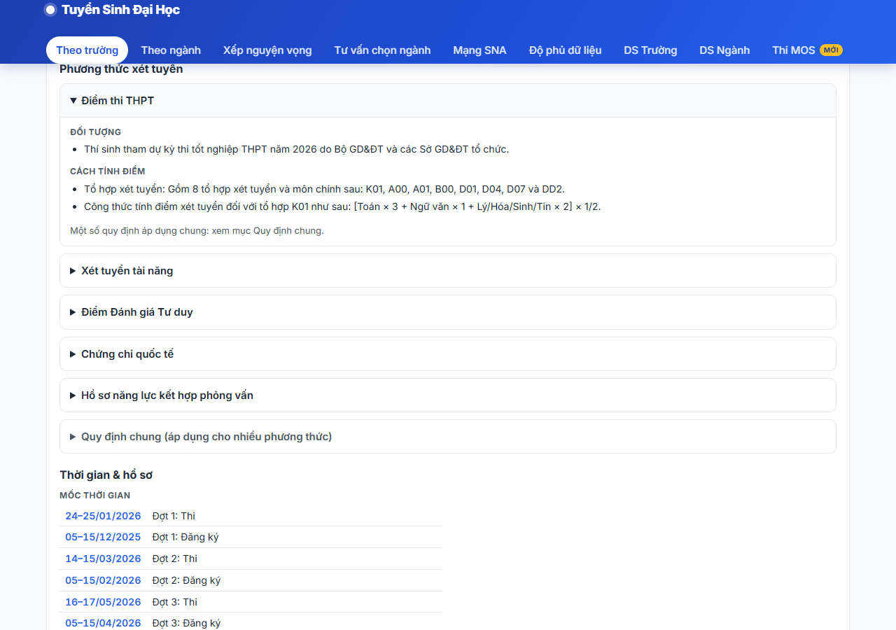

*Hình 6.6. Phần đề án của Đại học Bách khoa Hà Nội: dữ kiện bóc theo heading thành từng phương thức, thời gian, hồ sơ.*

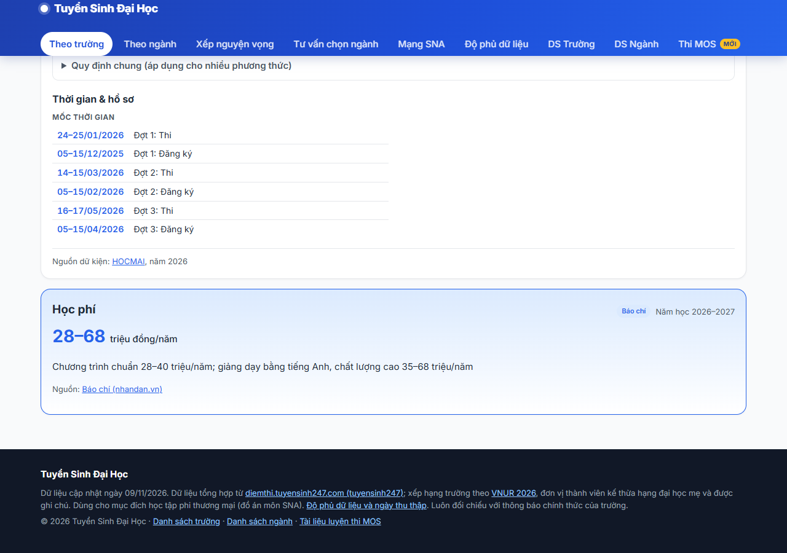

*Hình 6.7. Thẻ học phí cùng trang: mức tiền kèm đơn vị, năm học và nhãn loại nguồn.*

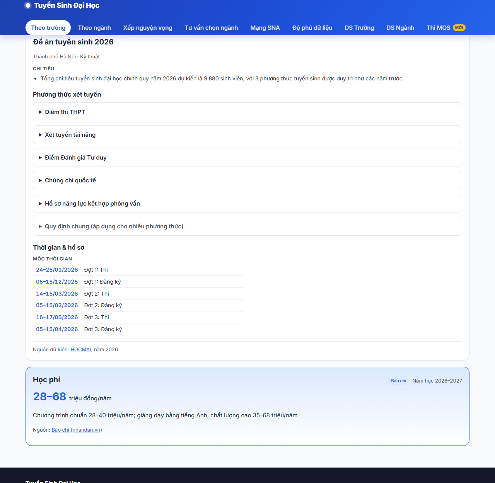

*Hình 6.8. Một trang trường hiển thị cả đề án và học phí sau khi thu gọn các khối chi tiết.*

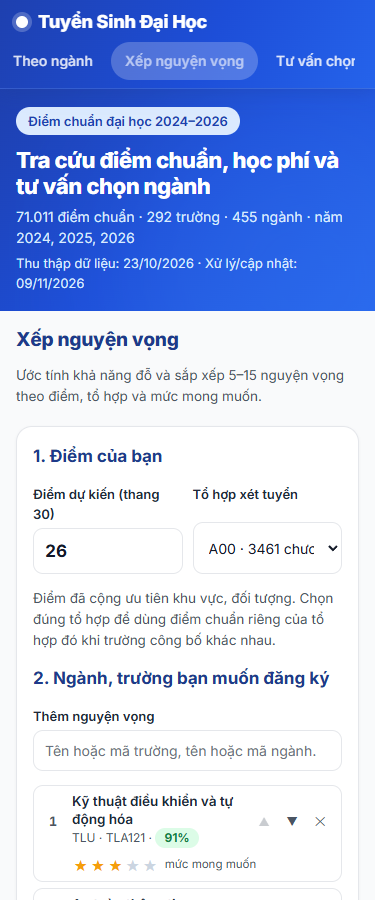

*Hình 6.9. Tab Xếp nguyện vọng ở 375 px: các khối xếp dọc, không tràn ngang.*

*Ảnh Hình 6.1–6.9 chụp bằng `scripts/capture_report_web.cjs` từ bản tĩnh `site/` (nội dung sẽ triển khai tại diemthidaihoc.com) ngày 21/11/2026.*

## 6.3. Kiểm chứng ứng dụng

`scripts/check_static.py` so dữ liệu bản tĩnh với FastAPI (meta, đề án, trang trường, ngành, chương trình, mạng G2) và kiểm 624 trang HTML, sitemap, liên kết nội bộ; `--committed` kiểm dữ liệu đã commit. `scripts/check_static_browser.cjs` chạy Edge headless ở 375 px và 1.280 px cho cả bản tĩnh và FastAPI: sáu tab, 25 phép đối chiếu API, không lỗi console/HTTP, không tràn ngang; thêm 10 trang SEO ngẫu nhiên. Ngày 21/11/2026 cả bốn mức kiểm đều đạt; ngoài ra đã duyệt 4 mạng × 3 năm trên tab Mạng SNA và quét toàn bộ 619 trang trường/ngành ở 375 px (0 trang tràn ngang). Các kiểm tra này xác nhận tính nhất quán giữa hai cách phục vụ, không thay cho việc đối chiếu thông báo gốc.

## 6.4. Kịch bản demo sáu bước

1. Mở https://diemthidaihoc.com; chỉ hai mốc ngày ở đầu trang. Tại Theo trường tìm BKA, năm 2026: một dòng điểm kèm tổ hợp, phần đề án và học phí (năm, đơn vị, nguồn).
2. Theo ngành: nhập `7480201`, phương thức THPT; so các trường và mở một ngành tương tự từ G3.
3. Xếp nguyện vọng: bấm “Dùng ví dụ mẫu”, chỉ xác suất đỗ từng nguyện vọng và lý do thứ tự đề xuất.
4. Tư vấn chọn ngành: “Xem lại hồ sơ mẫu”, giải thích trọng số RIASEC/MBTI và khả năng trúng tuyển.
5. Mạng SNA: G2 2026, đọc thẻ định nghĩa; tìm “Võ Trường Toản”, bấm nút xem betweenness; lọc cộng đồng y dược; chuyển G4 để giải thích mũi tên, authority và PageRank.
6. Độ phủ dữ liệu: phễu 76.726 → 71.011, cách gán mã ngành, trường/năm thiếu.

# Chương 7. Kết luận

## 7.1. Trả lời các câu hỏi nghiên cứu

**Trường giống nhau.** G2 năm 2026 có 19 cộng đồng, Q = 0,4845: trường tư đa ngành phía Nam, đại học địa phương, kinh tế – ngân hàng, kỹ thuật, y dược, công an – quân đội, nghệ thuật, thể thao. Cụm y dược giữ nguyên ở mọi ngưỡng Jaccard đã thử; số cộng đồng chính xác thì nhạy với ngưỡng.

**Ngành phổ biến và ngành cầu nối.** Bậc G1 đo độ phổ biến (Quản trị kinh doanh, Công nghệ thông tin mở ở hơn 150 trường); betweenness G3 đo vai trò nối khối (Sinh học 0,1624), nhưng thứ hạng cầu nối nhạy với ngưỡng. Eigenvector G3 bị localization vào khối ngành mỏ – địa chất (Jaccard = 1), không đo tầm quan trọng toàn cục.

**Cạnh tranh.** G4 năm 2026 có 226 đỉnh, 9.215 cạnh, SCC lớn nhất 192 trường, đường kính có hướng 4. PageRank tương quan dương với điểm THPT trung bình ở cả ba năm (0,54–0,61); authority đổi dấu (âm 2024–2025, dương 2026) vì HITS dồn vào lõi cạnh tranh dày nhất, nên “authority” không phải uy tín học thuật.

**Thay đổi 2024–2026.** G1 dày hơn (cạnh +13,9%, 16,05 → 18,28 ngành/trường); G3 giữ Q ≈ 0,84; phân bố bậc đuôi nặng (γ ≈ 2,4–2,9) nhưng không phải scale-free thuần. Chiều tăng Q của G2 và transitivity của G3 vững qua các ngưỡng; mức liên thông và thứ hạng cầu nối thì nhạy.

**Ứng dụng.** Mức tăng bậc ngành G1 là một thành phần của độ hot; G3 cho ngành tương tự; Adamic–Adar dự đoán cặp ngành mở cùng nhau tốt hơn nền hàng chục lần. Sáu tab đưa người dùng từ điểm số đến trường/ngành, xếp nguyện vọng, tư vấn ngành, cấu trúc mạng và độ phủ dữ liệu.

*Nguồn: `data/network/summary.csv`, `metrics/*.csv`, `docs/do_nhay_sna.md`, `docs/TONG_KET_DU_LIEU.md`.*

## 7.2. Hạn chế

Dữ liệu điểm đến từ một trang tổng hợp nên có thể kế thừa sai sót của nguồn. Thang điểm một phần là suy luận; dòng có cờ và 631 dòng trùng khoá khác điểm chưa được phân xử. Tỉ lệ 97,33% dòng có mã ngành là độ phủ ánh xạ, chưa phải độ chính xác đã đo; kết quả kiểm 20 dòng còn để người thực hiện điền.

Phép chiếu Jaccard làm mất thông tin của mạng hai phía và tạo khối Jaccard = 1 ở ngành hiếm (nguyên nhân localization của eigenvector). Đường đi tính không trọng số, giới hạn trên LCC. Chưa kiểm định thế giới nhỏ với mô hình null; ước lượng power-law chưa so với phân bố thay thế (log-normal, mũ cắt). Louvain là heuristic; GN dừng ở 40 cộng đồng. Closeness hai phía của G1 không xếp hạng được toàn cục. Dự đoán liên kết lưu theo tên ngành nên có nguy cơ nhập nhằng tên–mã.

Đề án, học phí, xếp hạng và tỉnh có phạm vi và mốc thời gian khác nhau; chỉ dùng kèm các ghi chú đi cùng.

## 7.3. Hướng phát triển

Hoàn tất kiểm tra 20 dòng và đo độ chính xác ánh xạ mã ngành; so phân bố bậc với các phân bố thay thế bằng kiểm định tỉ số hợp lý; thêm mô hình null bảo toàn bậc cho nhận định thế giới nhỏ; thử khoảng cách $1-J$ cho đường đi có trọng số; lưu mã ngành trong dự đoán liên kết và so Adamic–Adar với các nền khác; phân tích mạng theo từng phương thức và cộng đồng động qua năm.

# Tài liệu tham khảo

1. Tuyensinh247. [Điểm chuẩn đại học](https://diemthi.tuyensinh247.com/diem-chuan.html), API công khai `school/search`, `common/cutoff-score`, `common/blocks`. Ngày thu thập điểm: 23/10/2026 theo `fetch_log.csv`.
2. VNUR. [Bảng xếp hạng đại học Việt Nam](https://vnur.vn/bang-xep-hang/), bản 2026. Phạm vi sử dụng và hạng kế thừa: `docs/TONG_KET_DU_LIEU.md`.
3. HOCMAI. [Hướng nghiệp và thông tin tuyển sinh](https://huongnghiep.hocmai.vn/). Dữ kiện đề án bóc theo heading; ngày tải từng bài chưa được tổng hợp trong các nguồn thống kê của báo cáo.
4. Cổng Thông tin điện tử Chính phủ. [Danh mục và mã số các tỉnh, thành sau sắp xếp năm 2025](https://xaydungchinhsach.chinhphu.vn/bang-danh-muc-va-ma-so-cua-34-tinh-thanh-moi-cac-don-vi-hanh-chinh-cap-xa-moi-11925070418263625.htm). Địa chỉ từng trường và nguồn học phí được gắn tại thẻ trên ứng dụng.
5. NetworkX Developers. [Centrality](https://networkx.org/documentation/stable/reference/algorithms/centrality.html), [community algorithms](https://networkx.org/documentation/stable/reference/algorithms/community.html), [link prediction](https://networkx.org/documentation/stable/reference/algorithms/link_prediction.html). Tài liệu API đối chiếu các hàm ở Chương 3–4.
6. Blondel, V. D., Guillaume, J.-L., Lambiotte, R., & Lefebvre, E. (2008). [Fast unfolding of communities in large networks](https://arxiv.org/abs/0803.0476). Journal of Statistical Mechanics: Theory and Experiment, P10008. DOI: 10.1088/1742-5468/2008/10/P10008.
7. Girvan, M., & Newman, M. E. J. (2002). [Community structure in social and biological networks](https://arxiv.org/abs/cond-mat/0112110). PNAS, 99(12), 7821–7826. DOI: 10.1073/pnas.122653799.
8. Kleinberg, J. M. (1999). [Authoritative sources in a hyperlinked environment](https://www.cs.cornell.edu/home/kleinber/auth.pdf). Journal of the ACM, 46(5), 604–632. DOI: 10.1145/324133.324140.
9. Brin, S., & Page, L. (1998). [The anatomy of a large-scale hypertextual Web search engine](https://infolab.stanford.edu/~backrub/google.html). Computer Networks and ISDN Systems, 30, 107–117. DOI: 10.1016/S0169-7552(98)00110-X.
10. Adamic, L. A., & Adar, E. (2003). [Friends and neighbors on the Web](https://doi.org/10.1016/S0378-8733(03)00009-1). Social Networks, 25(3), 211–230.
11. Clauset, A., Shalizi, C. R., & Newman, M. E. J. (2009). [Power-law distributions in empirical data](https://arxiv.org/abs/0706.1062). SIAM Review, 51(4), 661–703. DOI: 10.1137/070710111.
12. Latapy, M., Magnien, C., & Del Vecchio, N. (2008). [Basic notions for the analysis of large two-mode networks](https://doi.org/10.1016/j.socnet.2007.04.006). Social Networks, 30(1), 31–48.

Số liệu thực nghiệm của báo cáo lấy từ `docs/TONG_KET_DU_LIEU.md`, `data/clean/quality_report.md`, `data/raw/fetch_log.csv`, `data/network/summary.csv`, `data/network/metrics/*.csv`, `docs/do_nhay_sna.md` (`scripts/report_sensitivity.py`) và `data/eduradar.db`; các bảng Chương 3–4 sinh bằng `scripts/report_sna_tables.py`. Các tài liệu học thuật dùng cho định nghĩa, thuật toán và diễn giải phương pháp.

# Phụ lục A. Cấu trúc thư mục và lệnh chạy

## A.1. Cấu trúc chính

```text
crawler/                Thu thập API điểm và HTML đề án
data/raw/               Phản hồi gốc và fetch_log.csv (không commit)
data/manual/            Bản đồ sửa tay, VNUR, tỉnh và học phí
pipeline/clean.py       Làm sạch, chuẩn hoá và tạo SQLite
pipeline/dean.py        Bóc dữ kiện đề án theo heading
pipeline/tuition_import.py  Nhập học phí bổ sung và overrides
data/eduradar.db        DB sinh tại máy (không commit)
sna/build.py            Dựng bốn mạng, tính độ đo, xuất GEXF
data/network/           summary.csv, metrics/, gexf/, fig/ (sinh tại máy)
webapp/                 FastAPI và HTML/JS tĩnh
site/                   Bản tĩnh công khai tại https://diemthidaihoc.com
scripts/                Xuất site, dựng báo cáo, kiểm tra và chụp ảnh
docs/                   Báo cáo và docs/fig/ (commit)
```

## A.2. Lệnh tái lập

Chạy tại thư mục repo bằng PowerShell; các lệnh dưới đây dùng Python của môi trường dự án. Dừng web trước khi crawl; khi raw đã có, bắt đầu từ bước làm sạch. Không chạy lại thu thập chỉ để dựng báo cáo.

```powershell
uv sync --locked
# Chỉ khi cần thu thập và đã dừng web:
.venv/Scripts/python.exe -m crawler.fetch
.venv/Scripts/python.exe -m crawler.fetch_dean
# Tái tạo dữ liệu từ raw có sẵn:
.venv/Scripts/python.exe -m pipeline.clean
.venv/Scripts/python.exe -m pipeline.tuition_import
.venv/Scripts/python.exe -m pipeline.dean
.venv/Scripts/python.exe -m sna.build
.venv/Scripts/python.exe scripts/export_static.py
# Chạy bản FastAPI hoặc bản tĩnh:
.venv/Scripts/python.exe -m uvicorn webapp.main:app --port 8000
.venv/Scripts/python.exe -m http.server 8001 --directory site
# Dựng hình và báo cáo từ dữ liệu có sẵn:
.venv/Scripts/python.exe -X utf8 scripts/report_sensitivity.py
.venv/Scripts/python.exe -X utf8 scripts/report_sna_tables.py
.venv/Scripts/python.exe scripts/build_report_figures.py
node scripts/capture_report_web.cjs [url]
.venv/Scripts/python.exe scripts/build_report_docx.py
.venv/Scripts/python.exe scripts/check_report.py
```

Hai lệnh chạy web là hai lựa chọn phục vụ tương ứng; dừng tiến trình đang chạy trước khi chuyển bước. Chỉnh dữ liệu thủ công qua `data/manual/`, sau đó chạy lại pipeline; không sửa trực tiếp bảng sạch hay DB. Để chụp ảnh cần Playwright ở `.venv/browser-check/node_modules` và Edge; để xuất Word cần `pypandoc_binary`, `python-docx` đã khai báo trong môi trường dự án.


## A.3. Số record sạch theo từng trường

Bảng A.1. Toàn bộ 292 mã trường; giá trị 0 biểu diễn chưa có dòng điểm trong năm ở mẫu thu thập. Tổng của ba cột năm là 71.011.

| Trường (mã) | 2024 | 2025 | 2026 | Tổng |
| --- | --- | --- | --- | --- |
| Học Viện An Ninh Nhân Dân (ANH) | 22 | 26 | 16 | 64 |
| Trường Đại Học An Ninh Nhân Dân (ANS) | 19 | 20 | 4 | 43 |
| Đại Học Bách Khoa Hà Nội (BKA) | 192 | 325 | 287 | 804 |
| Trường Đại học Y Dược Buôn Ma Thuột (BMU) | 12 | 16 | 28 | 56 |
| Học Viện Biên Phòng (BPH) | 12 | 40 | 30 | 82 |
| Học Viện Công Nghệ Bưu Chính Viễn Thông (BVH) | 88 | 252 | 351 | 691 |
| Học Viện Công Nghệ Bưu Chính Viễn Thông (Cơ sở TP.HCM) (BVS) | 59 | 117 | 162 | 338 |
| Trường Đại Học Bà Rịa – Vũng Tàu (BVU) | 152 | 188 | 180 | 520 |
| Trường Đại học Công nghiệp và Thương mại Hà Nội (CCM) | 22 | 22 | 33 | 77 |
| Trường Đại học Nghệ An (CEA) | 30 | 80 | 73 | 183 |
| Trường Đại Học CMC (CMC) | 40 | 42 | 100 | 182 |
| Học Viện Cảnh Sát Nhân Dân (CSH) | 15 | 16 | 4 | 35 |
| Trường Đại Học Cảnh Sát Nhân Dân (CSS) | 19 | 20 | 4 | 43 |
| Trường Đại Học Đông Á (DAD) | 214 | 228 | 883 | 1325 |
| Trường Đại Học Bình Dương (DBD) | 52 | 52 | 37 | 141 |
| Trường Đại học Nông Lâm Bắc Giang (DBG) | 53 | 40 | 60 | 153 |
| Trường Đại Học Quốc Tế Bắc Hà (DBH) | 16 | 0 | 0 | 16 |
| Trường Đại Học Bạc Liêu (DBL) | 34 | 44 | 58 | 136 |
| Trường Đại học Intracom (DCA) | 14 | 0 | 68 | 82 |
| Trường Đại Học Công Nghệ Đồng Nai (DCD) | 44 | 75 | 66 | 185 |
| Trường Sĩ Quan Đặc Công (DCH) | 5 | 6 | 20 | 31 |
| Trường Đại Học Cửu Long (DCL) | 61 | 76 | 126 | 263 |
| Đại Học Công Nghiệp Hà Nội (DCN) | 195 | 179 | 222 | 596 |
| Trường Đại Học Công Nghệ và Quản Lý Hữu Nghị (DCQ) | 30 | 34 | 34 | 98 |
| Trường Đại Học Công Thương TPHCM (DCT) | 136 | 153 | 176 | 465 |
| Trường Đại học Công nghiệp Vinh (DCV) | 12 | 8 | 6 | 26 |
| Trường Đại Học Công Nghệ Đông Á (DDA) | 105 | 0 | 0 | 105 |
| Trường Đại Học Thành Đông (DDB) | 50 | 0 | 58 | 108 |
| Trường Đại Học Ngoại Ngữ Đà Nẵng (DDF) | 39 | 63 | 24 | 126 |
| Trường Đại Học Bách Khoa Đà Nẵng (DDK) | 124 | 163 | 133 | 420 |
| Trường Đại Học Điện Lực (DDL) | 57 | 96 | 114 | 267 |
| Trường Đại Học Công Nghiệp Quảng Ninh (DDM) | 18 | 22 | 60 | 100 |
| Trường Đại Học Đại Nam (DDN) | 78 | 84 | 146 | 308 |
| Phân Hiệu Đại Học Đà Nẵng tại Kon Tum (DDP) | 13 | 29 | 17 | 59 |
| Trường Đại Học Kinh Tế – Đại Học Đà Nẵng (DDQ) | 57 | 70 | 55 | 182 |
| Trường Đại Học Sư Phạm - Đại Học Đà Nẵng (DDS) | 81 | 100 | 112 | 293 |
| Đại Học Duy Tân (DDT) | 205 | 290 | 351 | 846 |
| Trường Đại Học Đông Đô (DDU) | 36 | 60 | 102 | 198 |
| Viện nghiên cứu và đào tạo Việt Anh - Đại học Đà Nẵng (DDV) | 6 | 24 | 0 | 30 |
| Trường Y Dược Đà Nẵng (DDY) | 7 | 11 | 11 | 29 |
| Trường Đại học Luật Huế (DHA) | 4 | 4 | 4 | 12 |
| Khoa Giáo Dục Thể Chất Huế (DHC) | 2 | 2 | 2 | 6 |
| Trường Du Lịch - Đại Học Huế (DHD) | 21 | 14 | 28 | 63 |
| Khoa Kỹ thuật và Công nghệ - Đại học Huế (DHE) | 18 | 21 | 40 | 79 |
| Trường Đại Học Ngoại Ngữ Huế (DHF) | 33 | 24 | 52 | 109 |
| Khoa Quốc tế - Đại học Huế (DHI) | 9 | 8 | 9 | 26 |
| Trường Đại Học Kinh Tế - Đại Học Huế (DHK) | 43 | 42 | 88 | 173 |
| Trường Đại Học Nông Lâm Huế (DHL) | 43 | 40 | 76 | 159 |
| Trường Đại Học Nghệ Thuật Huế (DHN) | 12 | 12 | 12 | 36 |
| Phân Hiệu Đại Học Huế tại Quảng Trị (DHQ) | 10 | 6 | 0 | 16 |
| Trường Đại Học Sư Phạm Huế (DHS) | 97 | 88 | 170 | 355 |
| Trường Đại Học Khoa Học Huế (DHT) | 76 | 102 | 144 | 322 |
| Trường Đại học Hùng Vương TPHCM (DHV) | 38 | 57 | 92 | 187 |
| Trường Đại Học Y Dược Huế (DHY) | 14 | 11 | 34 | 59 |
| Trường Đại Học Kinh Tế Kỹ Thuật Bình Dương (DKB) | 51 | 54 | 80 | 185 |
| Trường Đại học Công Nghệ TPHCM (DKC) | 189 | 244 | 312 | 745 |
| Trường Đại Học Dược Hà Nội (DKH) | 13 | 14 | 17 | 44 |
| Trường Đại Học Kinh Tế Kỹ Thuật Công Nghiệp (DKK) | 192 | 200 | 196 | 588 |
| Trường Đại học Kiểm Sát  (DKS) | 64 | 54 | 76 | 194 |
| Trường Đại Học Hải Dương (DKT) | 50 | 91 | 128 | 269 |
| Trường Đại Học Kỹ Thuật Y Tế Hải Dương (DKY) | 24 | 25 | 25 | 74 |
| Trường Đại Học Kinh Tế Công Nghiệp Long An (DLA) | 24 | 27 | 27 | 78 |
| Trường Đại Học Lạc Hồng (DLH) | 25 | 104 | 113 | 242 |
| Trường Đại Học Lao Động – Xã Hội (Cơ sở II) (DLS) | 22 | 14 | 98 | 134 |
| Trường Đại Học Lao Động – Xã Hội (DLX) | 30 | 18 | 196 | 244 |
| Trường Đại Học Tài Chính Marketing (DMS) | 181 | 88 | 136 | 405 |
| Trường Đại học Tài Nguyên và Môi Trường Hà Nội (DMT) | 86 | 70 | 108 | 264 |
| Trường Đại Học Hoa Lư (DNB) | 14 | 13 | 13 | 40 |
| Trường Đại học Nam Cần Thơ (DNC) | 87 | 180 | 199 | 466 |
| Học Viện Khoa Học Quân Sự - Hệ Dân sự (DNH) | 0 | 3 | 9 | 12 |
| Trường Đại Học Ngoại Ngữ Tin Học TPHCM (DNT) | 76 | 69 | 115 | 260 |
| Trường Đại Học Đồng Nai (DNU) | 15 | 24 | 35 | 74 |
| Trường Đại Học Phan Châu Trinh (DPC) | 18 | 42 | 35 | 95 |
| Trường Đại Học Phương Đông (DPD) | 50 | 64 | 146 | 260 |
| Trường Đại Học Phạm Văn Đồng (DPQ) | 28 | 28 | 54 | 110 |
| Trường Đại Học Phan Thiết (DPT) | 45 | 45 | 48 | 138 |
| Trường Đại Học Phú Xuân (DPX) | 9 | 12 | 45 | 66 |
| Trường Đại Học Phú Yên (DPY) | 18 | 24 | 21 | 63 |
| Trường Đại Học Quảng Bình (DQB) | 26 | 131 | 116 | 273 |
| Học Viện Kỹ Thuật Quân Sự - Hệ Dân sự (DQH) | 0 | 32 | 61 | 93 |
| Trường Đại Học Kinh Doanh và Công Nghệ Hà Nội (DQK) | 52 | 90 | 94 | 236 |
| Trường Đại Học Quy Nhơn (DQN) | 181 | 399 | 286 | 866 |
| Trường Đại Học Quang Trung (DQT) | 39 | 30 | 0 | 69 |
| Trường Đại Học Quảng Nam (DQU) | 26 | 60 | 56 | 142 |
| Trường Đại Học Sân Khấu Điện Ảnh TPHCM (DSD) | 0 | 0 | 4 | 4 |
| Trường Đại Học Công Nghệ Sài Gòn (DSG) | 40 | 54 | 80 | 174 |
| Trường Đại học Sư phạm Kỹ thuật - Đại học Đà Nẵng (DSK) | 50 | 92 | 25 | 167 |
| Trường Đại Học Thái Bình (DTB) | 50 | 20 | 40 | 110 |
| Trường Đại học Công Nghệ Thông Tin và Truyền Thông Thái Nguyên (DTC) | 48 | 75 | 99 | 222 |
| Trường Đại Học Tây Đô (DTD) | 73 | 100 | 145 | 318 |
| Trường Đại học Kinh tế và Quản trị kinh doanh Thái Nguyên (DTE) | 38 | 84 | 203 | 325 |
| Trường Ngoại Ngữ Thái Nguyên (DTF) | 10 | 16 | 15 | 41 |
| Phân hiệu Đại học Thái Nguyên tại Hà Giang (DTG) | 14 | 15 | 0 | 29 |
| Trường Đại Học Kỹ Thuật Công Nghiệp Thái Nguyên (DTK) | 47 | 78 | 116 | 241 |
| Trường Đại Học Thăng Long (DTL) | 62 | 176 | 169 | 407 |
| Trường Đại học Tài Nguyên và Môi Trường TPHCM (DTM) | 57 | 187 | 100 | 344 |
| Trường Đại Học Nông Lâm Thái Nguyên (DTN) | 46 | 75 | 69 | 190 |
| Phân Hiệu Đại Học Thái Nguyên Tại Lào Cai (DTP) | 20 | 32 | 0 | 52 |
| Khoa Quốc Tế - Đại Học Thái Nguyên (DTQ) | 12 | 42 | 104 | 158 |
| Đại Học Sư Phạm Thái Nguyên (DTS) | 71 | 139 | 127 | 337 |
| Trường Đại Học Tôn Đức Thắng (DTT) | 517 | 598 | 1139 | 2254 |
| Trường Đại Học Lương Thế Vinh (DTV) | 20 | 22 | 22 | 64 |
| Trường Đại Học Y Dược Thái Nguyên (DTY) | 18 | 36 | 45 | 99 |
| Trường Đại Học Khoa Học Thái Nguyên (DTZ) | 66 | 186 | 280 | 532 |
| Trường Đại Học Kinh tế công nghệ Thái Nguyên (DVB) | 17 | 46 | 44 | 107 |
| Trường Đại Học Văn Hóa, Thể Thao Và Du Lịch Thanh Hóa (DVD) | 126 | 120 | 0 | 246 |
| Trường Đại Học Văn Hiến (DVH) | 214 | 127 | 130 | 471 |
| Trường Đại Học Văn Lang (DVL) | 178 | 227 | 448 | 853 |
| Trường Đại Học Trưng Vương (DVP) | 28 | 32 | 34 | 94 |
| Đại Học Trà Vinh (DVT) | 178 | 313 | 144 | 635 |
| Trường Đại Học Yersin Đà Lạt (DYD) | 80 | 68 | 51 | 199 |
| Học Viện Quân Y - Hệ Dân sự (DYH) | 0 | 6 | 12 | 18 |
| Trường Đại Học Quốc Tế Miền Đông (EIU) | 30 | 30 | 30 | 90 |
| Trường Đại Học Hòa Bình (ETU) | 47 | 42 | 59 | 148 |
| Trường Đại Học Tài Chính Ngân Hàng Hà Nội (FBU) | 9 | 30 | 36 | 75 |
| Trường Đại Học FPT (FPT) | 7 | 0 | 16 | 23 |
| Trường Đại Học Gia Định (GDU) | 59 | 75 | 87 | 221 |
| Trường Đại Học Giao Thông Vận Tải (GHA) | 117 | 139 | 175 | 431 |
| Trường Đại Học Sư Phạm Nghệ Thuật Trung Ương (GNT) | 17 | 27 | 38 | 82 |
| Trường Đại Học Giao Thông Vận Tải (Cơ sở 2) (GSA) | 47 | 72 | 79 | 198 |
| Trường Đại học Công nghệ Giao thông vận tải (GTA) | 99 | 336 | 338 | 773 |
| Học viện Báo chí và Tuyên truyền (HBT) | 218 | 165 | 98 | 481 |
| Học Viện Chính Trị Công An Nhân Dân (HCA) | 8 | 8 | 8 | 24 |
| Học viện Kỹ thuật và Công nghệ an ninh (Phía Bắc) (HCB) | 4 | 14 | 18 | 36 |
| Học Viện Hành Chính và Quản trị công (HCH) | 149 | 203 | 184 | 536 |
| Học viện Kỹ thuật và Công nghệ an ninh (Phía Nam) (HCN) | 4 | 14 | 14 | 32 |
| Học Viện Chính Sách và Phát Triển (HCP) | 80 | 81 | 225 | 386 |
| Học Viện Hành Chính Và Quản Trị Công (phía Nam) (HCS) | 32 | 82 | 0 | 114 |
| Trường Đại Học Hồng Đức (HDT) | 217 | 208 | 254 | 679 |
| Học Viện Hậu Cần - Hệ Quân sự (HEH) | 20 | 24 | 20 | 64 |
| Học Viện Hậu Cần - Hệ Dân sự (HFH) | 0 | 9 | 30 | 39 |
| Trường Sĩ Quan Phòng Hóa (HGH) | 8 | 6 | 8 | 22 |
| Trường Đại Học Hàng Hải Việt Nam (HHA) | 281 | 868 | 699 | 1848 |
| Học Viện Hàng không Việt Nam (HHK) | 76 | 196 | 245 | 517 |
| Trường Đại Học Hà Tĩnh (HHT) | 30 | 109 | 158 | 297 |
| Trường Đại Học Quốc Tế Hồng Bàng (HIU) | 151 | 320 | 405 | 876 |
| Trường Đại Học Hạ Long (HLU) | 46 | 93 | 64 | 203 |
| Trường Đại học Thủ Đô Hà Nội (HNM) | 78 | 122 | 58 | 258 |
| Học Viện Phụ Nữ Việt Nam (HPN) | 52 | 63 | 184 | 299 |
| Trường Đại học Quản lý và Công nghệ Hải Phòng (HPU) | 18 | 12 | 28 | 58 |
| Học Viện Hải Quân (HQH) | 12 | 10 | 20 | 42 |
| Học Viện Ngoại Giao (HQT) | 56 | 33 | 41 | 130 |
| Trường Đại Học Hoa Sen (HSU) | 128 | 186 | 186 | 500 |
| Học viện Tòa án (HTA) | 32 | 8 | 16 | 56 |
| Học Viện Tài chính (HTC) | 42 | 68 | 103 | 213 |
| Học Viện Thanh Thiếu Niên Việt Nam (HTN) | 20 | 24 | 22 | 66 |
| Học viện Tài chính - Phân hiệu Hưng Yên (HTY) | 21 | 21 | 32 | 74 |
| Học Viện Âm Nhạc Huế (HVA) | 0 | 0 | 12 | 12 |
| Học viện cán bộ TPHCM (HVC) | 10 | 20 | 15 | 45 |
| Học Viện Dân Tộc (HVD) | 2 | 2 | 2 | 6 |
| Học Viện Nông Nghiệp Việt Nam (HVN) | 36 | 38 | 46 | 120 |
| Học Viện Quản Lý Giáo Dục (HVQ) | 12 | 35 | 42 | 89 |
| Học Viện Y Dược Học Cổ Truyền Việt Nam (HYD) | 6 | 3 | 3 | 12 |
| Trường Đại Học Công Nghiệp TPHCM (IUH) | 189 | 198 | 273 | 660 |
| Trường Đại học Kỹ Thuật Công Nghệ Cần Thơ (KCC) | 44 | 66 | 88 | 198 |
| Trường Đại Học Khoa Học Và Công Nghệ Hà Nội (KCN) | 16 | 60 | 60 | 136 |
| Trường Sĩ Quan Không Quân - Hệ Đại học (KGH) | 14 | 9 | 21 | 44 |
| Đại Học Kinh Tế Quốc Dân (KHA) | 460 | 529 | 937 | 1926 |
| Học Viện Kỹ Thuật Mật Mã (KMA) | 4 | 4 | 20 | 28 |
| Học Viện Kỹ Thuật Quân Sự - Hệ Quân sự (KQH) | 12 | 14 | 31 | 57 |
| Đại Học Kinh Tế TPHCM (KSA) | 222 | 177 | 164 | 563 |
| Đại học Kinh Tế TPHCM - Phân hiệu Vĩnh Long (KSV) | 60 | 90 | 45 | 195 |
| Trường Đại Học Kiến Trúc Hà Nội (KTA) | 35 | 38 | 30 | 103 |
| Trường Đại Học Kiến Trúc Đà Nẵng (KTD) | 56 | 32 | 37 | 125 |
| Trường Đại Học Kiến Trúc TPHCM (KTS) | 55 | 58 | 44 | 157 |
| Trường Sĩ Quan Lục Quân 1 - Đại học Trần Quốc Tuấn (LAH) | 4 | 16 | 10 | 30 |
| Trường Sĩ Quan Lục Quân 2 - Đại học Nguyễn Huệ (LBH) | 16 | 12 | 41 | 69 |
| Trường Sĩ Quan Chính Trị - Đại Học Chính Trị (LCH) | 24 | 17 | 35 | 76 |
| Trường Đại Học Công Đoàn (LDA) | 17 | 27 | 65 | 109 |
| Phân hiệu Đại học Lâm nghiệp tỉnh Gia Lai (LNA) | 12 | 0 | 0 | 12 |
| Trường Đại Học Lâm nghiệp (LNH) | 54 | 112 | 134 | 300 |
| Phân hiệu Đại Học Lâm nghiệp tại Đồng Nai (LNS) | 41 | 30 | 44 | 115 |
| Trường Đại Học Luật Hà Nội (LPH) | 62 | 32 | 26 | 120 |
| Trường Đại Học Luật TPHCM (LPS) | 37 | 120 | 210 | 367 |
| Trường Đại Học Mở TPHCM (MBS) | 171 | 183 | 335 | 689 |
| Trường Đại Học Mỏ Địa Chất (MDA) | 83 | 188 | 204 | 475 |
| Trường Đại Học Mở Hà Nội (MHN) | 48 | 49 | 67 | 164 |
| Trường Đại học Công nghệ Miền Đông (MIT) | 75 | 57 | 0 | 132 |
| Trường Đại Học Mỹ Thuật Công Nghiệp (MTC) | 0 | 7 | 7 | 14 |
| Trường Đại Học Mỹ Thuật Việt Nam (MTH) | 0 | 5 | 6 | 11 |
| Trường Đại Học Mỹ Thuật TPHCM (MTS) | 0 | 5 | 10 | 15 |
| Trường Đại Học Xây Dựng Miền Tây (MTU) | 18 | 27 | 32 | 77 |
| Học Viện Ngân Hàng (Phân Viện Bắc Ninh) (NHB) | 12 | 16 | 36 | 64 |
| Trường Đại Học Hà Nội (NHF) | 172 | 54 | 58 | 284 |
| Học Viện Ngân Hàng (NHH) | 120 | 181 | 247 | 548 |
| Học Viện Ngân Hàng (Phân Viện Phú Yên) (NHP) | 6 | 15 | 45 | 66 |
| Trường Đại Học Ngân Hàng TPHCM (NHS) | 44 | 57 | 76 | 177 |
| Phân hiệu Đại học Nông Lâm TPHCM tại Gia Lai (NLG) | 24 | 24 | 0 | 48 |
| Phân hiệu Đại học Nông Lâm TPHCM tại Ninh Thuận (NLN) | 20 | 42 | 28 | 90 |
| Trường Đại Học Nông Lâm TPHCM (NLS) | 129 | 288 | 220 | 637 |
| Học Viện Khoa Học Quân Sự - Hệ Quân sự (NQH) | 36 | 30 | 24 | 90 |
| Trường Đại học Ngoại thương (NTH) | 278 | 184 | 372 | 834 |
| Trường Đại học Ngoại thương (Cơ sở II) (NTS) | 50 | 52 | 55 | 157 |
| Trường Đại Học Nguyễn Tất Thành (NTT) | 252 | 286 | 341 | 879 |
| Trường Đại Học Nguyễn Trãi (NTU) | 22 | 28 | 28 | 78 |
| Nhạc Viện TPHCM (NVS) | 0 | 0 | 7 | 7 |
| Trường Sĩ Quan Pháo Binh (PBH) | 8 | 6 | 8 | 22 |
| Học viện Phòng cháy chữa cháy và Cứu nạn cứu hộ (PCH) | 4 | 4 | 8 | 16 |
| Học viện Phòng cháy chữa cháy và cứu nạn cứu hộ (phía Nam) (PCS) | 4 | 4 | 4 | 12 |
| Đại Học Phenikaa (PKA) | 220 | 320 | 510 | 1050 |
| Học Viện Phòng Không – Không Quân (PKH) | 8 | 14 | 20 | 42 |
| Trường Đại Học Dầu Khí Việt Nam (PVU) | 36 | 15 | 30 | 81 |
| Trường Quản Trị và Kinh Doanh - ĐHQG Hà Nội (QHD) | 14 | 18 | 18 | 50 |
| Trường Đại Học Kinh Tế - ĐHQG Hà Nội (QHE) | 19 | 18 | 18 | 55 |
| Trường Đại Học Ngoại Ngữ - ĐH Quốc gia Hà Nội (QHF) | 122 | 58 | 48 | 228 |
| Trường Đại Học Công Nghệ – Đại Học Quốc Gia Hà Nội (QHI) | 53 | 60 | 80 | 193 |
| Trường Khoa học liên ngành và Nghệ thuật Hà Nội (QHK) | 68 | 41 | 30 | 139 |
| Trường Đại học Luật – ĐHQG Hà Nội (QHL) | 32 | 12 | 9 | 53 |
| Trường Quốc Tế  - ĐHQG Hà Nội (QHQ) | 58 | 28 | 42 | 128 |
| Trường Đại Học Giáo Dục - ĐHQG Hà Nội (QHS) | 20 | 22 | 42 | 84 |
| Trường Đại Học Khoa Học Tự Nhiên Hà Nội (QHT) | 102 | 140 | 112 | 354 |
| Trường Đại Học Khoa Học Xã Hội và Nhân Văn Hà Nội (QHX) | 203 | 219 | 87 | 509 |
| Trường Đại học Y Dược - ĐHQG Hà Nội (QHY) | 12 | 36 | 18 | 66 |
| Trường Đại Học An Giang (QSA) | 111 | 170 | 43 | 324 |
| Trường Đại Học Bách Khoa HCM (QSB) | 88 | 64 | 73 | 225 |
| Trường Đại Học Công Nghệ Thông Tin - ĐHQG TPHCM (QSC) | 26 | 84 | 38 | 148 |
| Trường Đại học Kinh Tế Luật TPHCM (QSK) | 182 | 205 | 38 | 425 |
| Phân hiệu Đại học Quốc gia TPHCM tại Bến Tre (QSP) | 6 | 0 | 0 | 6 |
| Trường Đại Học Quốc Tế - ĐHQG TPHCM (QSQ) | 131 | 30 | 38 | 199 |
| Trường Đại Học Khoa Học Tự Nhiên TPHCM (QST) | 126 | 294 | 78 | 498 |
| Trường Đại Học Khoa Học Xã Hội và Nhân Văn TPHCM (QSX) | 363 | 409 | 162 | 934 |
| Trường Đại học Khoa học sức khỏe TPHCM (QSY) | 35 | 15 | 5 | 55 |
| Trường Đại học Sao Đỏ (SDU) | 70 | 60 | 105 | 235 |
| Trường Đại Học Sài Gòn (SGD) | 142 | 241 | 235 | 618 |
| Trường Đại học Quốc Tế Sài Gòn (SIU) | 56 | 42 | 42 | 140 |
| Trường Đại Học Sân Khấu Điện Ảnh Hà Nội (SKD) | 0 | 27 | 25 | 52 |
| Trường Đại Học Sư Phạm Kỹ Thuật Hưng Yên (SKH) | 62 | 119 | 142 | 323 |
| Trường Đại Học Sư Phạm Kỹ Thuật Nam Định (SKN) | 64 | 80 | 84 | 228 |
| Trường Đại Học Sư Phạm Kỹ Thuật Vinh (SKV) | 31 | 56 | 84 | 171 |
| Trường Sĩ Quan Công Binh - Hệ Quân sự - Đại học Ngô Quyền (SNH) | 8 | 0 | 0 | 8 |
| Trường Đại Học Sư Phạm Hà Nội 2 (SP2) | 103 | 149 | 82 | 334 |
| Trường Đại Học Đồng Tháp (SPD) | 129 | 438 | 213 | 780 |
| Trường Đại Học Sư Phạm Hà Nội (SPH) | 138 | 141 | 165 | 444 |
| Trường Đại Học Công nghệ Kỹ thuật TP HCM (SPK) | 648 | 526 | 243 | 1417 |
| Trường Đại Học Sư Phạm TPHCM (SPS) | 133 | 524 | 426 | 1083 |
| Trường Đại Học Sư Phạm Thể Dục Thể Thao TPHCM (STS) | 2 | 6 | 6 | 14 |
| Trường Đại Học Thái Bình Dương (TBD) | 75 | 48 | 138 | 261 |
| Đại Học Cần Thơ (TCT) | 309 | 363 | 381 | 1053 |
| Trường Sĩ Quan Thông Tin - Hệ Dân Sự - Đại Học Thông Tin Liên Lạc (TCU) | 0 | 6 | 20 | 26 |
| Trường Đại Học Thể Dục Thể Thao Bắc Ninh (TDB) | 6 | 8 | 8 | 22 |
| Trường Đại học Thành Đô (TDD) | 13 | 28 | 56 | 97 |
| Trường Đại Học Sư Phạm Thể Dục Thể Thao Hà Nội (TDH) | 6 | 4 | 8 | 18 |
| Trường Đại Học Đà Lạt (TDL) | 120 | 160 | 155 | 435 |
| Trường Đại học Thủ Dầu Một (TDM) | 146 | 151 | 189 | 486 |
| Trường Đại Học Thể Dục Thể Thao TPHCM (TDS) | 6 | 8 | 8 | 22 |
| Trường Đại Học Vinh (TDV) | 251 | 204 | 228 | 683 |
| Trường Sĩ Quan Tăng - Thiết Giáp (TGH) | 8 | 6 | 20 | 34 |
| Trường Đại Học Hải Phòng (THP) | 41 | 205 | 251 | 497 |
| Trường Đại học Y khoa Tokyo Việt Nam (THU) | 4 | 12 | 16 | 32 |
| Trường Đại Học Hùng Vương (THV) | 40 | 69 | 58 | 167 |
| Trường Đại học Kiên Giang (TKG) | 75 | 93 | 112 | 280 |
| Trường Đại Học Thủy Lợi (TLA) | 96 | 103 | 109 | 308 |
| Trường Đại Học Thủy Lợi (Cơ sở 2) (TLS) | 14 | 34 | 40 | 88 |
| Trường Đại Học Thương Mại (TMU) | 264 | 225 | 407 | 896 |
| Trường Đại học Tân Trào (TQU) | 26 | 22 | 38 | 86 |
| Trường Đại Học Nha Trang (TSN) | 135 | 178 | 468 | 781 |
| Trường Đại Học Tây Bắc (TTB) | 50 | 74 | 134 | 258 |
| Trường Đại Học Thể Dục Thể Thao Đà Nẵng (TTD) | 7 | 10 | 8 | 25 |
| Trường Đại Học Tiền Giang (TTG) | 43 | 64 | 97 | 204 |
| Trường Sĩ Quan Thông Tin - Hệ Quân sự - Đại Học Thông Tin Liên Lạc (TTH) | 8 | 6 | 20 | 34 |
| Trường Đại Học Tây Nguyên (TTN) | 110 | 108 | 151 | 369 |
| Trường Đại học Tân Tạo (TTU) | 10 | 40 | 0 | 50 |
| Trường Đại Học Y Khoa Phạm Ngọc Thạch (TYS) | 12 | 12 | 14 | 38 |
| Trường Đại Học Kinh Tế Tài Chính TPHCM (UEF) | 144 | 242 | 168 | 554 |
| Trường Đại học Tài Chính - Marketing - Phân hiệu Quảng Ngãi (UFA) | 10 | 20 | 20 | 50 |
| Trường Đại Học Kinh Bắc (UKB) | 17 | 0 | 0 | 17 |
| Trường Đại học Khánh Hòa (UKH) | 45 | 51 | 63 | 159 |
| Trường Đại học Quản lý và công nghệ TPHCM (UMT) | 24 | 27 | 40 | 91 |
| Trường Đại Học Giao Thông Vận Tải TPHCM (UTH) | 117 | 55 | 64 | 236 |
| Trường Đại Học Việt Đức (VGU) | 18 | 33 | 130 | 181 |
| Trường Đại Học Công Nghiệp Việt - Hung (VHD) | 16 | 26 | 126 | 168 |
| Trường Đại Học Văn Hóa Hà Nội (VHH) | 111 | 81 | 42 | 234 |
| Trường Đại Học Văn Hóa TPHCM (VHS) | 28 | 28 | 30 | 86 |
| Trường Đại học Việt Nhật - ĐHQG Hà Nội (VJU) | 36 | 45 | 45 | 126 |
| Trường Đại học Công nghệ Thông tin và Truyền thông Việt Hàn - Đại học Đà Nẵng (VKU) | 48 | 76 | 44 | 168 |
| Trường Đại học Công nghệ kỹ thuật Vĩnh Long (VLU) | 150 | 105 | 109 | 364 |
| Trường Sĩ Quan Kĩ Thuật Quân Sự -  Hệ Quân sự - Đại Học Trần Đại Nghĩa (VPH) | 0 | 0 | 8 | 8 |
| Trường Đại Học Võ Trường Toản (VTT) | 28 | 0 | 32 | 60 |
| Trường Đại Học Công Nghiệp Việt Trì (VUI) | 28 | 52 | 72 | 152 |
| Trường Đại Học Xây Dựng Hà Nội (XDA) | 168 | 273 | 192 | 633 |
| Phân hiệu Đại học Xây dựng miền Trung tại Đà Nẵng (XDN) | 13 | 38 | 52 | 103 |
| Trường Đại Học Xây Dựng Miền Trung (XDT) | 75 | 47 | 104 | 226 |
| Trường Đại Học Y Dược Cần Thơ (YCT) | 12 | 15 | 28 | 55 |
| Trường Đại Học Điều Dưỡng Nam Định (YDD) | 6 | 9 | 9 | 24 |
| Trường Đại học Kỹ thuật Y Dược Đà Nẵng (YDN) | 17 | 25 | 44 | 86 |
| Đại Học Y Dược TPHCM (YDS) | 32 | 32 | 36 | 100 |
| Trường Đại Học Y Hà Nội (YHB) | 28 | 22 | 35 | 85 |
| Trường Đại Học Y Khoa Vinh (YKV) | 8 | 9 | 9 | 26 |
| Trường Đại Học Y Dược Hải Phòng (YPB) | 17 | 14 | 14 | 45 |
| Học Viện Quân Y - Hệ Quân sự (YQH) | 30 | 24 | 40 | 94 |
| Trường Đại Học Y Dược Thái Bình (YTB) | 6 | 6 | 12 | 24 |
| Trường Đại Học Y Tế Công Cộng (YTC) | 12 | 11 | 11 | 34 |

Nguồn: `data/eduradar.db`, bảng `admissions` GROUP BY `uni_code`, `year`, ghép tên từ `universities`; script `scripts/report_data_evidence.py`.

# Phụ lục B. Từ điển dữ liệu bảng admissions

Bảng B.1. Các cột thực tế trong SQLite.

| Cột | Kiểu SQLite | Ý nghĩa và quy ước |
| --- | --- | --- |
| id | INTEGER | Khóa kỹ thuật sinh lại sau pipeline, không dùng làm định danh bền vững của nguồn. |
| uni_code | TEXT | Mã trường, liên kết universities.uni_code; ví dụ BKA. |
| year | INTEGER | Năm tuyển sinh 2024, 2025 hoặc 2026. |
| method | TEXT | Một trong 10 mã phương thức chuẩn. |
| method_name | TEXT | Tên phương thức hiển thị. |
| sub_method | TEXT | Mã phương thức con từ nguồn; có thể rỗng. |
| program_code | TEXT | Mã chương trình do nguồn/trường công bố, giữ tách với mã ngành. |
| major_code | TEXT | Mã ngành thống nhất nội bộ gồm 7 chữ số; NULL nếu chưa map hoặc chủ động bỏ map. |
| program_name | TEXT | Tên chương trình sau NFC, loại tiền tố đánh số và chuẩn khoảng trắng. |
| program_type | TEXT | CHUAN, TIENG_ANH, LIEN_KET, TIEN_TIEN, CLC, PHAN_HIEU hoặc TAI_NANG. |
| combos | TEXT | Nhóm mã tổ hợp đã chuẩn, loại lặp, nối bằng dấu chấm phẩy; quan hệ tách ở admission_combos. |
| score | REAL | Điểm chuẩn số dương được giữ từ nhánh điểm gốc hoặc dòng đơn. |
| scale_max | REAL | Thang mặc định hoặc suy ra; NULL cho ngoại lai không xác định được thang. |
| score_equiv | REAL | Điểm biểu diễn quy đổi lấy từ nguồn khi ghép được; NULL nếu không có. |
| note | TEXT | Ghi chú nội dung của nguồn sau chuẩn văn bản. |
| flag | TEXT | Rỗng hoặc thang_khac_30, diem_thap_bat_thuong, outlier; không bao phủ mọi lỗi. |
| match_how | TEXT | Dấu vết quy tắc gán mã ngành; thu_cong_bo là chủ động bỏ; rỗng là chưa khớp. |
| source_url | TEXT | URL trang tổng hợp điểm của trường trên Tuyensinh247. |
| crawled_at | TEXT | Thời điểm tải phản hồi gốc; khác ngày chạy lại pipeline. |

Nguồn: `PRAGMA table_info(admissions)` và dữ liệu `admissions` trong `data/eduradar.db`; cách sinh cột từ `pipeline/clean.py`. SQLite không ràng buộc toàn bộ miền giá trị bằng CHECK; các quy ước nêu trên là quy tắc pipeline.

# Phụ lục C. Hai mươi dòng kiểm tra đối chiếu

Mẫu phân tầng: chọn ngẫu nhiên hai dòng cho mỗi phương thức bằng `sample(n=2, random_state=42)`, trên dữ liệu đã sắp theo `id`. Người thực hiện đối chiếu trường, năm, phương thức, chương trình, tổ hợp, điểm và thang với nguồn; ghi Đúng/Sai và ghi chú sau kiểm. Kết quả tổng hợp: **\_\_/20**. Cột Đúng/Sai cố ý để trống. `id` hỗ trợ truy vấn lại `source_url` trong SQLite; bảng này không có cột URL.

Bảng C.1. Mẫu 20 dòng để kiểm tra thủ công.

| STT | ID | Trường | Năm | Phương thức | Chương trình | Tổ hợp | Điểm | Thang | Mã ngành | Đúng/Sai |
| --- | --- | --- | --- | --- | --- | --- | --- | --- | --- | --- |
| 1 | 21715 | DTT | 2025 | CCQT | K7340301 — Kế toán (song bằng 3+1) - Chương trình liên kết Đại học West of England, Bristol (Vương Quốc Anh) |  | 983 | 1200 | 7340301 |  |
| 2 | 51489 | QSC | 2025 | CCQT | 7340122 — Thương mại điện tử |  | 1340 | 1600 | 7340122 |  |
| 3 | 33215 | HHK | 2025 | DGNL_HCM | 7840102E — Quản lý hoạt động bay (học bằng Tiếng Anh); Quản lý và khai thác bay (học bằng Tiếng Anh) |  | 921.25 | 1200 | 7840102 |  |
| 4 | 6991 | DDK | 2024 | DGNL_HCM | 7520122 — Kỹ thuật Tàu thủy |  | 659 | 1200 | 7520122 |  |
| 5 | 33600 | HHT | 2025 | DGNL_HN | 7340101_01 — Quản trị kinh doanh |  | 50 | 150 | 7340101 |  |
| 6 | 8663 | DDT | 2024 | DGNL_HN | 7310206 — Quan hệ quốc tế |  | 85 | 150 | 7310206 |  |
| 7 | 19789 | DTL | 2025 | DGNL_SPT | 7480207 — Trí tuệ nhân tạo | A01;D01;D07 | 16 | 30 | 7480207 |  |
| 8 | 30654 | HDT | 2025 | DGNL_SPT | 7310401 — Tâm lý học |  | 11 | 30 | 7310401 |  |
| 9 | 1865 | BVS | 2025 | DGTD | 7320104 — Truyền thông đa phương tiện |  | 66.52 | 100 | 7320104 |  |
| 10 | 64415 | TMU | 2025 | DGTD | TM32 — Hệ thống thông tin quản lý (Quản trị Hệ thống thông tin - Chương trình định hướng chuyên sâu nghề nghiệp quốc tế - IPOP) |  | 65.48 | 100 | 7340405 |  |
| 11 | 46717 | NTS | 2024 | HOCBA | KDQS2.1 — Chương trình ĐHNNQT Logistics và Quản lý chuỗi cung ứng | A00;A01;D01;D07 | 31 | 40 | 7510605 |  |
| 12 | 67013 | UEF | 2025 | HOCBA | 7220210 — Ngôn ngữ Hàn Quốc | D01;D11;D14;D15;D66;X79 | 18 | 30 | 7220210 |  |
| 13 | 31879 | HHA | 2025 | KETHOP | D106 — Máy tàu thủy | C02 | 20.67 | 30 | — |  |
| 14 | 27948 | GSA | 2026 | KETHOP | GSA02 — Quản trị kinh doanh | A00;A01;C01;D01 | 24.47 | 30 | 7340101 |  |
| 15 | 9329 | DDT | 2026 | KHAC | 7510205_11 — Công nghệ Kỹ thuật Ô tô - Chương trình CTBT |  | 225 | 1200 | 7510205 |  |
| 16 | 66207 | TTG | 2025 | KHAC | 7340301 — Kế toán |  | 15 | 30 | 7340301 |  |
| 17 | 5308 | DCL | 2025 | THPT | 7540101 — Công nghệ thực phẩm | A00;A01;A02;A10;B00;C01;D01;D07;X11 | 15 | 30 | 7540101 |  |
| 18 | 52923 | QSX | 2024 | THPT | 7310613_CLC — Nhật Bản học (chuẩn quốc tế) | D01 | 23.3 | 30 | 7310613 |  |
| 19 | 1905 | BVS | 2025 | UTXT | 7329001 — Công nghệ đa phương tiện |  | 42.5 | 100 | 7329001 |  |
| 20 | 21613 | DTT | 2024 | UTXT | FA7310630Q — Việt Nam học (Chuyên ngành Du lịch và Quản lý du lịch) - Chương trình đại học bằng tiếng Anh |  | 28 | 30 | 7310630 |  |

Nguồn: `data/eduradar.db`, bảng `admissions`; chọn mẫu bằng pandas với seed 42. Cột kết quả phải được người thực hiện hoàn tất; báo cáo chưa khẳng định 20/20 dòng đúng.
